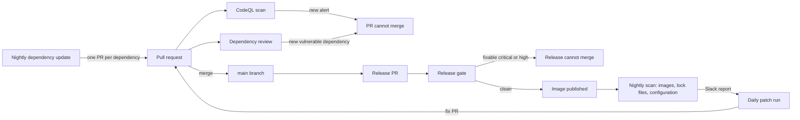

<!-- confluence-page-id: <NO CONFLUENCE ID REQUEST> -->
<!-- confluence-space-key: <NO CONFLUENCE ID REQUEST> -->

# Security process

This repository handles three kinds of security findings: code, dependencies, and images. This document shows how they connect. We follow the Confluence page "Vulnerability Patch Management Process", with the deviations listed below.

To report a vulnerability, read [SECURITY.md](./SECURITY.md). This document does not cover disclosure.

## The whole process

## The three kinds

| Kind | Tool | What blocks | Read |
|---|---|---|---|
| Code | CodeQL | A PR that adds an alert | [Code vulnerabilities](./docs/security/code-vulnerabilities.md) |
| Dependencies | Nightly update, lock file scan, dependency review | A PR that adds a vulnerable dependency | [Dependencies](./docs/security/dependencies.md) |
| Images | Trivy | A release PR with a fixable critical or high finding | [Image vulnerabilities](./docs/security/image-vulnerabilities.md) |

## The nightly timetable

| Time (UTC) | What runs |
|---|---|
| 02:00 | The dependency update opens its PRs. |
| 03:00 | The Trivy scan reads the published images, the lock files of `main`, and the Dockerfiles. It posts the Slack report. |
| 05:00 | The patch run reads the findings and opens fix PRs. The cache warming also runs. |

## Setup that needs an admin

| What | Why |
|---|---|
| The secret `SLACK_SECURITY_WEBHOOK_URL` | The nightly scan posts the Slack report. Without it, the scan posts nothing. |
| The variable `DEPS_APP_CLIENT_ID` and the secret `DEPS_APP_PRIVATE_KEY` of a GitHub App with `contents`, `pull-requests`, and `workflows` write access | The nightly dependency update opens PRs with it. Without it, the job writes only its plan. |
| The ruleset in [Code vulnerabilities](./docs/security/code-vulnerabilities.md#the-ruleset) | CodeQL, `gatekeeper`, and `release-gate` become required. |
| Cursor automations for the skill `vulna-squash`. One runs on a schedule and is `nightly-vulna-patchy`. One reacts to the label `deps-ci-failed`. One reacts to the label `deps-review-ready`. | The daily patch run, and the whole job for a nightly dependency PR: assess, fix a red CI, report, and a follow-up ticket. |
| The Jira tool for those automations, with the site `unique-ch.atlassian.net`, the project `UN`, and the component `mcp-servers` | A hand-off creates a follow-up ticket in Jira. Without the tool, the agent creates a GitHub issue instead. |

## DEVIATION from monorepo setup

We are a smaller team that iterates faster. Two rules differ from the monorepo and from the policy page.

1. **No image gate on pull requests.** Only the dependency review and CodeQL block a PR. The release gate blocks the release instead. A PR still builds the image, but it does not scan it. The release PR and the nightly scan do.
2. **Anyone with write access can skip the release gate.** The policy page asks for two approvals. We ask for the label `security-exception`. A bot comment on the release PR records who set it. See [Skip the release gate](./docs/security/image-vulnerabilities.md#skip-the-release-gate).
