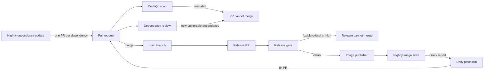

<!-- confluence-page-id: <NO CONFLUENCE ID REQUEST> -->
<!-- confluence-space-key: <NO CONFLUENCE ID REQUEST> -->

# Security process

This repository handles three kinds of security findings: code, dependencies, and images. This document shows how they connect. We follow the Confluence page "Vulnerability Patch Management Process", with the deviations listed below.

To report a vulnerability, read [SECURITY.md](./SECURITY.md). This document does not cover disclosure.

## The whole process

## The three kinds

| Kind | Tool | What blocks | Read |
|---|---|---|---|
| Code | CodeQL | A PR that adds an alert | [Code vulnerabilities](./docs/security/code-vulnerabilities.md) |
| Dependencies | Nightly update, dependency review, Dependabot alerts | A PR that adds a vulnerable dependency | [Dependencies](./docs/security/dependencies.md) |
| Images | Trivy | A release PR with a fixable critical or high finding | [Image vulnerabilities](./docs/security/image-vulnerabilities.md) |

## DEVIATION from monorepo setup

We are a smaller team that iterates faster. Two rules differ from the monorepo and from the policy page.

1. **No image gate on pull requests.** Only the dependency review and CodeQL block a PR. The release gate blocks the release instead. A PR still builds and scans the image, but the scan only reports warnings.
2. **Anyone with write access can skip the release gate.** The policy page asks for two approvals. We ask for the label `security-exception` and a stamp comment on the release PR.
