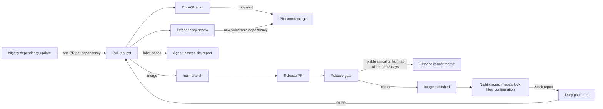

# Security process

This repository handles three kinds of security findings: code, dependencies, and images. This document shows how they connect. We follow the Confluence page "Vulnerability Patch Management Process", with the deviations listed below.

To report a vulnerability, read [SECURITY.md](./SECURITY.md). This document does not cover disclosure.

## The whole process

## The three kinds

| Kind | Tool | What blocks | Read |
|---|---|---|---|
| Code | CodeQL | A PR that adds an alert | [Code vulnerabilities](./docs/security/code-vulnerabilities.md) |
| Dependencies | Nightly update, dependency review, nightly lock file scan (reports only) | A PR that adds a vulnerable dependency | [Dependencies](./docs/security/dependencies.md) |
| Images | Trivy | A release PR with a fixable critical or high finding whose fix is older than 3 days | [Image vulnerabilities](./docs/security/image-vulnerabilities.md) |

## The nightly timetable

| Time (UTC) | What runs |
|---|---|
| 02:00 | The dependency update opens its PRs. Each new PR starts an agent run. |
| 03:00 | The Trivy scan reads the published images, the lock files of `main`, and the Dockerfiles. It posts the Slack report. |
| 05:00 | The patch run reads the findings and opens fix PRs. The cache warming also runs. |

## Who starts what

| Part | What it is | It starts when |
|---|---|---|
| Nightly dependency job | The workflow `deps-nightly.yaml` | 02:00 UTC |
| Rebase request | The workflow `deps-rebase.yaml` | A comment `/rebase` or `/recreate` on a dependency PR |
| Nightly Trivy scan | The workflow `security-trivy-nightly.yaml` | 03:00 UTC |
| CI | The test, lint, and build workflows, the dependency review, and CodeQL | A PR opens or changes |
| Gatekeeper | The check that waits for all other checks | A PR opens or changes |
| Release gate | The workflow `security-release-gate.yaml` | A release PR opens or changes |
| PR automation | The Cursor automation `connectors-dependency-pr-assess` | The label `dependencies` is added to a PR |
| Cron automation | The Cursor automation `connectors-vulna-patchy` | 05:00 UTC |
| The skill | `vulna-squash`: the instructions that both automations run | An automation starts |
| Review | The skill `dependency-pr-review` | The skill `vulna-squash` runs it, or a person runs it on a dependency PR |
| A person | An engineer with write access | A report, a Slack message, or a red check |

## Labels

| Label | Set by | Read by | Meaning |
|---|---|---|---|
| `dependencies` | Nightly job | PR automation, person | The PR comes from the nightly job. |
| `npm`, `uv`, `github-actions`, `docker`, `terraform` | Nightly job | A person | The ecosystem of the update. |
| `superseded` | Nightly job | Nightly job | The job closed this PR. A newer version replaced it, or no update targets it any more. A person did not reject it. Do not add it by hand. |
| `rebuild` | Agent, Rebuild Service workflow | PR automation, workflow | The PR only rebuilds an image for operating system patches. It has the label `dependencies` too. The PR automation stops at its entry check, and no agent run handles it. |
| `ai-assisted` | Agent | Agent | An agent run owns the PR and posted its report. |
| `human-required` | Agent | Agent, person | The agent cannot finish the PR. It removes `ai-assisted` first, so a PR never has both labels. A person finishes the PR. |
| `security-exception` | Person | Release gate, dependency review | Skip the gate on this PR. |
| `title-exception` | Person | Gatekeeper title check | Skip the PR title check. |

## Where the state lives

| State | Where |
|---|---|
| The result of an agent run | The report comment on the PR, and the labels |
| What needs an image release | The Slack report and the Security tab |
| Which version a person rejected | A closed PR without the label `superseded` |
| Who skipped the release gate | The bot comment on the release PR |
| Which dependencies stay fixed | The pins: `override-dependencies` and `pnpm.overrides` |

## Where alerts show

| Alert | Source | Where you see it | Updates |
|---|---|---|---|
| Code | CodeQL | Security tab, Code scanning, tool CodeQL. A PR that adds an alert cannot merge. | On each PR to `main` that changes code, and every night |
| A new vulnerable dependency in a PR | Dependency review | The check `dependency-review` on the PR | On each PR |
| Lock files | Trivy, category `trivy-lockfiles` | Security tab, Code scanning. The Slack report, in the line "Repository (main)". | Every night |
| Images | Trivy, categories `trivy-image/<service>` | Security tab, Code scanning. Each message starts with the image and the tag. The Slack report. | Every night, and at each release build |
| Dockerfiles and configuration | Trivy, category `trivy-config` | Security tab, Code scanning | Every night |
| A release | The release gate | The check `release-gate` on the release PR. Its job summary names each blocking finding. | On each release PR |
| The result of an agent run | The skill `vulna-squash` | The report comment on the PR, the labels, and for the patch run the Slack message | When the agent runs |
| GitHub Dependabot alerts | The dependency graph of GitHub | Security tab, Dependabot. This process does not read them. | When GitHub scans |

A missing Slack report has two causes: every image scan failed, or the secret `SLACK_LEGACY_WEBHOOK_URL` is empty. Read the scan jobs of the last run. The run shows a notice when the secret is empty.

## Required configuration

| What | Why |
|---|---|
| The secret `SLACK_LEGACY_WEBHOOK_URL` | The nightly scan posts the Slack report to the channel `C0C1PR9CNMP` with it. Without it, the scan posts nothing. |
| The environment `workflow-automation` of this repository, with the variable `GH_APP_WORKFLOW_AUTOMATION_CLIENT_ID` and the secret `GH_APP_WORKFLOW_AUTOMATION_PRIVATE_KEY` of the GitHub App `gh/workflow-automations` | The nightly dependency update opens PRs with the App. Only `main` can use the environment. The jobs that use it run on the runner `gh-static-ip-slim`, because the App accepts only fixed IP addresses. Without the credentials, the job `credentials` fails, and the jobs that update and open PRs do not start. |
| The check `release-gate` in the list `required_status_checks` of the ruleset code. See [The ruleset](./docs/security/code-vulnerabilities.md#the-ruleset). | A release PR cannot merge before the gate has run. Today the ruleset requires only `gatekeeper`. |
| The two Cursor automation files in the monorepo. Apply them with the Cursor Terraform. See [Cursor automations](#cursor-automations). | Cursor needs access to this repository. `connectors-vulna-patchy` also needs access to the Slack channel `C0C1PR9CNMP`. Without the automations, no agent run starts. |

## Cursor automations

| Fact | Value |
|---|---|
| Defined in | The monorepo, in `.cursor/automations/workflows/*.yaml`. Terraform applies them. This repository does not define them. |
| Repository and branch | `Unique-AG/connectors`, `main` |
| Memory | Off |
| Slack action | Only `connectors-vulna-patchy`, on the channel `C0C1PR9CNMP` |
| Jira | The agent uses no Jira tool and never files a ticket. |

| Name | Trigger | Prompt |
|---|---|---|
| `connectors-vulna-patchy` | Cron `0 5 * * *` (05:00 UTC) | Run the skill `vulna-squash` in mode `findings`. |
| `connectors-dependency-pr-assess` | "Label added" with the label `dependencies` on a PR | Run the skill `vulna-squash` in mode `pr` for the PR of this event. |

The prompt names the skill only. All steps live in the skill. Cursor loads the skill from its checkout of this repository, so the skill lives here, in `agentic/skills/vulna-squash/`.

## DEVIATION from monorepo setup

We are a smaller team that iterates faster. Two rules differ from the monorepo and from the policy page.

1. **No image gate on pull requests.** Only the dependency review and CodeQL block a PR. The release gate blocks the release instead. A PR still builds the image, but it does not scan it. The release PR and the nightly scan do.
2. **Anyone with write access can skip the release gate.** The policy page asks for two approvals. We ask for the label `security-exception`. A bot comment on the release PR records who set it. See [Skip the release gate](./docs/security/image-vulnerabilities.md#skip-the-release-gate).
