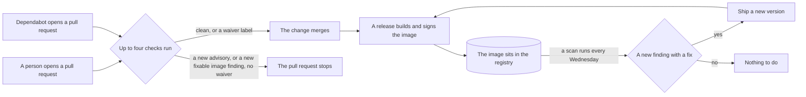

# Security process

This document explains how this repository manages three things: known vulnerabilities, dependency versions, and the images it builds and ships. It tells you what runs, when it runs, and what to do when a check stops your pull request.

To report a vulnerability, read [SECURITY.md](./SECURITY.md). This document does not cover disclosure.

## The process at a glance

A pull request can come from a person or from Dependabot. Up to four checks run on it. Two of them can stop it. A merged change later becomes part of a release. A release builds an image, signs it, and pushes it to two registries. After that, a scan reads the latest image of each service every week.

| When | What happens |
|---|---|
| A pull request | Up to four checks run. The files that you change decide which. Two can stop the merge. |
| Friday, 06:00 Europe/Berlin | Dependabot opens up to 5 pull requests for each ecosystem. |
| Every release | The image is built, signed, and pushed. Two more scans run against it. |
| Wednesday, 06:00 UTC | A scan reads the latest image of each service. |
| All the time | Dependabot reads the lockfiles on `main` for new advisories and opens alerts. |
| Monday | An operator sorts the Dependabot pull requests, and reads the scan. |
| Every few weeks | An operator refreshes the transitive dependencies by hand. |

## Three sources of findings

Three sources report findings. They work in different ways. Do not mix them.

| Source | What it reads | When it reports | Can it stop a pull request |
|---|---|---|---|
| Dependency review | The lockfile change in your pull request | On the pull request | Yes. It stops only an advisory that your change adds. |
| Image scans, with Trivy | The built image, with every package inside it | On the pull request, on a release, and every Wednesday | Only on the pull request, and only for a fixable finding that the application layers add. |
| CodeQL | Our workflow files, JavaScript, TypeScript, and Python | On the pull request and on `main` | No. A repository ruleset can make it stop a pull request. No such ruleset exists now. |
| Dependabot alerts | The lockfiles on `main` | All the time, with no pull request | Never. An alert has no pull request to stop. |

A Dependabot alert opens when a new advisory appears for a version that is already on `main`. No pull request touched that version, so no pull request check can see it. An operator clears these alerts. See [The operator routine](./docs/security/operator-routine.md).

## The documents

| Document | Read it to learn |
|---|---|
| [Checks and pull requests](./docs/security/checks-and-pull-requests.md) | what each check does, what stops a pull request, and how a waiver works |
| [Images and releases](./docs/security/images-and-releases.md) | how an image is built and released, and what to do when a published image has a finding |
| [The operator routine](./docs/security/operator-routine.md) | how Dependabot works, how to clear an alert, and the Monday and monthly routines |

## Files

| File | What it holds |
|---|---|
| `.github/dependabot.yaml` | the ecosystems, the schedule, and the labels for dependency updates |
| `.github/workflows/security-dependency-review.yaml` | the dependency review |
| `.github/workflows/_template-containerize.yaml` | the pull request image build, and the call to the image vulnerability gate |
| `.github/actions/container-image-vuln-gate/` | the image vulnerability gate |
| `.github/workflows/security-trivy-repo.yaml` | the Dockerfile scan |
| `.github/workflows/security-trivy-registry.yaml` | the Wednesday scan of published images, with its alert upload |
| `.github/workflows/release-rebuild.yaml` | the workflow that opens a rebuild pull request for a service |
| `.github/workflows/_template-cd.yaml` | the release build: push, sign, attest, the release image scan, and the license scan |
| `.github/trivyignore.yaml` | the findings that the Wednesday scan accepts, each with an expiry date |
| `services/*/deploy/Dockerfile` | how each image is built and hardened |
| `agentic/skills/dependabot-pr-review/SKILL.md` | the skill that reviews a Dependabot pull request |
