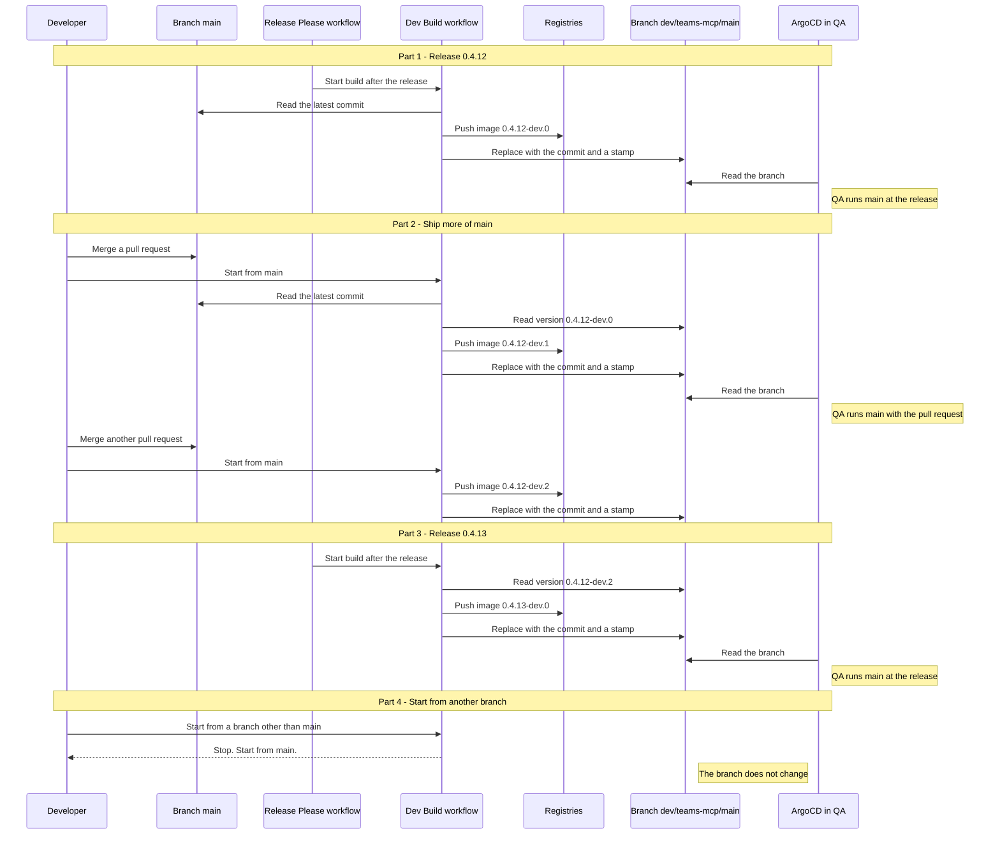

# Rolling dev builds

Rolling dev builds ship `main` to QA without a release. Each service has one branch, `dev/<service>/main`. ArgoCD in QA follows this branch. A new build moves the branch, and QA follows it. You do not change a pin.

The workflow builds only `main`. It does not build a branch, a tag, or a pull request. Merge to `main` first.

## Terms

| Term | Meaning |
|---|---|
| Dev build | A signed image of the latest commit on `main`. The workflow `[Release] Dev Build` makes it. |
| `<release>-dev.<n>` | The version of a dev build. The number `n` counts the builds of one release. |
| `dev/<service>/main` | A branch with two commits: the commit of `main` that was built, and a stamp commit. The name ends in `main`, because the branch ships `main`. |
| Stamp commit | A commit that sets the dev version in `Chart.yaml` and in the image tag of `values.yaml`. |

## Rules

- Start every run from `main`. The run builds the latest commit of `main`.
- A release of a service starts a dev build. This build has `n = 0`.
- Each manual run adds 1 to `n`.
- A new release sets `n` back to 0.
- Each run replaces the branch. The branch holds only the latest build. Old images stay in the registries.
- The branch stays in the repository. ArgoCD reads it, and the workflow reads the count from it. Do not delete it. Do not commit to it.
- A dev build pushes no chart, starts no image scan, publishes no docs, writes no build cache, and creates no tag or release.

## Example

The diagram shows `teams-mcp` from one release to the next.



| Step | Image | Branch holds | QA runs |
|---|---|---|---|
| 1. Release 0.4.12 | `0.4.12-dev.0` | `main` and stamp | `main` at the release |
| 2. Merge, then run | `0.4.12-dev.1` | `main` and stamp | `main` |
| 3. Merge again, then run | `0.4.12-dev.2` | `main` and stamp | `main` |
| 4. Release 0.4.13 | `0.4.13-dev.0` | `main` and stamp | `main` at the release |
| 5. Start from another branch | None. The run stops. | No change | No change |

## How the count works

The `plan` job reads the version on `dev/<service>/main`. It compares the release in that version with the release on `main`.

| Case | Count |
|---|---|
| Same release | The count of the branch plus 1 |
| Newer release on `main` | 0 |
| The branch does not exist, or its version is not `<release>-dev.<n>` | 0 |

## Set up QA

Do this one time for each service.

1. Make sure that the branch `dev/<service>/main` exists. It exists after the first release of the service, or after one manual run.
2. Use the `bump-service` skill with the target `dev` for the QA cluster.
3. Merge the PR that the skill opens.

The pin in the app spec then looks like this:

```yaml
targetRevision: dev/teams-mcp/main # x-teams-mcp-version: teams-mcp@0.4.12
```

The comment keeps the release to return to.

## Run a dev build

1. Open Actions, then `[Release] Dev Build`.
2. Choose Run workflow. Keep the branch `main`.
3. Choose the service.
4. Wait for the run to end. The summary shows the image and the source commit.
5. Refresh the app in ArgoCD to see the build at once.

The image label `org.opencontainers.image.revision` holds the full commit SHA of the build.

## Return to a release

Use the `bump-service` skill with the target `<version>` for the QA cluster. The PR sets the pin to the release again. The cluster then stops following the branch.

## Edge cases

| Case | What happens | What to do |
|---|---|---|
| The branch does not exist yet | The first run builds `n = 0` and creates the branch. | Run once for the service, or wait for its next release. Then set the QA pin. |
| Two runs for one service | The runs go one after the other. GitHub keeps one waiting run for each service. A newer waiting run replaces an older one. | Look at the run list. Start your run again if it is cancelled. |
| You use Re-run in GitHub | The run stops with an error. | Start a new run. |
| The run starts from a branch other than `main` | The run stops. | Start the run from `main`. |
| You need to test a branch or a pull request | The workflow does not build them. | Merge to `main`, then start a run. |
| Someone deletes the branch | The count restarts at 0. The build stops if an image `<release>-dev.0` exists from another commit. | Delete that image tag by hand in the registries. Start a new run. |
| Someone commits to the branch | The next run replaces the commit. The count restarts if the version is not `<release>-dev.<n>`. | Do not commit to the branch. |
| The release build fails | The job `dev <service>` of the release run fails. QA stays on the last dev build. | Open the job. Start `[Release] Dev Build` by hand for the service. |
| The service is not in the dropdown | You cannot choose it for a manual run. A release still builds it. | Add the service to `release-dev.yaml`. |
| `main` changes keys in the chart `values.yaml` | ArgoCD ignores an unknown key and shows green. | Copy each new key to the QA overlay values in the monorepo. |
| `main` changes `deploy/terraform/` | A dev build does not move Terraform. | Make a release. Use `bump-service` for the Terraform pin. |
| A prod cluster follows the branch | Prod runs code that is not released. | Never do this. |
