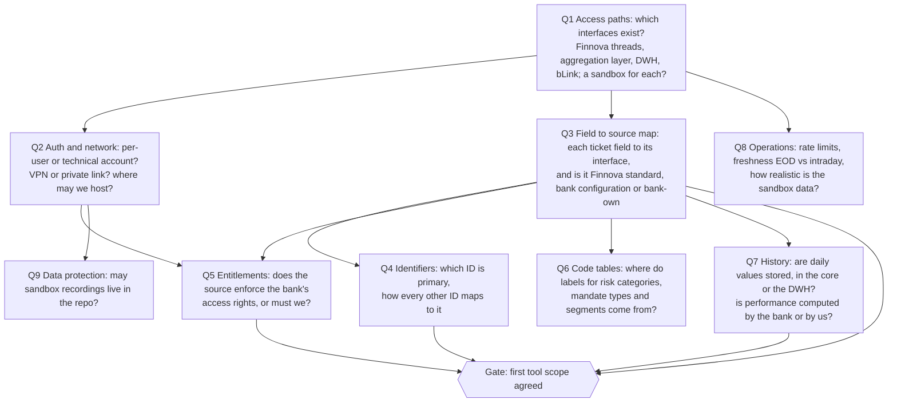
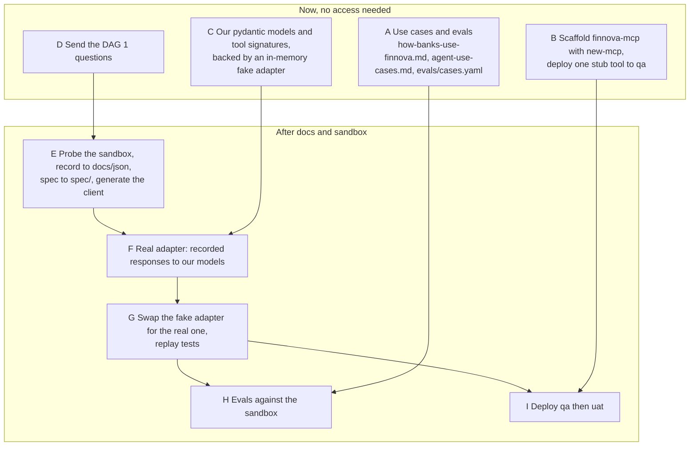

# Preparation plan

Two DAGs. The first is the questions that block design. The second is the implementation
order, arranged so that everything not needing API access is done before the docs and
sandbox arrive, and the critical path after that is as short as possible.

## DAG 1: questions to answer before coding

Q1 to Q3 are the roots. Send the full list to the bank before the docs arrive, so the answers
come back with them.

For Q7, ask what "the time series live in Finnova" means: the core, reachable through a
thread, or the bank's warehouse. The answer decides where `get_value_history` reads from.

## DAG 2: implementation

| Step | Needs | Notes |
|---|---|---|
| A | Ticket, product pages | Fixes what "done" means before code exists, as `polixis-mcp/docs/` did. |
| B | Nothing | Takes the chart, Argo and auth plumbing off the critical path. |
| C | Nothing | Tests and evals run against the fake until the real adapter lands. |
| D | Nothing | The DAG 1 list. |
| E | Docs, sandbox, Q1, Q2 | Record every probe. Their sandbox may be down or rationed, as with Backstop and Polixis. |
| F | C, E, Q3, Q4, Q6 | Mapping and code tables per bank. |
| G | F | Replay tests run without credentials. |
| H | A, G | Grade the calls made and whether the answer holds to what the tools returned. |
| I | B, G | One stacked PR per sub-task. |

## Ship in slices

Each slice runs E → I on its own, so the first one deploys while a later one still waits on
the bank.

1. `find_customer`. Every other tool joins on it.
2. `get_portfolios` with positions.
3. `get_value_history`, once Q7 is answered. Or `get_signing_authority` if history is blocked.

## Lessons from the repo

- **`polixis-mcp`** is the pattern UN-29657 names: use-case docs first, tools of our own,
  then record and replay.
- **`temenos-mcp`**, our other core banking connector, takes the opposite approach: 49 tools,
  one per DataHub endpoint. For Finnova, follow Polixis. The fixed tools have to be exact, and
  discovery tools cover the long tail if a bank's warehouse allows them.
