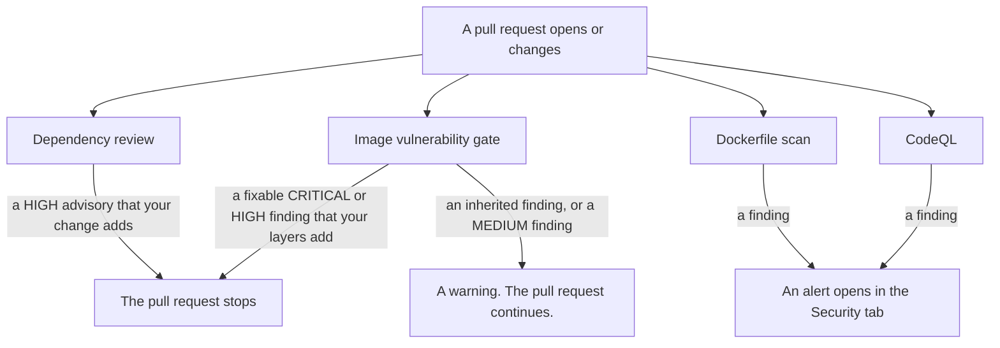

# Checks and pull requests

This document explains what each check and scan does, which of them can stop a pull request, and how to waive a result. For the whole process, read [SECURITY-PROCESS.md](../../SECURITY-PROCESS.md).

## The checks and scans

Seven checks and scans look for known problems. Some match packages against published advisories. The Dockerfile scan and CodeQL look for flaws in our own files and code.

| Name | Runs when | Reads | Reports | Stops a pull request | Where to look |
|---|---|---|---|---|---|
| Dependency review | a pull request changes `pnpm-lock.yaml`, a `package.json` or `uv.lock` under `services/`, or a file under `packages/` | the npm and Python dependencies that the pull request adds or changes, with their transitive dependencies | HIGH and above, set by `fail-on-severity: high` | yes | a check on the pull request, and a comment when it fails |
| Image vulnerability gate | a pull request changes a file under `services/` or `packages/`, `pnpm-lock.yaml`, a template workflow, or a file under `.github/actions/` | the image that the pull request builds, before any push | CRITICAL and HIGH with a fix block. MEDIUM with a fix warns. | yes, for a finding that the application layers add | the check on the pull request, a summary, and one annotation for each finding |
| Dockerfile scan | a pull request changes a file under `services/*/deploy/`, or a docker-compose file, and every push to `main` | our own Dockerfiles and compose files | CRITICAL and HIGH | no | Security tab, code scanning, category `trivy-config` |
| CodeQL | a pull request changes any file, and every push to `main` | our workflow files, our JavaScript and TypeScript, and our Python | every finding | no | Security tab, code scanning, one category for each language |
| Release image scan | every release | the image after it reaches the registry | CRITICAL and HIGH, with a fix | no | Security tab, code scanning, category `trivy-image/<service>` |
| Registry image scan | every Wednesday, 06:00 UTC | the latest image of each service | CRITICAL and HIGH, with a fix | no, but the run turns red | Actions tab, a red run with a table in the run summary, and the Security tab under category `trivy-image/<service>` |
| License scan | every release | the finished image, for open-source licenses | UNKNOWN, HIGH, and CRITICAL | no | the log of the `security-trivy-license-scan` job on the release run |

These rules apply to the table:

- The image vulnerability gate, the release image scan, and the registry image scan skip a finding that has no fix.
- The dependency review and the Dockerfile scan set no condition on a fix.
- A merge is also a push, so the Dockerfile scan repeats right after your change lands.
- Trivy is the tool behind five of the seven. They are the image vulnerability gate, the Dockerfile scan, the release image scan, the registry image scan, and the license scan.
- The license scan also reports UNKNOWN, because an unclassified license is itself the finding. It writes no alert to the Security tab.
- The registry image scan reads only the latest version of each service. It does not read an older version.
- No part of this document tracks a LOW finding. MEDIUM findings show only as warnings on a pull request.
- Dependabot alerts are a separate source. They appear in the Security tab, under Dependabot.
- GitHub Actions runs every check and scan in this document. It is the platform, not a check.
- Every check runs on a stacked pull request. No check carries a branch filter.

### Why the scans do not overlap

Two facts keep the scans apart.

- **A Dockerfile is a build input.** It never appears inside the image it builds. No image scan can read a Dockerfile.
- **An image holds software that no lockfile lists.** Examples are a base operating system package, and a file that a build step adds by hand. No lockfile scan can find these.

## What stops a pull request

Two checks can stop a merge. Each one stops only for what your pull request changes.

### The dependency review

The dependency review compares your lockfile with the base branch. It stops the merge only for an advisory that your change adds. This includes a transitive dependency that your change pulls in.

It cannot see an advisory on a version that was already on `main`. Dependabot raises an alert for that case. See [The operator routine](./operator-routine.md).

### The image vulnerability gate

The gate builds your image and splits the findings into two groups.

- **Inherited findings** come from the runtime base image. An author cannot fix these. The gate reports them as warnings.
- **Introduced findings** come from the layers that the application Dockerfile adds. The gate stops the pull request for an introduced CRITICAL or HIGH finding that has a fix.

An introduced MEDIUM finding with a fix is a warning. A finding with no fix is a warning.

The gate stops with an error when it cannot trust its own result. Examples are a missing scan result, a base image that it cannot resolve, and a final image that lists fewer packages than its base.

The image build takes fresh operating system packages, so it shows what a release gets. See [How an image is built](./images-and-releases.md#how-an-image-is-built).

A file under `services/` starts the image build, even a docs file.

### What does not stop a pull request

The Dockerfile scan and CodeQL open an alert in the Security tab. They stop nothing.

CodeQL can stop a pull request only through a repository ruleset that requires code scanning results. No such ruleset exists now. A repository admin can add one. The CodeQL tool then blocks a pull request that adds an alert at or above the severity that the ruleset sets.

A Dependabot alert never stops a pull request. It opens on `main`, with no pull request.

Fix an alert, or dismiss it and give a reason.

## If a check stops your pull request

### The dependency review

The check writes a comment on the pull request that names the advisory.

1. Raise the version of the dependency you added.
2. If a parent package pins the version exactly, add a pnpm override instead.
3. If you cannot take the fix now, add the `security-exception` label. See [Waivers](#waivers).

**Do not use Re-run jobs.** A re-run reads the event data of the first run. It never reads a label that you added after that run. If you add the label, a new run starts by itself.

### The image vulnerability gate

The check annotation names the package, the installed version, the fixed version, and the advisory.

1. Raise the version of the package in the lockfile of the service.
2. If the finding is in an operating system package, rebuild the pull request. The build takes the newest patch.
3. If you cannot take the fix now, add the `security-exception` label. See [Waivers](#waivers).

The gate reads the live labels of the pull request. After you add the label, re-run the gate job.

## Waivers

| Waiver | How to set it | What it does |
|---|---|---|
| The `security-exception` label | Add the label to the pull request. It needs write access to this repository, and no separate approval. | The dependency review does not run. The image vulnerability gate still runs, and it reports the findings that it would block as warnings. |
| An entry in `.github/trivyignore.yaml` | Add the finding, and give the entry an `expired_at` date. | The registry image scan ignores the finding until that date. |
| A dismissed alert | Dismiss the alert in the Security tab, and give a reason. | The alert closes. |

Use the label only when you accept the advisory.

**The label only changes what happens on your pull request.** It does not reach the release image scan or the registry image scan. Once you merge and release, the same finding can open a fresh alert in the Security tab, with no link back to this label.

A finding that you waive with the label before merge stays in the published image. Only a new version clears it. See [When a published image has a finding](./images-and-releases.md#when-a-published-image-has-a-finding).
