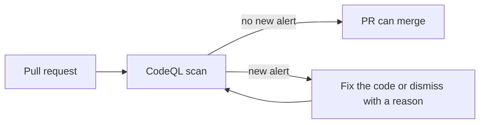

<!-- confluence-page-id: <NO CONFLUENCE ID REQUEST> -->
<!-- confluence-space-key: <NO CONFLUENCE ID REQUEST> -->

# Code vulnerabilities

CodeQL scans the code that we write. It finds flaws in our own code, for example an array access out of bounds. It does not scan dependencies or images. For those, read [Dependencies](./dependencies.md) and [Image vulnerabilities](./image-vulnerabilities.md).

For the whole process, read [SECURITY-PROCESS.md](../../SECURITY-PROCESS.md).

## What runs

CodeQL scans our workflow files, our JavaScript and TypeScript, and our Python. It runs on every PR and on every push to `main`. A repository ruleset requires the CodeQL result. A PR that adds an alert cannot merge. As a result, unsafe code does not reach `main`.

## If CodeQL blocks your PR

1. Read the alert in the Security tab, under code scanning.
2. If the alert is real, fix the code and push.
3. If the alert is a false positive, dismiss it and give a reason.

Do not dismiss an alert without a reason. The next scan of `main` closes a fixed alert.

## Where to look

| What | Where |
|---|---|
| Alerts | Security tab, code scanning, one category for each language |
| The ruleset | Repository settings, Rules. An admin changes it. |
