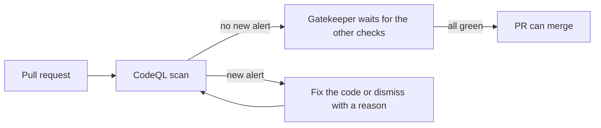

# Code vulnerabilities

CodeQL scans the code that we write. It finds flaws in our own code, for example an array access out of bounds. It does not scan dependencies or images. For those, read [Dependencies](./dependencies.md) and [Image vulnerabilities](./image-vulnerabilities.md).

For the whole process, read [SECURITY-PROCESS.md](../../SECURITY-PROCESS.md).

## What runs

CodeQL scans our workflow files, our JavaScript and TypeScript, and our Python. The workflow `security-codeql.yaml` runs it on every PR to `main` and every night on `main`. A release PR does not run it, because it changes only versions and changelogs. A PR that changes only lock files or documentation does not run it either. The gatekeeper waits for the CodeQL result. A PR that adds an alert cannot merge. As a result, the scan stops much unsafe (newly added) code before it reaches `main`. It does not find every flaw.

## If CodeQL blocks your PR

1. Read the alert in the Security tab, under code scanning.
2. If the alert is real, fix the code and push.
3. If the alert is a false positive, dismiss it and give a reason.

Do not dismiss an alert without a reason. The next scan of `main` closes a fixed alert.

## Where to look

| What | Where |
|---|---|
| Alerts | Security tab, code scanning, one category for each language |
| The ruleset | Repository settings, Rules. An admin changes it. See [The ruleset](#the-ruleset). |

## The ruleset

The ruleset is created as code, here: https://github.com/unique-ag/infrastructure/blob/0a6f17440184c3238b67c2537591a0d043ca816d/providers/github/unique-ag/repos/connectors.yaml

It requires the check `gatekeeper`. The gatekeeper waits for every other check, CodeQL included. It does not wait for the check `Cursor Automation: Connectors Dependency PR Assess`. That check is the agent that watches the PR for up to 45 minutes, and the gatekeeper stops after 20 minutes.
