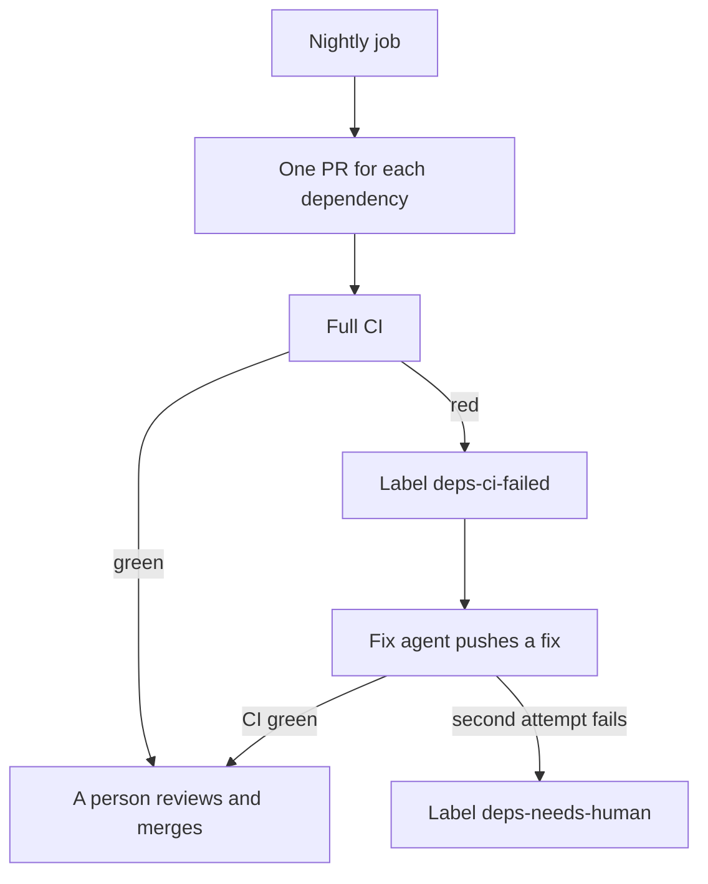

<!-- confluence-page-id: <NO CONFLUENCE ID REQUEST> -->
<!-- confluence-space-key: <NO CONFLUENCE ID REQUEST> -->

# Dependencies

A nightly job updates our dependencies, direct and indirect. It opens one PR for each dependency. The PR changes that dependency in every project that uses it, so one dependency has one version everywhere. For the whole process, read [SECURITY-PROCESS.md](../../SECURITY-PROCESS.md).

## The nightly update

| Rule | Value |
|---|---|
| Scope | Direct and indirect dependencies in pnpm (Node) and uv (Python), GitHub Actions, and Docker base images |
| One PR for | One dependency, or one group that must move together, for example `opentelemetry-*` |
| Cooldown | A version younger than 3 days waits. The job passes `--config.minimumReleaseAge=4320` to pnpm and `--exclude-newer "3 days"` to uv. |
| Labels | `dependencies`, and the ecosystem: `npm`, `uv`, `actions`, or `docker` |
| CI | The full CI runs on every PR. A red CI blocks the merge. |
| Cap | At most 5 new PRs each night |
| Merge | A person merges. The agent never merges. |

A manual run of the nightly job is a dry run by default. It writes the plan to the job summary and opens no PR. The job also opens no PR until the GitHub App exists. See [Setup that needs an admin](../../SECURITY-PROCESS.md#setup-that-needs-an-admin).

## If CI is red

The job adds the label `deps-ci-failed`. A Cursor Automation then starts the fix agent. The agent pushes a fix to the PR branch and tries at most 2 times. After that, it adds `deps-needs-human` and a comment.

The agent edits only the paths in the PR. It never edits a lockfile by hand. The skill `dependency-pr-review` is the base for the review.

## Each day

1. Run `gh pr list --label dependencies --state open`.
2. If a PR has a green CI, review it and merge it.
3. If a PR has the label `deps-needs-human`, fix it or close it.
4. Read the job summary of the last nightly run. The list "Needs a person" holds what the job cannot update, for example a Terraform provider that is outside its range.
5. Every month, read each pin and override. Remove the entry when upstream fixes the problem.

Pins are `override-dependencies` in `pyproject.toml` and `pnpm.overrides` in the root `package.json`. A pin holds a dependency at one version, so the nightly job cannot move it.

## Dependency review

The dependency review runs on a PR that changes a lockfile or a manifest. It fails for a known HIGH advisory or worse. It checks only what the PR adds. It checks runtime and development dependencies.

If the dependency review blocks your PR, raise the version of the dependency you added. If a parent pins it exactly, add a pnpm override. If you cannot take the fix, add the label `security-exception`.

The policy needs written approval from the engineering council for a new dependency with a known critical or high vulnerability.

## Pinned actions

The pinned-actions check runs on a PR that changes a workflow file. It fails when an action is not pinned to a commit. A new action is a new dependency, so it must be pinned. The nightly job keeps the pins current.

## GitHub Actions, Docker, and Terraform

The nightly job also updates these. The same rules apply: one PR for each item, one version everywhere, and a cooldown of 3 days.

| What | What the job does |
|---|---|
| GitHub Actions | One PR for each action repository. It moves the pinned commit and the version comment in every workflow. A major bump says so in the PR body. |
| Docker base images | One PR for each image, for example `node`. It moves the tag and the digest in every Dockerfile. It stays in the same major version. The change starts a release for each service. |
| Terraform | No PR. The job lists a provider in the plan summary when its newest release is outside the version range. A person widens the range. |

An action that is pinned to a branch goes to the list "Needs a person". An image that is not an official Docker Hub image goes there too.

## Advisories in lock files

Every night, Trivy scans `pnpm-lock.yaml` and every `uv.lock` on `main`, dev dependencies included. It uploads critical and high findings that have a fix to the Security tab, category `trivy-lockfiles`.

A lock file alert closes when the fixed lock file reaches `main`. It does not need a release. The nightly job fixes most of them with its next PR.

| File | What it holds |
|---|---|
| `.github/workflows/deps-nightly.yaml` | The nightly job |
| `.github/workflows/deps-ci-label.yaml` | The job that sets `deps-ci-failed` |
| `agentic/skills/deps-ci-fix/SKILL.md` | The skill that fixes a red dependency PR |
| `.github/workflows/security-dependency-review.yaml` | The dependency review |
| `.github/workflows/security-trivy-nightly.yaml` | The nightly scan, including the lock files of `main` |
| `.github/workflows/security-pinned-actions.yaml` | The check that an action is pinned to a commit |
| `agentic/skills/dependency-pr-review/SKILL.md` | The skill that reviews a dependency PR |
