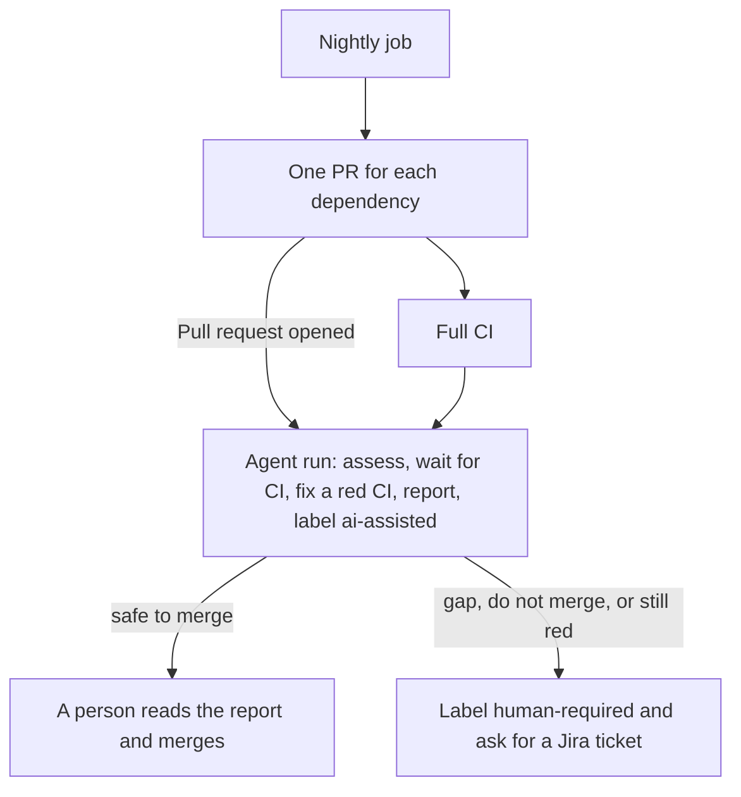

<!-- confluence-page-id: <NO CONFLUENCE ID REQUEST> -->
<!-- confluence-space-key: <NO CONFLUENCE ID REQUEST> -->

# Dependencies

A nightly job updates our dependencies, direct and indirect. It opens one PR for each dependency. The PR changes that dependency in every project that uses it, so one dependency has one version everywhere. For the whole process, read [SECURITY-PROCESS.md](../../SECURITY-PROCESS.md).

## The nightly update

| Rule | Value |
|---|---|
| Scope | Direct and indirect dependencies in pnpm (Node) and uv (Python), GitHub Actions, and Docker base images |
| One PR for | One dependency, or one group that must move together, for example `opentelemetry-*` |
| Cooldown | A version younger than 3 days waits. The job passes `--config.minimumReleaseAge=4320` to pnpm and `--exclude-newer "3 days"` to uv. |
| Labels | `dependencies`, and the ecosystem: `npm`, `uv`, `github-actions`, or `docker` |
| CI | The full CI runs on every PR. A red CI blocks the merge. |
| Cap | At most 5 new PRs each night |
| Merge | A person merges. The agent never merges. |

A manual run of the nightly job is a dry run by default. It writes the plan to the job summary and opens no PR. The job also opens no PR until the GitHub App exists. See [Setup that needs an admin](../../SECURITY-PROCESS.md#setup-that-needs-an-admin).

## One agent run for every PR

The skill `vulna-squash` does the whole job for a dependency PR in one run. The Cursor automation `dependency-pr-assess` starts it. Its trigger is "Pull request opened". The nightly job opens a PR, and the run starts. The agent stops at once for a PR without the label `dependencies`. The daily cron run of the same skill handles Trivy findings.

In one run the agent does these things:
1. It assesses the PR: the release notes, our own usage, and the CI result.
2. It fixes a red CI when the bump caused it. It tries at most 2 times and pushes to the PR branch.
3. It posts one report comment with the verdict, and adds the label `ai-assisted`.
4. It hands off to a person when the verdict is "do not merge" or "safe with a gap". It also hands off when the CI is still red after 2 attempts.

The agent never merges, never approves, and never edits a lockfile by hand. The agent waits for the CI of the PR. To run the agent again, remove the labels `ai-assisted` and `human-required`, convert the PR to a draft, and mark it ready for review.

## Hand-off

When a person is needed, the agent adds the label `human-required`. It adds the section "Hand-off: log a Jira ticket" to its report comment. The section lists the exact next steps.

The agent has no Jira access, so it creates no ticket. A person logs the Jira ticket and finishes the work. No one needs to run a review by hand after a hand-off, because the report is already in the PR comment.

## An open PR on the next night

The nightly job runs again while a PR is open. It does this for each dependency.

| Case | What the job does |
|---|---|
| The version is the same, and the agent has not handled the PR | It rebuilds the branch from `main` and updates the PR body. |
| The version is the same, and the PR has the label `ai-assisted` or `human-required` | It keeps the commits and merges `main` into the branch. If this fails, the job warns and a person resolves the conflict. |
| A newer version exists | It closes the PR with a comment and opens a new PR. The new PR starts a new agent run. |
| A person closed the PR without a merge | It skips that version. A newer version opens a new PR. This is how you ignore one version. |
| A person merged the PR | Nothing. The plan finds no update. |

To ignore a dependency for good, add a pin. The job lists a pinned dependency in "Needs a person" and does not move it.

## Each day

1. Run `gh pr list --label dependencies --state open`.
2. If a PR has the label `ai-assisted` and not `human-required`, read the report in its comment and merge the PR.
3. If a PR has the label `human-required`, read the section "Hand-off: log a Jira ticket" in its report comment. Log the Jira ticket, then finish the work.
4. Read the job summary of the last nightly run. The list "Needs a person" holds what the job cannot update, for example a Terraform provider that is outside its range.
5. Every month, read each pin and override. Remove the entry when upstream fixes the problem.

Pins are `override-dependencies` in `pyproject.toml` and `pnpm.overrides` in the root `package.json`. A pin holds a dependency at one version, so the nightly job cannot move it.

## Who fixes what

Two parts touch dependency PRs. Each has one job.

| Part | It starts from | What it does |
|---|---|---|
| The nightly job | The schedule | Opens one PR for each dependency. |
| The skill `vulna-squash` | The event "Pull request opened" for a nightly PR. The daily cron run for a Trivy alert that has a fix. | Does the whole job for the PR in one run: assess, fix a red CI, report, and hand off with a comment. For a finding it opens the PR first. At most 3 such PRs are open. |

The nightly job and the patch run never open two PRs for one package. The patch run skips a package that an open nightly PR changes. The nightly job skips a package that an open patch PR names in its title.

## Dependency review

The dependency review runs on a PR that changes a lockfile or a manifest. It fails for a known HIGH advisory or worse. It checks only what the PR adds. It checks runtime and development dependencies.

If the dependency review blocks your PR, raise the version of the dependency you added. If a parent pins it exactly, add a pnpm override. If you cannot take the fix, add the label `security-exception`.

The policy needs written approval from the engineering council for a new dependency with a known critical or high vulnerability.

## Pinned actions

The pinned-actions check runs on a PR that changes a workflow file. It fails when an action is not pinned to a commit. A new action is a new dependency, so it must be pinned. The nightly job keeps the pins current.

## GitHub Actions, Docker, and Terraform

The nightly job also updates these. The same rules apply: one PR for each item, one version everywhere, and a cooldown of 3 days.

| What | What the job does |
|---|---|
| GitHub Actions | One PR for each action repository. It moves the pinned commit and the version comment in every workflow. A major bump says so in the PR body. |
| Docker base images | One PR for each image, for example `node`. It moves the tag and the digest in every Dockerfile. It stays in the same major version. The change starts a release for each service. |
| Terraform | No PR. The job lists a provider in the plan summary when its newest release is outside the version range. A person widens the range. |

An action that is pinned to a branch goes to the list "Needs a person". An image that is not an official Docker Hub image goes there too.

## Advisories in lock files

Every night, Trivy scans `pnpm-lock.yaml` and every `uv.lock` on `main`, dev dependencies included. It uploads critical and high findings that have a fix to the Security tab, category `trivy-lockfiles`.

A lock file alert closes when the fixed lock file reaches `main`. It does not need a release. The nightly job fixes most of them with its next PR.

| File | What it holds |
|---|---|
| `.github/workflows/deps-nightly.yaml` | The nightly job |
| `agentic/skills/vulna-squash/SKILL.md` | The skill that handles every dependency PR in one run |
| `.github/workflows/security-dependency-review.yaml` | The dependency review |
| `.github/workflows/security-trivy-nightly.yaml` | The nightly scan, including the lock files of `main` |
| `.github/workflows/security-pinned-actions.yaml` | The check that an action is pinned to a commit |
