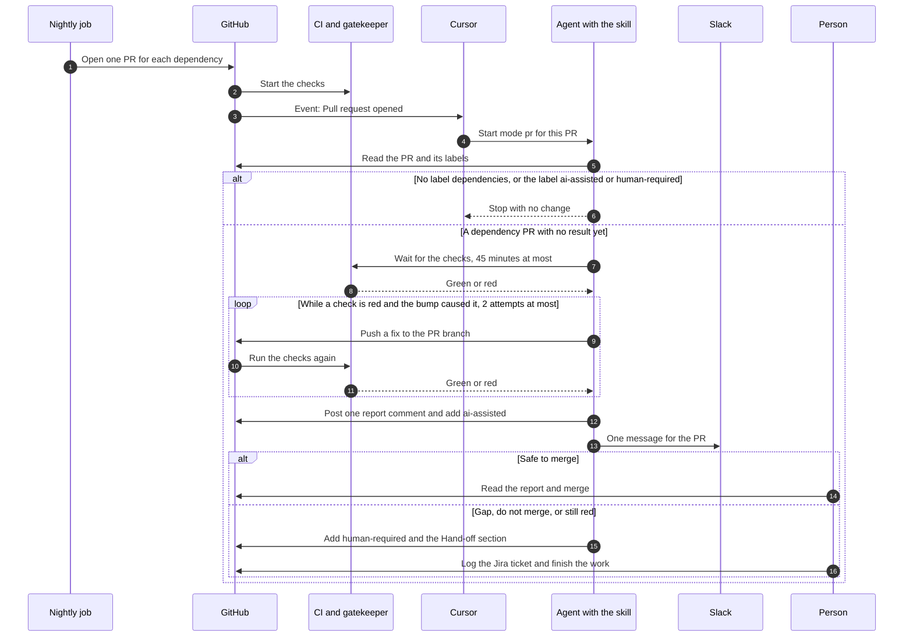
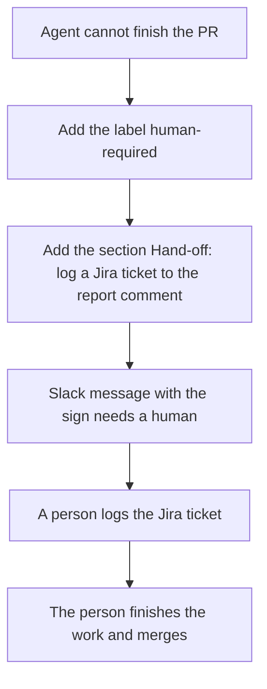
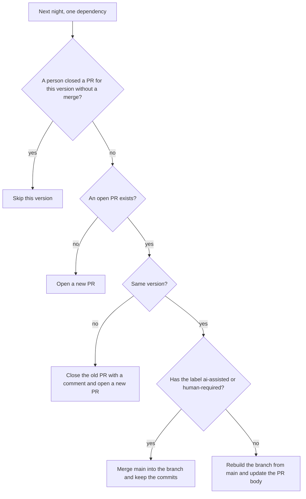

<!-- confluence-page-id: <NO CONFLUENCE ID REQUEST> -->
<!-- confluence-space-key: <NO CONFLUENCE ID REQUEST> -->

# Dependencies

A nightly job updates our dependencies, direct and indirect. It opens one PR for each dependency. The PR changes that dependency in every project that uses it, so one dependency has one version everywhere. For the whole process, read [SECURITY-PROCESS.md](../../SECURITY-PROCESS.md).

## The nightly update

| Rule | Value |
|---|---|
| Scope | Direct and indirect dependencies in pnpm (Node) and uv (Python), GitHub Actions, Docker base images, and Terraform providers |
| One PR for | One dependency, or one group that must move together, for example `opentelemetry-*` |
| Cooldown | A version younger than 3 days waits. The job passes `--config.minimumReleaseAge=4320` to pnpm and `--exclude-newer "3 days"` to uv. |
| Labels | `dependencies`, and the ecosystem: `npm`, `uv`, `github-actions`, `docker`, or `terraform` |
| CI | The full CI runs on every PR. A red CI blocks the merge. |
| Cap | At most 5 new PRs each night |
| Merge | A person merges. The agent never merges. |

A manual run of the nightly job is a dry run by default. It writes the plan to the job summary and opens no PR. The job also opens no PR until the GitHub App exists. See [Setup that needs an admin](../../SECURITY-PROCESS.md#setup-that-needs-an-admin).

## One agent run for every PR

The skill `vulna-squash` does the whole job for a dependency PR in one run. The Cursor automation `dependency-pr-assess` starts it. Its trigger is "Pull request opened". The daily cron run of the same skill handles Trivy findings.

| Step | Who | What happens |
|---|---|---|
| 1 | Nightly job | It plans the updates. It opens one PR for each dependency or group. The PR has the labels `dependencies` and the ecosystem. |
| 2 | GitHub | It starts the checks. The gatekeeper waits for every check. A red CI blocks the merge. |
| 3 | GitHub, Cursor | GitHub sends the event "Pull request opened". Cursor starts the PR automation. |
| 4 | Agent | It reads the PR. It stops with no change when the PR has no label `dependencies`. It also stops when the PR has `ai-assisted` or `human-required`. |
| 5 | Agent | It reads the release notes and our own usage of the dependency. It waits for the checks. |
| 6 | Agent | A red check that the bump caused gets a fix. The agent pushes the fix to the PR branch, and the checks run again. After 2 attempts, the agent stops. |
| 7 | Agent | It posts one comment that starts with `<!-- vulna-squash-report -->`. It adds the label `ai-assisted`. A second run updates the same comment. |
| 8 | Agent | It posts one Slack message to the channel `C0C1PR9CNMP`. |
| 9 | Person | If the verdict is "safe to merge", the person reads the report and merges the PR. |

The agent never merges, never approves, and never edits a lockfile by hand. To run the agent again, remove the labels `ai-assisted` and `human-required`, convert the PR to a draft, and mark it ready for review.

## Hand-off

The agent hands off when the verdict is "do not merge" or "safe with a gap". It also hands off when the CI is still red after 2 attempts, when a check times out, and when GitHub holds the runs.

The section in the report comment lists the exact next steps. The agent has no Jira access, so it creates no ticket. A person logs the Jira ticket and finishes the work. No one needs to run a review by hand, because the report already holds the full result.

## An open PR on the next night

The nightly job runs again while a PR is open. It checks each dependency before it pushes anything.

| Case | What the job does |
|---|---|
| The version is the same, and the agent has not handled the PR | It rebuilds the branch from `main` and updates the PR body. |
| The version is the same, and the PR has the label `ai-assisted` or `human-required` | It keeps the commits and merges `main` into the branch. If this fails, the job warns and a person resolves the conflict. |
| A newer version exists | It closes the PR with a comment and opens a new PR. The new PR starts a new agent run. |
| A person closed the PR without a merge | It skips that version. A newer version opens a new PR. This is how you ignore one version. |
| A person merged the PR | Nothing. The plan finds no update. |

Only a new PR fires the event "Pull request opened". A rebuilt or updated PR starts no new run. A handled PR keeps its commits, because a rebuild from `main` deletes the fixes of the agent.

To ignore a dependency for good, add a pin. The job lists a pinned dependency in "Needs a person" and does not move it.

## Rebase a PR yourself

Do not close a PR to get a rebuild. A closed PR skips that version. Use one of these ways.

| What you want | What to do |
|---|---|
| Update the branch from `main` and keep the commits | Click "Update branch" in the PR, or run `gh pr update-branch <number>`. This merges `main` into the branch. |
| Update the branch by a rebase | Run `gh pr update-branch <number> --rebase`. This rewrites the branch. |
| Fix a conflict in a lock file | Check out the PR and merge or rebase `main`. Regenerate the lock file with `pnpm install --lockfile-only` or `uv lock`. Never edit it by hand. After a rebase, push with `git push --force-with-lease`. |
| Rebuild the PR from `main` and drop every commit on it | Remove the labels `ai-assisted` and `human-required`. The next nightly run rebuilds the branch. To run it now, run `gh workflow run deps-nightly.yaml -f dry-run=false`. This run can also open up to 5 new PRs. Then run the agent again, as in [One agent run for every PR](#one-agent-run-for-every-pr). |
| Keep your own commits on a PR | Add the label `human-required`. The job rebuilds a PR that has no label, and this drops your commits. |

## Each day

1. Run `gh pr list --label dependencies --state open`.
2. If a PR has the label `ai-assisted` and not `human-required`, read the report in its comment and merge the PR.
3. If a PR has the label `human-required`, read the section "Hand-off: log a Jira ticket" in its report comment. Log the Jira ticket, then finish the work.
4. Read the job summary of the last nightly run. The list "Needs a person" holds what the job cannot update, for example the Terraform version in `required_version`.
5. Every month, read each pin and override. Remove the entry when upstream fixes the problem.

Pins are `override-dependencies` in `pyproject.toml` and `pnpm.overrides` in the root `package.json`. A pin holds a dependency at one version, so the nightly job cannot move it.

## What can go wrong

| Problem | What you see | What to do |
|---|---|---|
| The PR from the GitHub App does not start the agent. | The PR has no report comment after the checks end. | Convert the PR to a draft, then mark it ready for review. |
| GitHub holds the workflow runs. | The report says that a maintainer must approve the runs. The PR has `human-required`. | Approve the runs. Then run the agent again. |
| The agent run crashes. | The PR has no label `ai-assisted`. | Run the agent again. |
| A handled PR has a conflict with `main`. | The nightly job warns in its summary. | Resolve the conflict, or close the PR to skip that version. |

## Who fixes what

Two parts touch dependency PRs. Each has one job.

| Part | It starts from | What it does |
|---|---|---|
| The nightly job | The schedule | Opens one PR for each dependency. |
| The skill `vulna-squash` | The event "Pull request opened" for a nightly PR. The daily cron run for a Trivy alert that has a fix. | Does the whole job for the PR in one run: assess, fix a red CI, report, and hand off with a comment. For a finding it opens the PR first. At most 3 such PRs are open. |

The nightly job and the patch run never open two PRs for one package. The patch run skips a package that an open nightly PR changes. The nightly job skips a package that an open patch PR names in its title.

## Dependency review

The dependency review runs on a PR that changes a lockfile or a manifest. It fails for a known HIGH advisory or worse. It checks only what the PR adds. It checks runtime and development dependencies.

If the dependency review blocks your PR, raise the version of the dependency you added. If a parent pins it exactly, add a pnpm override. If you cannot take the fix, add the label `security-exception`.

The policy needs written approval from the engineering council for a new dependency with a known critical or high vulnerability.

## Pinned actions

The pinned-actions check runs on a PR that changes a workflow file. It fails when an action is not pinned to a commit. A new action is a new dependency, so it must be pinned. The nightly job keeps the pins current.

## GitHub Actions, Docker, and Terraform

The nightly job also updates these. The same rules apply: one PR for each item, one version everywhere, and a cooldown of 3 days.

| What | What the job does |
|---|---|
| GitHub Actions | One PR for each action repository. It moves the pinned commit and the version comment in every workflow. A major bump says so in the PR body. |
| Docker base images | One PR for each image, for example `node`. It moves the tag and the digest in every Dockerfile. It stays in the same major version. The change starts a release for each service. |
| Terraform providers | One PR for each provider whose newest release is outside our version constraint. The PR widens the constraint in every `versions.tf` that names the provider, so that the release fits. The repository has no Terraform lock file, so a release inside the constraint needs no PR. The CI job `validate-terraform` checks the change. |

An action that is pinned to a branch goes to the list "Needs a person". An image that is not an official Docker Hub image goes there too. The Terraform version itself, `required_version`, goes there when its newest release is outside the constraint.

## Advisories in lock files

Every night, Trivy scans `pnpm-lock.yaml` and every `uv.lock` on `main`, dev dependencies included. It uploads critical and high findings that have a fix to the Security tab, category `trivy-lockfiles`.

A lock file alert closes when the fixed lock file reaches `main`. It does not need a release. The nightly job fixes most of them with its next PR.

| File | What it holds |
|---|---|
| `.github/workflows/deps-nightly.yaml` | The nightly job |
| `agentic/skills/vulna-squash/SKILL.md` | The skill that handles every dependency PR in one run |
| `.github/workflows/security-dependency-review.yaml` | The dependency review |
| `.github/workflows/security-trivy-nightly.yaml` | The nightly scan, including the lock files of `main` |
| `.github/workflows/security-pinned-actions.yaml` | The check that an action is pinned to a commit |
