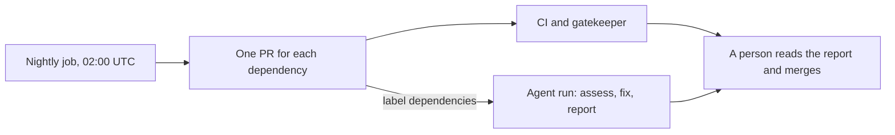
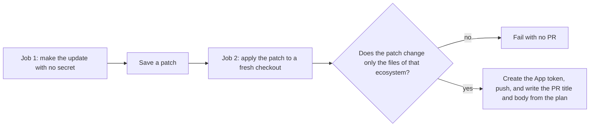
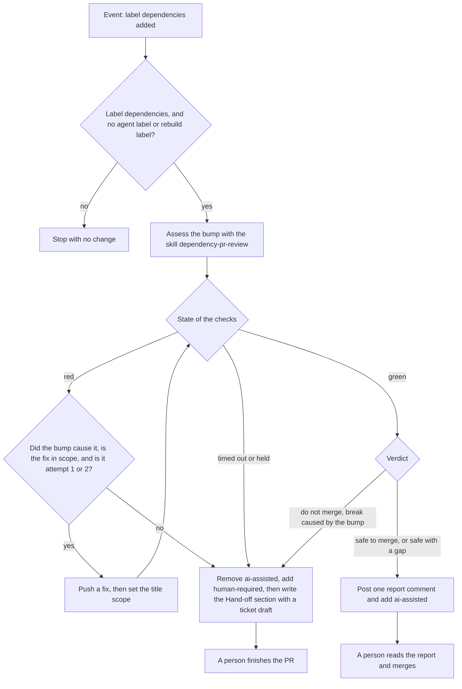
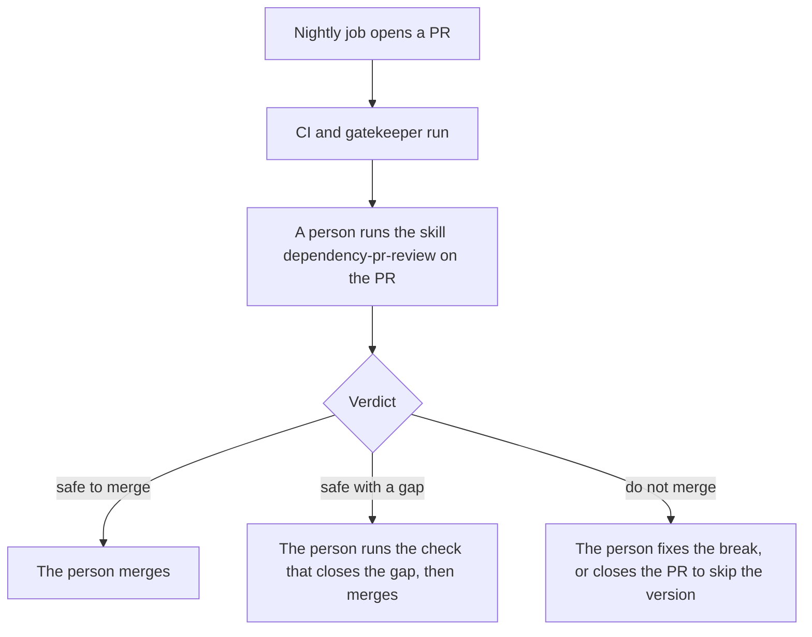
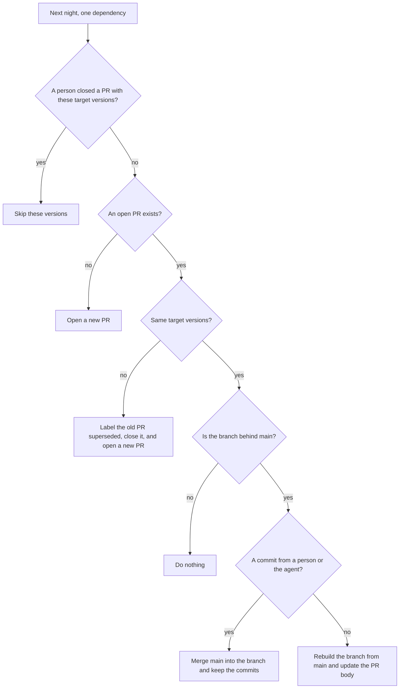
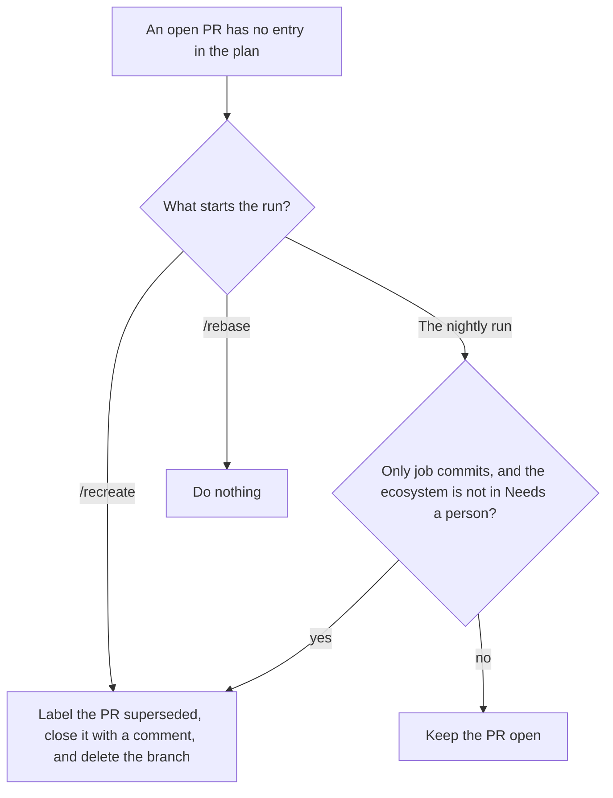
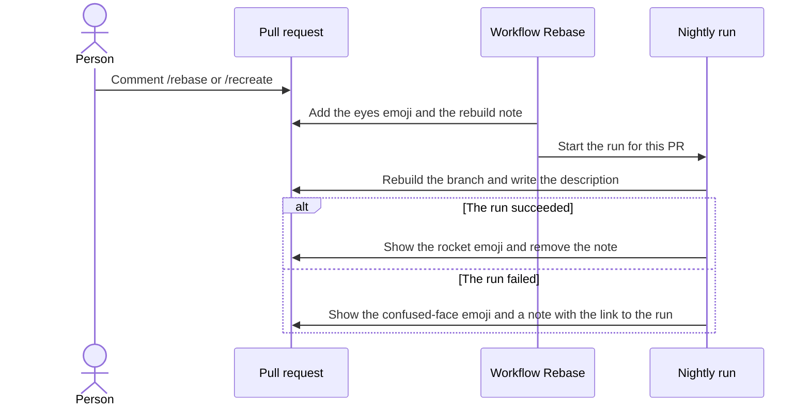

# Dependencies

A nightly job updates our direct and indirect dependencies. It opens one PR for each dependency. The PR changes that dependency in every project that uses it, so each dependency has one version everywhere. For the whole process, read [SECURITY-PROCESS.md](../../SECURITY-PROCESS.md).



## The nightly update

| Rule | Value |
|---|---|
| Scope | Direct and indirect dependencies in pnpm (Node) and uv (Python), GitHub Actions, Docker base images, and Terraform providers |
| One PR for | One dependency, or one group that must move together, for example `opentelemetry-*`. A major bump of a group member gets its own PR. |
| Only that package | A PR changes only the packages that it names and the packages that they need. If another package changes, the job fails and opens no PR. Put packages that must move together in one group in `.github/deps-groups.json`. |
| Title | The title names each version change, for example `bump @babel/parser from 7.29.11 to 7.29.12 and from 8.0.8 to 8.0.10`. |
| Cooldown | A version younger than 3 days waits. The job passes `--config.minimumReleaseAge=4320` to pnpm and `--exclude-newer "3 days"` to uv. |
| Labels | `dependencies`, and the ecosystem: `npm`, `uv`, `github-actions`, `docker`, or `terraform` |
| Limit | 250 PRs in one night, because GitHub allows 256 jobs in a matrix. The job summary lists the rest under "Left for the next night". |
| Ignore | See [Skip, close, or ignore](#skip-close-or-ignore). |
| Merge | A person merges, after a green CI. The agent never merges. See [Merge a dependency PR](#merge-a-dependency-pr). |

| Title scope | When |
|---|---|
| `deps` | The PR changes only dependency files. |
| The name of a service | The bump needs a code fix in that one service. |
| `main` | Any other mix of files. |

After the agent pushes a code fix, it sets the scope again from the files of the PR. It uses `.github/scripts/deps-nightly/scope.cli.mjs`.

| Risk | Control |
|---|---|
| A publisher moves a tag of a pinned GitHub Action | The job records the commit of each new tag. It opens a PR after the same commit has stayed for 3 days. A tag that moves goes to "Needs a person". The record is in the Actions cache. If GitHub deletes the cache, the wait starts again. |
| A package build runs code (`uv` builds a package that has no wheel) | The update runs in two jobs, as the diagram shows. |
| A manual run opens PRs by mistake | A manual run is a dry run by default. It writes the plan to the job summary and opens no PR. |
| Missing credentials | A scheduled run needs the credentials of the GitHub App. The job `credentials` validates them first. See [Required configuration](../../SECURITY-PROCESS.md#required-configuration). |



## One agent run for every PR

The skill `vulna-squash` does the whole job for a dependency PR in one run, in mode `pr`. The Cursor automation `connectors-dependency-pr-assess` starts it on the event "Label added" for the label `dependencies`. See [Cursor automations](../../SECURITY-PROCESS.md#cursor-automations).



| Fact | Value |
|---|---|
| Report | One comment that starts with `<!-- vulna-squash-report -->`. A second run updates it. |
| Slack | The PR run posts no Slack message. |
| Limits | The agent never merges, never approves, and never edits a lockfile by hand. |
| Run again | Comment `/recreate`. The job rebuilds the PR and starts a new run. It deletes the commits of a person and the agent, so use it only when you can discard them. |
| Run by hand | Remove the agent label. Start an agent session in this repository and say: "Run the skill `vulna-squash` in mode `pr` for PR <number>". |

Only the event "Label added" starts a run. This table shows when a PR gets a new run.

| What happens to the PR | New run |
|---|---|
| The job opens a PR, or replaces a PR because the target versions changed | Yes. It is a new PR. |
| The job rebuilds a PR: the nightly run, `/recreate`, or `/rebase` on a PR with only job commits | Yes. The job removes `ai-assisted`, `human-required`, and `dependencies`. Then it adds `dependencies`. |
| The job merges `main` into a PR that has a commit from a person or the agent | No. The labels stay. Comment `/recreate` to start a run. |

### The daily findings run

The cron automation `connectors-vulna-patchy` runs the same skill in mode `findings` at 05:00 UTC. It reads the Trivy findings. It skips a package that an open PR with the label `dependencies` already changes, except an operating system package. It opens each fix PR with the labels `dependencies` and `ai-assisted`, so the PR automation stops at its entry check. It opens or refreshes a rebuild PR with the labels `dependencies` and `rebuild`, so the PR automation stops at its entry check. See [Rebuild rules](./image-vulnerabilities.md#rebuild-rules). It posts one Slack message with the PR URLs and the status, or with the reason to stop. See [Patch a finding](./image-vulnerabilities.md#patch-a-finding).

### Hand-off

These causes give the label `human-required`:

- The bump caused a breaking change that we use.
- The CI is red after 2 fix attempts.
- The CI timed out, or a run waits for approval.
- The cause is unclear, or the fix is outside the PR scope.
- A command that sets the scope of the PR title failed.

| Rule | Value |
|---|---|
| Labels | The agent removes `ai-assisted` first, so a PR never has both labels. The verdicts "safe to merge" and "safe with a gap" give `ai-assisted`. |
| Ticket | The agent never files a Jira ticket. The report gets the section "Hand-off: log a Jira ticket" with a ticket draft (project `UN`, component `mcp-servers`). A person logs it. An assistant can do it from `agentic/skills/jira/SKILL.md`. |

## Review a dependency PR

The skill `dependency-pr-review` answers one question: does this version bump break our code? It starts from how we use the dependency, not from the changelog. The agent runs it first. A person can also run it on one PR: install it with `bash agentic/skill-management/setup.sh`, start an agent session, and give the PR link. The skill edits no file, posts no comment, and never approves or merges.



## An open PR on the next night

The nightly job decides for each dependency before it builds anything. Each PR body ends with a hidden marker. The marker holds the branch and the target versions.



- A rebuild removes every conflict with `main`.
- If a merge of `main` fails, the job warns and a person resolves the conflict.
- A close of a group PR skips only that set of versions.
- A merged PR needs nothing. The plan finds no update.

### A PR that no update targets

A dependency leaves the plan when a person merges a newer version, or when the cooldown or an ignore rule changes. The open PR then has no entry in the plan.



| Rule | Value |
|---|---|
| Commits | The nightly run keeps a PR that has a commit from a person or the agent. It lists the PR under "Skipped". |
| Blocked ecosystem | The nightly run keeps a PR when its ecosystem is in "Needs a person", because a blocked folder or a failed lookup can hide candidates. For such an ecosystem, only `/recreate` closes its PRs. |
| Marker | The job closes only a PR that has its hidden marker. A branch `deps/*` of a person stays open. |
| Head commit | Before it closes a PR, the job compares the head commit of the PR with the head commit of the plan. If a commit came after the plan, the job keeps the PR. A run for one PR then ends red. |
| One-PR run | A run for one PR closes nothing for another PR. |

## Ask for a rebase or a rebuild

Write one of these commands as the first line of a comment on a dependency PR.

| Comment | What happens |
|---|---|
| `/rebase` | The job does what it does each night for this PR. It rebuilds the branch from `main`, or merges `main` into a PR that has a commit from a person or the agent. It does nothing if the branch has all of `main`, or if no update targets the PR. |
| `/recreate` | The job rebuilds the branch from `main`, even if the PR has a commit. It deletes the commits of a person and the agent. If the target versions changed, it closes the PR and opens a new PR. If no update targets the PR, it closes the PR. |

| Rule | Value |
|---|---|
| Who | An owner, a member, or a collaborator |
| Where | A PR with the label `dependencies` and a branch that starts with `deps/` |
| Scope | The run handles that PR only. It opens no other PR. |
| By hand | Start the nightly workflow with the inputs `pr` and `recreate`. |
| State | The workflow `[Deps] Rebase` and the job `Finish` show it. The emoji on your comment shows it too. |



The next good rebuild removes the failure note.

## Merge a dependency PR

The repository uses the PR description as the squash commit message. The nightly job writes the description in two parts.

```text
Bump `@grpc/grpc-js` from 1.14.6 to 1.14.7.

Packages that changed in the lock files (1):

- `@grpc/grpc-js`: 1.14.6 -> 1.14.7

---

The nightly dependency job made this change. It only uses versions that are at least 3 days old.

### Projects that moved

- `services/teams-mcp`

<!-- deps-nightly:npm-grpc-grpc-js:fe18525b04da -->
```

| Part | At the merge |
|---|---|
| Above the line `---` | Keep it. It is the commit text. |
| The line `---` and everything below it | Delete it in one step. It is only for the review. |

The marker stays in the PR description. The planner needs it while the PR is open.

## Skip, close, or ignore

| What you want | What to do |
|---|---|
| Skip these target versions | Close the PR without a merge. Add no label. The job skips these versions. A newer version opens a new PR. |
| Remove an obsolete PR | Wait for the nightly run, or comment `/recreate`. The job labels the PR `superseded` and closes it. |
| Never update a dependency, or never take a major version | Add a rule to the list `ignore` in `.github/deps-groups.json`. |
| Hold a dependency at one version | Add a pin. The job lists a pinned dependency in "Needs a person" and does not move it. |
| Keep your own commits on a PR | Push the commit. The job only merges `main` into the branch. |
| Update a branch from `main` yourself | Click "Update branch", or run `gh pr update-branch <number>`. Add `--rebase` for a rebase. After a rebase, push with `git push --force-with-lease`. |
| Fix a conflict in a lock file | Merge or rebase `main`. Regenerate the lock file with `pnpm install --lockfile-only` or `uv lock`. Never edit it by hand. |

| Label on a closed PR | How the job reads it |
|---|---|
| None | A person rejected it. The job skips its versions. |
| `superseded` | The job closed it. A new PR can follow. |

The job sets `superseded` only when it closes a PR. Do not add it by hand, because the job then opens the same update again. Do not close a PR to get a rebuild, because a closed PR skips that version.

A rule in `ignore` has a `name` (a pattern with `*` is legal) and a `reason`. It can also have an `ecosystem` and `updateTypes`, which is a list of `major`, `minor`, or `patch`. This example skips the major versions of `eslint` packages:

```json
{ "ecosystem": "npm", "name": "eslint*", "updateTypes": ["major"], "reason": "Waits for the flat config move." }
```

The job lists each ignored update in its summary. Pins are `override-dependencies` in `pyproject.toml` and `pnpm.overrides` in the root `package.json`.

## Each day

1. List the open dependency PRs: `gh pr list --label dependencies --state open`.
2. If a PR has the label `ai-assisted`, read the report in its comment. If the verdict is "safe to merge", merge the PR. If the verdict is "safe with a gap", run the check that the report names first.
3. If a PR has the label `human-required`, read the report. Log the ticket from the draft. Then finish the work.
4. If a PR has no agent label and a green CI, run the review by hand.
5. Read the job summary of the last nightly run. The list "Needs a person" holds what the job cannot update.
6. Every month, read each pin and override. Remove the entry when upstream fixes the problem.

## What can go wrong

| Problem | What to do |
|---|---|
| The agent run crashes. The PR has no agent label. | Run the agent by hand. Comment `/recreate` only if you can discard the commits of a person and the agent. |
| A fix PR from the agent and a nightly PR change the same package. | Merge the PR that has the fix. Then close the other PR. |
| A handled PR has a conflict with `main`. The nightly job warns in its summary. | Resolve the conflict, or close the PR to skip that version. |
| A bump job is red. The job `Bump <slug>` shows the cause as an error annotation. No PR opens. | Read the cause. If a package pins the new version, wait for a release of that package. If other packages move too, put them in one group. |
| The report says "safe with a gap". | Run the check that the report names. Then merge. |
| The agent title step failed. The PR has `human-required` and a red title check. | Set the title scope by hand, from the files of the PR. |

## Checks on a PR

| Check | Runs on | Fails when | If it blocks your PR |
|---|---|---|---|
| Dependency review | A PR that changes `pnpm-lock.yaml`, `services/*/package.json`, `services/*/uv.lock`, or a file in `packages/` | The PR adds a dependency with a known HIGH advisory or worse | Raise the version. If a parent pins it exactly, add a pnpm override. If you cannot take the fix, add the label `security-exception`. |
| Pinned actions | A PR that changes a workflow file | An action is not pinned to a commit | Pin the action. |

A new dependency with a known critical or high vulnerability needs written approval from the engineering council.

## GitHub Actions, Docker, and Terraform

The same rules apply: one PR for each item, one version everywhere, and a cooldown of 3 days.

| What | What the job does |
|---|---|
| GitHub Actions | One PR for each action repository. It moves the pinned commit and the version comment in every workflow. An action with no GitHub Release uses its tags. |
| Docker base images | One PR for each image. It moves the tag and the digest in every `FROM` and `COPY --from` line. It stays in the same major version. A new digest for the same tag opens no PR when every platform image is the same. The change starts a release for each service. |
| Terraform providers | One PR for each provider that has a release newer than the lock. It updates `.terraform.lock.hcl` in every module that names the provider. If the release is outside our constraint, it also widens the constraint in `versions.tf`. A module with no lock file gets one. The CI job `validate-terraform` makes sure that the change is valid. |

The lock files hold hashes for `linux_amd64`, `linux_arm64`, and `darwin_arm64`. The list is `terraformPlatforms` in `.github/deps-groups.json`. To lock a new module by hand, run this command in the module, inside `nix develop`:

```bash
terraform providers lock -platform=linux_amd64 -platform=linux_arm64 -platform=darwin_arm64
```

These cases go to the list "Needs a person":

| Item | Case |
|---|---|
| GitHub Action | It is pinned to a branch, or its pinned tag points to another commit than the pin. |
| Docker image | It is not an official Docker Hub image, for example the `uv` image in `COPY --from`. Or the registry gives an access error, a rate limit, or a server error. |
| npm package | Its publisher deprecated the version, or the registry gives no usable answer about deprecation after one retry. |
| Transitive npm update | pnpm finds only versions younger than the cooldown for a range. The job skips these updates that night. The direct updates still run. |
| Python package | Its lookup at PyPI fails. |
| Terraform | The newest release of `required_version` is outside the constraint. |
| Any dependency | A pin holds it. |

## Advisories in lock files

Every night, Trivy scans `pnpm-lock.yaml` and every `uv.lock` on `main`, development dependencies included. It uploads findings of every severity to the Security tab, category `trivy-lockfiles`. A lock file alert closes when the fixed lock file reaches `main`. It needs no release. For all alert types, see [Where alerts show](../../SECURITY-PROCESS.md#where-alerts-show).

## Files

| File | What it holds |
|---|---|
| `.github/workflows/deps-nightly.yaml` | The nightly job |
| `.github/workflows/deps-rebase.yaml` | The `/rebase` and `/recreate` commands |
| `.github/scripts/deps-nightly/scope.cli.mjs` | The title scope of a PR |
| `agentic/skills/vulna-squash/SKILL.md` | The skill that handles every dependency PR in one run |
| `agentic/skills/dependency-pr-review/SKILL.md` | The skill for the review of a dependency PR |
| `.github/workflows/security-dependency-review.yaml` | The dependency review |
| `.github/workflows/security-trivy-nightly.yaml` | The nightly scan, including the lock files of `main` |
| `.github/workflows/security-pinned-actions.yaml` | The check that an action is pinned to a commit |
