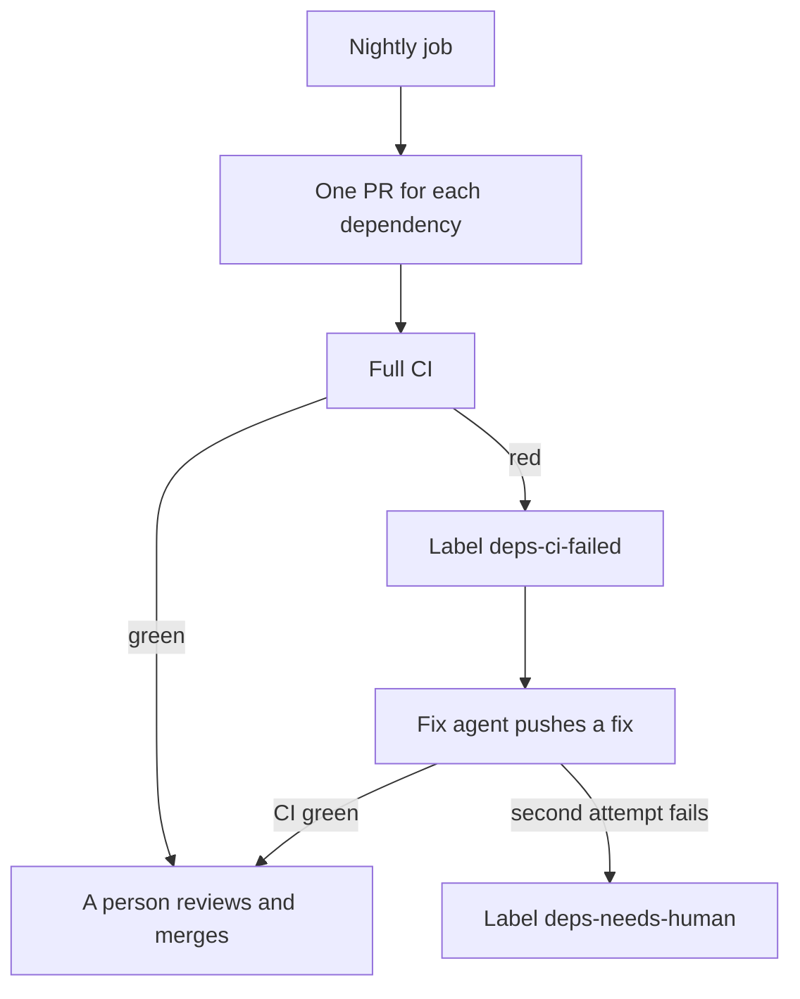

<!-- confluence-page-id: <NO CONFLUENCE ID REQUEST> -->
<!-- confluence-space-key: <NO CONFLUENCE ID REQUEST> -->

# Dependencies

A nightly job updates our dependencies, direct and indirect. It opens one PR for each dependency. The PR changes that dependency in every project that uses it, so one dependency has one version everywhere. For the whole process, read [SECURITY-PROCESS.md](../../SECURITY-PROCESS.md).

## The nightly update

| Rule | Value |
|---|---|
| Scope | Direct and indirect dependencies, in pnpm (Node) and uv (Python) |
| One PR for | One dependency, or one group that must move together, for example `opentelemetry-*` |
| Cooldown | A version younger than 3 days waits. pnpm: `minimumReleaseAge: 4320`. uv: `exclude-newer = "3 days"`. |
| Labels | `dependencies`, and `npm` or `uv` |
| CI | The full CI runs on every PR. A red CI blocks the merge. |
| Cap | At most 5 new PRs each night |
| Merge | A person merges. The agent never merges. |

## If CI is red

The job adds the label `deps-ci-failed`. A Cursor Automation then starts the fix agent. The agent pushes a fix to the PR branch and tries at most 2 times. After that, it adds `deps-needs-human` and a comment.

The agent edits only the paths in the PR. It never edits a lockfile by hand. The skill `dependabot-pr-review` is the base for the review.

## Each day

1. Run `gh pr list --label dependencies --state open`.
2. If a PR has a green CI, review it and merge it.
3. If a PR has the label `deps-needs-human`, fix it or close it.
4. Every month, read each pin and override. Remove the entry when upstream fixes the problem.

Pins are `override-dependencies` in `pyproject.toml` and `pnpm.overrides` in the root `package.json`. A pin holds a dependency at one version, so the nightly job cannot move it.

## Dependency review

The dependency review runs on a PR that changes a lockfile or a manifest. It fails for a known HIGH advisory or worse. It checks only what the PR adds.

If the dependency review blocks your PR, raise the version of the dependency you added. If a parent pins it exactly, add a pnpm override. If you cannot take the fix, add the label `security-exception`.

The policy needs written approval from the engineering council for a new dependency with a known critical or high vulnerability.

## Dependabot

Dependabot updates GitHub Actions, Docker, and Terraform. It also opens an alert when a new advisory appears for a version on `main`. The nightly job clears most alerts with its next PR.

| File | What it holds |
|---|---|
| `.github/workflows/deps-nightly.yaml` | The nightly job |
| `.github/dependabot.yaml` | Dependabot for Actions, Docker, and Terraform |
| `.github/workflows/security-dependency-review.yaml` | The dependency review |
| `agentic/skills/dependabot-pr-review/SKILL.md` | The skill that reviews a dependency PR |
