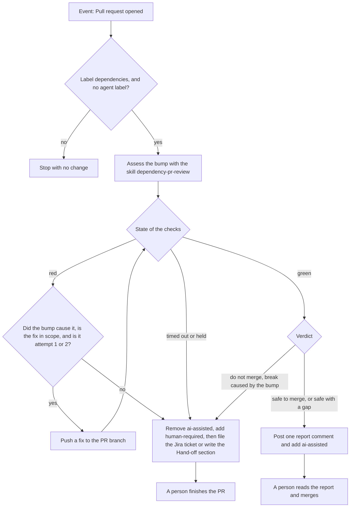
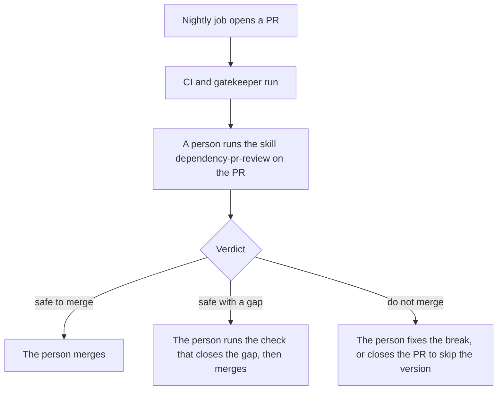
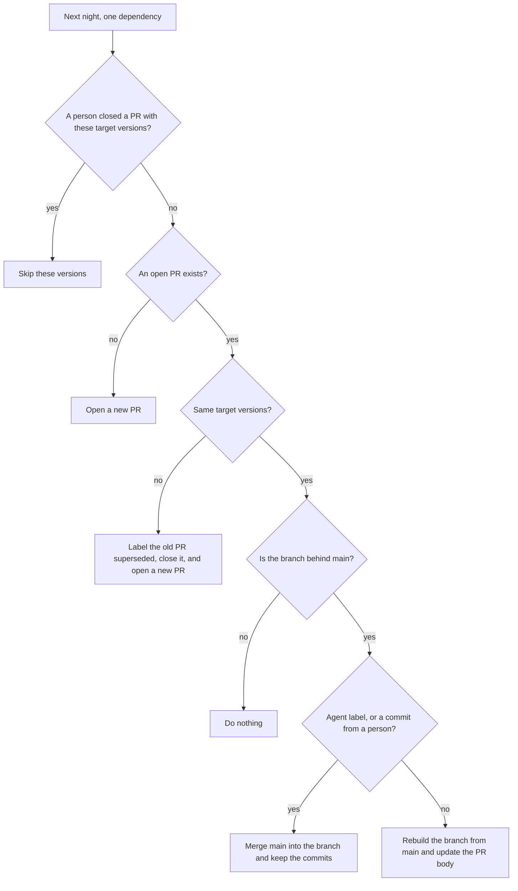

<!-- confluence-page-id: <NO CONFLUENCE ID REQUEST> -->
<!-- confluence-space-key: <NO CONFLUENCE ID REQUEST> -->

# Dependencies

A nightly job updates our dependencies, direct and indirect. It opens one PR for each dependency. The PR changes that dependency in every project that uses it, so one dependency has one version everywhere. For the whole process, read [SECURITY-PROCESS.md](../../SECURITY-PROCESS.md).

## The nightly update

| Rule | Value |
|---|---|
| Scope | Direct and indirect dependencies in pnpm (Node) and uv (Python), GitHub Actions, Docker base images, and Terraform providers |
| One PR for | One dependency, or one group that must move together, for example `opentelemetry-*`. A major bump of a group member gets its own PR. |
| Cooldown | A version younger than 3 days waits. The job passes `--config.minimumReleaseAge=4320` to pnpm and `--exclude-newer "3 days"` to uv. |
| Labels | `dependencies`, and the ecosystem: `npm`, `uv`, `github-actions`, `docker`, or `terraform` |
| CI | The full CI runs on every PR. A red CI blocks the merge. |
| Limit | 250 PRs in one night, because GitHub allows only 256 jobs in a matrix. The job opens a PR for every update it finds, up to this number. The other updates wait for the next night. The job summary lists them under "Left for the next night". |
| Ignore | The list `ignore` in `.github/deps-groups.json`. See [Ignore a dependency](#ignore-a-dependency). |
| Merge | A person merges. The agent never merges. See [One agent run for every PR](#one-agent-run-for-every-pr). |

Our policy pins every GitHub Action to a commit, so a moved tag cannot change a workflow. But the job reads the commit from a tag when it opens a PR. A publisher can move a tag after the release is old enough. So the job records the commit of each new tag. It opens a PR only after the same commit has been there for 3 days. A tag that moves goes to "Needs a person". The record is in the Actions cache. If GitHub deletes the cache, the wait starts again.

A package build can run code. The `uv` tool builds a package that has no wheel. So a first job makes the update with no secret and saves a patch. A second job applies the patch to a fresh checkout and checks that the patch changes only the files of that ecosystem. Only then does it create the App token and push. The second job builds the PR title and body itself, from the plan and the patched files. The patch is the only thing that it takes from the first job.

A manual run of the nightly job is a dry run by default. It writes the plan to the job summary and opens no PR. The job also opens no PR until the GitHub App exists. See [Setup that needs an admin](../../SECURITY-PROCESS.md#setup-that-needs-an-admin).

## One agent run for every PR

The skill `vulna-squash` does the whole job for a dependency PR in one run. The Cursor automation `connectors-dependency-pr-assess` starts it in mode `pr`. Its trigger is "Pull request opened". See [Cursor automations](../../SECURITY-PROCESS.md#cursor-automations).



The report comment starts with `<!-- vulna-squash-report -->`. A second run updates the same comment. The agent never merges, never approves, and never edits a lockfile by hand. The PR run posts no Slack message. To run the agent again, remove the agent label. Then start an agent session in this repository and say: "Run the skill `vulna-squash` in mode `pr` for PR <number>". Do not close the PR, because a closed PR skips that version.

## The daily findings run

The cron automation `connectors-vulna-patchy` runs the same skill in mode `findings` at 05:00 UTC. It reads the Trivy findings and skips a package that an open PR with the label `dependencies` already changes. It opens each fix PR with the labels `dependencies` and `ai-assisted`, so the PR automation stops at its entry check. Then it does the same assess, fix, report, and hand-off steps for each PR. It posts one Slack message with the PR URLs and the status, or with the reason to stop. See [Patch a finding](./image-vulnerabilities.md#patch-a-finding).

## Hand-off

The agent hands off when it cannot finish the PR. These causes give the label `human-required`:

- The bump caused a breaking change that we use.
- The CI is red after 2 fix attempts.
- The CI timed out, or a run waits for approval.
- The cause is unclear, or the fix is outside the PR scope.

The agent removes `ai-assisted` first, so a PR never has both labels. With a Jira tool, the agent files one ticket and writes the key in the report. The project is `UN` and the component is `mcp-servers`. Without the tool, the report gets the section "Hand-off: log a Jira ticket", and a person logs the ticket. The verdicts "safe to merge" and "safe with a gap" give `ai-assisted`.

## Review a dependency PR

The agent runs the skill `dependency-pr-review` first. A person can also run it by hand on a dependency PR. It answers one question: does this version bump break our code? It starts from how we use the dependency, not from the changelog.



| Step | What happens |
|---|---|
| 1 | Start an agent session in this repository. Run `bash agentic/skill-management/setup.sh` once to install the skill. |
| 2 | Give the link of one PR. Say "code wise only" when the CI has run the tests. |
| 3 | The skill reads the PR, the CI, and our use of the dependency. It starts read-only agents for the lenses that fit the PR. |
| 4 | The skill checks the claims that decide the verdict. Then it writes a one page report in the chat. |
| 5 | The person reads the verdict and decides. |

The skill edits no file, posts no comment, and never approves or merges. It lives in `agentic/skills/dependency-pr-review/`.

## An open PR on the next night

The nightly job runs again while a PR is open. It decides for each dependency before it builds anything. Each PR body ends with a hidden marker. The marker holds the branch and the target versions.



| Case | What the job does |
|---|---|
| The target versions are the same, and the branch has all of `main` | Nothing. |
| The target versions are the same and the branch is behind `main`. Nobody touched the PR. | It rebuilds the branch from `main` and updates the PR body. |
| The target versions are the same, and the PR has an agent label or a commit from a person | It keeps the commits and merges `main` into the branch. If this fails, the job warns and a person resolves the conflict. |
| A target version changed | It labels the old PR `superseded`, closes it with a comment, and opens a new PR. The new PR starts a new agent run. |
| A person closed the PR without a merge | It skips those target versions. A newer version opens a new PR. For a group, a close skips only that set of versions. |
| A person merged the PR | Nothing. The plan finds no update. |

Only a new PR fires the event "Pull request opened". A rebuilt or updated PR starts no new run. A touched PR keeps its commits, because a rebuild from `main` deletes the fixes of the agent.

## Ignore a dependency

Use one of these ways.

| What you want | What to do |
|---|---|
| Skip one version | Close the PR without a merge. |
| Never update a dependency, or never take a major version | Add a rule to the list `ignore` in `.github/deps-groups.json`. |
| Hold a dependency at one version | Add a pin. The job lists a pinned dependency in "Needs a person" and does not move it. |

A rule in `ignore` has a `name` (a pattern with `*` is legal) and a `reason`. It can also have an `ecosystem` and `updateTypes`, which is a list of `major`, `minor`, or `patch`. This example skips the major versions of `eslint` packages:

```json
{ "ecosystem": "npm", "name": "eslint*", "updateTypes": ["major"], "reason": "Waits for the flat config move." }
```

The job lists each ignored update in its summary.

## Rebase a PR yourself

Do not close a PR to get a rebuild. A closed PR skips that version. Use one of these ways.

| What you want | What to do |
|---|---|
| Update the branch from `main` and keep the commits | Click "Update branch" in the PR, or run `gh pr update-branch <number>`. This merges `main` into the branch. |
| Update the branch by a rebase | Run `gh pr update-branch <number> --rebase`. This rewrites the branch. |
| Fix a conflict in a lock file | Check out the PR and merge or rebase `main`. Regenerate the lock file with `pnpm install --lockfile-only` or `uv lock`. Never edit it by hand. After a rebase, push with `git push --force-with-lease`. |
| Rebuild a PR that has no agent label and no commit from a person | Wait for the next nightly run. It rebuilds the branch when the branch is behind `main`. To run it now, run `gh workflow run deps-nightly.yaml -f dry-run=false`. This run can also open new PRs. |
| Rebuild a PR and drop every commit on it | Remove the agent label. Check out the PR. Reset the branch to the first commit, the one by `github-actions[bot]`. Push with `git push --force-with-lease`. Then rebuild as in the row above. |
| Keep your own commits on a PR | Push the commit. The job sees a commit from a person and only merges `main` into the branch. |

## Each day

1. Read the issue with the label `dependency-dashboard`. The nightly job updates it. It lists the plan and the open dependency PRs. You can also run `gh pr list --label dependencies --state open`.
2. If a PR has the label `ai-assisted`, read the report in its comment. Then merge the PR.
3. If a PR has the label `human-required`, read the report. If it has the section "Hand-off: log a Jira ticket", log the Jira ticket. Then finish the work.
4. If a PR has no agent label and a green CI, run the review by hand. See [Review a dependency PR](#review-a-dependency-pr).
5. Read the job summary of the last nightly run. The list "Needs a person" holds what the job cannot update, for example the Terraform version in `required_version`.
6. Every month, read each pin and override. Remove the entry when upstream fixes the problem.


Pins are `override-dependencies` in `pyproject.toml` and `pnpm.overrides` in the root `package.json`. A pin holds a dependency at one version, so the nightly job cannot move it.

## What can go wrong

| Problem | What you see | What to do |
|---|---|---|
| The agent run crashes. | The PR has no agent label. | Run the agent again, as in [One agent run for every PR](#one-agent-run-for-every-pr). |
| A fix PR from the agent and a nightly PR change the same package. | Both PRs conflict, or one has a conflict after the other merges. | Merge the PR that has the fix. Then close the other PR. A closed PR skips only its own target versions. |
| A handled PR has a conflict with `main`. | The nightly job warns in its summary. | Resolve the conflict, or close the PR to skip that version. |
| The report says "safe with a gap". | The report names one check. | Run that check, for example one real request in QA. Then merge. |

## Dependency review

The dependency review runs on a PR that changes a lockfile or a manifest. It fails for a known HIGH advisory or worse. It checks only what the PR adds. It checks runtime and development dependencies.

If the dependency review blocks your PR, raise the version of the dependency you added. If a parent pins it exactly, add a pnpm override. If you cannot take the fix, add the label `security-exception`.

The policy needs written approval from the engineering council for a new dependency with a known critical or high vulnerability.

## Pinned actions

The pinned-actions check runs on a PR that changes a workflow file. It fails when an action is not pinned to a commit. A new action is a new dependency, so it must be pinned. The nightly job keeps the pins current.

## GitHub Actions, Docker, and Terraform

The nightly job also updates these. The same rules apply: one PR for each item, one version everywhere, and a cooldown of 3 days.

| What | What the job does |
|---|---|
| GitHub Actions | One PR for each action repository. It moves the pinned commit and the version comment in every workflow. A major bump says so in the PR body. An action with no GitHub Release uses its tags, and the date of the tag commit. If the pinned tag now points to another commit than the pin, the job lists the action in "Needs a person". |
| Docker base images | One PR for each image, for example `node`. It moves the tag and the digest in every Dockerfile, in the `FROM` lines and in the `COPY --from` lines. It stays in the same major version. A new digest for the same tag opens no PR when every platform image is the same. The change starts a release for each service. A rate limit or a server error of the registry goes to "Needs a person". |
| Terraform providers | One PR for each provider that has a release newer than the locked version in any module. The PR updates `.terraform.lock.hcl` in every module that names the provider. If the release is outside our version constraint, the PR also widens the constraint in every `versions.tf` that names the provider. A part `!=` that excludes the new release is dropped. A module with no lock file gets one. The CI job `validate-terraform` checks the change. |

The lock files hold hashes for `linux_amd64`, `linux_arm64`, and `darwin_arm64`. The list is `terraformPlatforms` in `.github/deps-groups.json`. To lock a new module by hand, run this command in the module, inside `nix develop`:

```bash
terraform providers lock -platform=linux_amd64 -platform=linux_arm64 -platform=darwin_arm64
```

An action that is pinned to a branch goes to the list "Needs a person". An image that is not an official Docker Hub image goes there too, for example the `uv` image in `COPY --from`. An npm version that its publisher deprecated goes there as well. An npm update goes there too when the registry gives no usable answer about deprecation after one retry. The Terraform version itself, `required_version`, goes there when its newest release is outside the constraint. A Python package goes there when its lookup at PyPI fails. If pnpm finds only versions younger than the 3-day cooldown for a version range, the job skips the transitive npm updates that night. It lists the package with a reason. The direct updates still run.

## Advisories in lock files

Every night, Trivy scans `pnpm-lock.yaml` and every `uv.lock` on `main`, dev dependencies included. It uploads critical and high findings that have a fix to the Security tab, category `trivy-lockfiles`.

A lock file alert closes when the fixed lock file reaches `main`. It does not need a release. The nightly job fixes most of them with its next PR.

| File | What it holds |
|---|---|
| `.github/workflows/deps-nightly.yaml` | The nightly job |
| `agentic/skills/vulna-squash/SKILL.md` | The skill that handles every dependency PR in one run |
| `agentic/skills/dependency-pr-review/SKILL.md` | The skill for the review of a dependency PR |
| `.github/workflows/security-dependency-review.yaml` | The dependency review |
| `.github/workflows/security-trivy-nightly.yaml` | The nightly scan, including the lock files of `main` |
| `.github/workflows/security-pinned-actions.yaml` | The check that an action is pinned to a commit |
