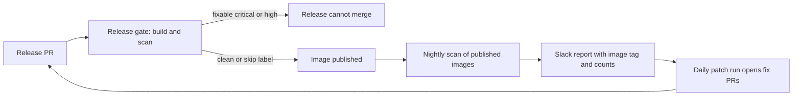
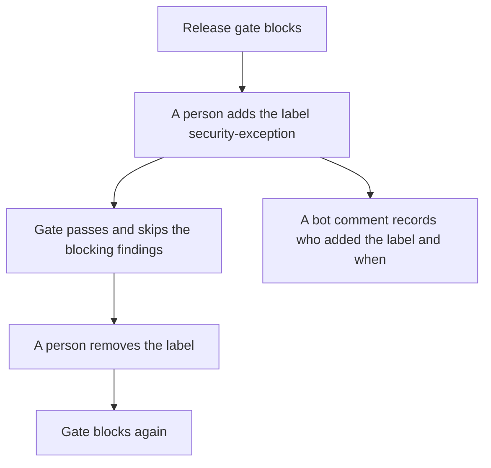
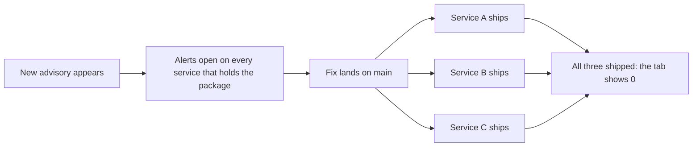
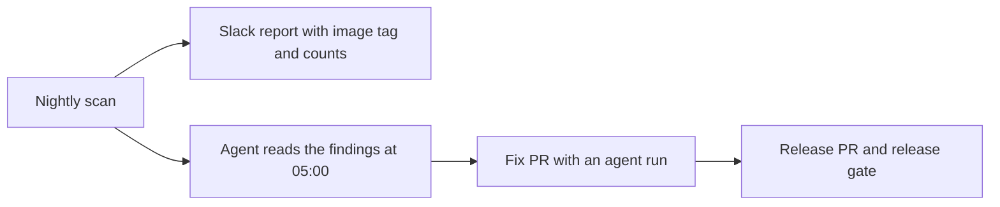
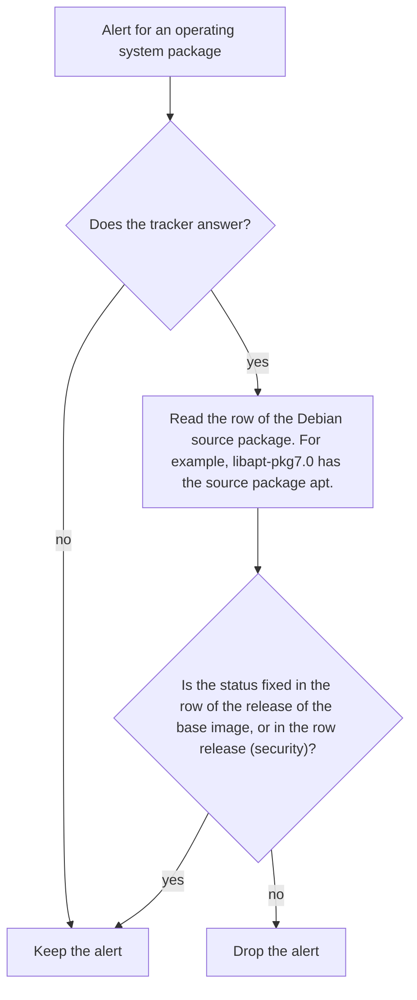

# Image vulnerabilities

Trivy scans our images. It reports operating system packages and application packages inside the image. We scan published images every night, and we scan each release before it ships. For the whole process, read [SECURITY-PROCESS.md](../../SECURITY-PROCESS.md).

## Rules

These rules follow the policy page "Vulnerability Patch Management Process".

| Severity | Patch window |
|---|---|
| Critical and High | 1 month |
| Medium | 3 months |
| Low | 6 months |

| Rule | Value |
|---|---|
| Release | A release needs no fixable critical or high finding. |
| No fix | A finding with no fix is visible. It does not block. |
| Young fix | A fix younger than 3 days does not count. |
| Age of a fix | It comes from the package registry. If the registry gives no answer after one retry, the age is unknown and the finding blocks the release. For an operating system package, the date of the advisory is the age. |

## The release gate

| Fact | Value |
|---|---|
| Runs on | The release-please PR |
| Does | It builds the image fresh from the PR head and scans it. |
| Fails for | A fixable critical or high finding that is older than 3 days |
| State | A person approves the workflow runs on the release PR. The gate reads the state at that moment. |

If the gate blocks a release:

1. Fix the finding in a new PR. Merging that PR updates the release PR.
2. Approve the workflow runs again.

If a release must ship with a critical or high finding, read [Skip the release gate](#skip-the-release-gate).

## Skip the release gate

Use the skip only when a release must ship with a fixable critical or high finding. The skip is one label.

1. Read the gate summary on the release PR. It names each blocking finding.
2. Get the approval of the people who accept the risk.
3. Add the label `security-exception` to the release PR.
4. Approve the workflow runs again. The gate then passes.

To undo the skip, remove the label.

| Rule | Value |
|---|---|
| One step | The label is the only step, so no second step can be forgotten. |
| Record | A bot comment shows the state, the person, the time, and the commit. It updates in place. Its history lists every change. |
| Who | Anyone with write access. This is a deviation. |
| No blocking finding | The label does nothing. The gate says that the label is not needed. |
| New commit | The label stays. Read the job summary after each new commit. Remove the label if the commit needs a new decision. |

The skip covers one release PR. The finding stays visible in the nightly scan, and it stays in the Security tab until a new version ships. On any other PR, the label `security-exception` skips the dependency review. See [DEVIATION from monorepo setup](../../SECURITY-PROCESS.md#deviation-from-monorepo-setup).

## The nightly scan

Every night, the scan reads the latest published image of each service.

| Output | What it holds |
|---|---|
| Slack report | The counts of critical, high, and medium findings. A table with one row for each image that has findings. |
| Slack part "Repository (main)" | The counts for the lock files and the configuration of `main`. A table row only for a scan that has a finding. If the job cannot read the open alerts, this part says so. |
| Security tab, category `trivy-image/<service>` | One alert for each CVE and package. Each message starts with the image and the tag. |
| Security tab, category `trivy-config` | Misconfiguration in the Dockerfiles and the compose files of `main`. A person fixes these alerts. |

| Result of the image scans | What you see |
|---|---|
| All scans work | The Slack report posts. |
| Some scans fail | The report posts. Each failed image is marked "scan failed". |
| Every scan fails | No Slack report. The run shows the warning "Slack report not posted". Read the scan jobs of that run. |

The run turns red when it finds a fixable critical or high finding. A missing or empty Trivy results file fails the scan of that image. It does not count as clean.

## Why the Security tab does not show 0

The tab holds one alert for each CVE and package in each published image. A published image never changes, so an alert closes only when its service ships a new version. Each service ships through its own release PR, so the count falls one service at a time. A new advisory can raise it again.

| Fact | Result |
|---|---|
| A fixed lockfile on `main` | It does not close an image alert. Only a release does. |
| A lock file alert, category `trivy-lockfiles` | It closes when the fixed lock file reaches `main`. It needs no release. |
| A service with no code change | It needs the Rebuild Service workflow to ship an operating system patch. |
| A count above 0 during the week | It is normal. The window for critical and high findings is 1 month. |

The nightly Slack report is the list of images that still need a release.

## Patch a finding

The cron automation `connectors-vulna-patchy` starts the skill `vulna-squash` in mode `findings` at 05:00 UTC, after the 03:00 scan. The skill opens fix PRs for the findings. A person merges them. A critical or high finding must ship within 1 month. For each PR, see [One agent run for every PR](./dependencies.md#one-agent-run-for-every-pr).

| Cause | Fix |
|---|---|
| A Python or Node dependency | The nightly dependency PR, or a fix PR from the patch run |
| An operating system package | The Rebuild Service workflow. The new build takes the patch. |
| The base image | Merge the nightly Docker PR for the base image. It starts a release. |
| A finding with no fix | Do nothing. |

### An operating system alert

The agent decides the alert with the Debian tracker at `https://security-tracker.debian.org/tracker/<CVE>`.

The rule "no fixed version, or a fix younger than 3 days" applies to other packages only. The PR body of an operating system fix follows these rules.

| Item | Rule |
|---|---|
| Links | The GHSA for the description and the Debian advisory (DSA or DLA), each when it exists. If one is missing, the CVE and the tracker URL. |
| Source of the fix | A DSA or DLA, when one exists. Otherwise the fixed row and version of the Debian tracker. If the tracker did not answer, the PR says that the fix is not confirmed. |

## Build and release

| Fact | Value |
|---|---|
| Base image | One exact digest |
| Final stage | It removes the package manager, runs as a non-root user, and runs `apt-get upgrade` on every build. |
| Layer cache | The container build template turns it off for the final stage, so `apt-get upgrade` takes the newest patches. |
| A rebuild | A normal release. The Rebuild Service workflow opens one PR for each service, with the labels `dependencies` and `rebuild`. [Rebuild rules](#rebuild-rules) say when it opens, refreshes, or closes that PR. Its `build(...)` commit makes release-please open a patch release. Release-please sets the chart `version`, the chart `appVersion`, and the image tag in `values.yaml`. |
| The file `deploy/rebuild-date` | It holds the time of the rebuild PR. No code reads it. It only changes a file in the service, so release-please sees a commit. Each rebuild PR writes a new time. A release does not update it. |
| A release | It pushes the image to GHCR and to Azure, signs it with Cosign, and attaches an SBOM and a provenance record. |
| A PR that is not a release PR | It builds the image without a push. It does not scan the image. |

### Rebuild rules

An open release PR already rebuilds the image. The Rebuild Service workflow and the skill `vulna-squash` both run `rebuild.sh`, which follows this table.

| Open release PR | Open rebuild PR | Action |
|---|---|---|
| No | No | Open a rebuild PR. |
| No | Yes | Refresh it. A new commit writes a new time to `deploy/rebuild-date`. |
| Yes | Yes | Close the rebuild PR with a comment, and delete its branch. |
| Yes | No | Do nothing. |

`rebuild-plan.sh` prints `none` for a service that is not in `.release-please-manifest.json`. `rebuild.sh` stops with an error for it.

## Files

| File | What it holds |
|---|---|
| `.github/workflows/security-release-gate.yaml` | The release gate |
| `.github/workflows/security-release-gate-exception.yaml` | The comment that records who set the label |
| `.github/workflows/security-trivy-nightly.yaml` | The nightly scan and the Slack report |
| `.github/workflows/release-rebuild.yaml` | The Rebuild Service workflow |
| `.github/scripts/release-rebuild/rebuild.sh` | Opens, refreshes, or closes the rebuild PR of each service. The workflow and the skill `vulna-squash` both run it. |
| `.github/scripts/release-rebuild/rebuild-plan.sh` | Prints the action for one service as JSON: `open`, `refresh`, `close`, or `none`. A failed lookup exits non-zero. |
| `agentic/skills/vulna-squash/SKILL.md` | The skill for the daily patch run |
| `agentic/skills/vulna-squash/scripts/` | The shell scripts that the skill runs: the scan check, the entry check, the CI watch, the PR title scope, the result label, and the report comment |
| `.github/trivyignore.yaml` | Accepted findings, each with an expiry date. The nightly scan and the release gate skip them. |
