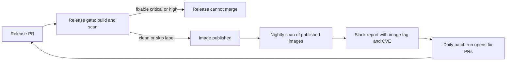

<!-- confluence-page-id: <NO CONFLUENCE ID REQUEST> -->
<!-- confluence-space-key: <NO CONFLUENCE ID REQUEST> -->

# Image vulnerabilities

Trivy scans our images. It reports operating system packages and application packages inside the image. We scan published images every night, and we scan each release before it merges. For the whole process, read [SECURITY-PROCESS.md](../../SECURITY-PROCESS.md).

## Rules

These rules follow the policy page "Vulnerability Patch Management Process".

| Severity | Patch window |
|---|---|
| Critical and High | 1 month |
| Medium | 3 months |
| Low | 6 months |

- A release needs no fixable critical or high finding.
- A finding with no fix is visible. It does not block.
- A fix younger than 3 days does not count.
- The age of a fix is its registry date. If that date is not available, it is the date of the advisory. If both are not available, the finding blocks.

## The release gate

The gate runs on the release-please PR. It builds the image fresh from the PR head and scans it. It fails for a fixable critical or high finding that is older than 3 days.

A person approves the workflow runs on the release PR. The gate then reads the state at that moment.

If the gate blocks a release, fix the finding in a new PR. Merging that PR updates the release PR. Then approve the runs again.

If a release must ship with a critical or high finding, add the label `security-exception` to the release PR. Add a stamp comment that starts with `Security exception approved by:` and names who approved. The gate passes only with the label and the stamp. It skips that release only. The finding stays visible.

## The nightly scan

Every night, the scan reads the latest published image of each service. It posts a report to Slack with the image tag and each CVE. It also updates alerts in the Security tab, category `trivy-image/<service>`. The run turns red when it finds a fixable critical or high finding.

The report shows which old images need a patch in a new release. A published image never changes, so only a new version clears a finding.

## The daily patch run

A Cursor Automation reads the findings every day. It opens fix PRs for critical and high findings. It opens at most 3 PRs at a time, and it never merges.

| Cause | Fix |
|---|---|
| A Python or Node dependency | The nightly dependency PR, or a fix PR from the patch run |
| An operating system package | Run the Rebuild Service workflow. The new build takes the patch. |
| The base image | Merge the Dependabot PR for the base image. |
| A finding with no fix | Do nothing. |

## Build and release

- The base image is pinned to one exact digest.
- The final stage removes the package manager, runs as a non-root user, and runs `apt-get upgrade` on every build.
- A release pushes the image to GHCR and to Azure, signs it with Cosign, and attaches an SBOM and a provenance record.
- A PR builds the image without a push. It does not scan it.

## Files

| File | What it holds |
|---|---|
| `.github/workflows/release-gate.yaml` | The release gate |
| `.github/workflows/security-trivy-registry.yaml` | The nightly scan and the Slack report |
| `.github/workflows/release-rebuild.yaml` | The Rebuild Service workflow |
| `.cursor/automations/workflows/nightly-vulna-patchy.yaml` | The daily patch run |
| `agentic/skills/vulna-squash/SKILL.md` | The skill for the daily patch run |
| `.github/trivyignore.yaml` | Accepted findings, each with an expiry date |
