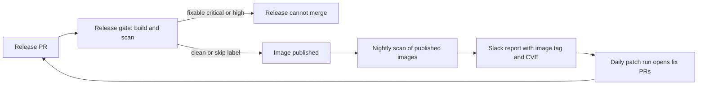
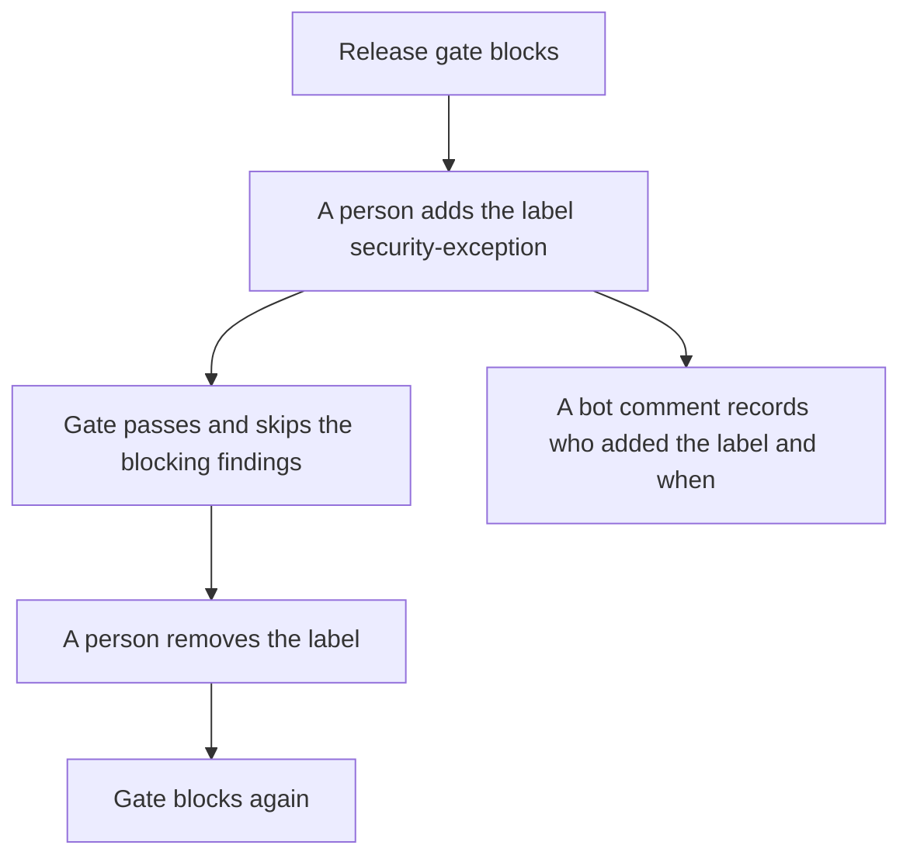
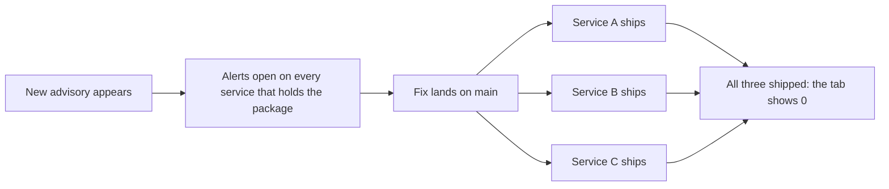

<!-- confluence-page-id: <NO CONFLUENCE ID REQUEST> -->
<!-- confluence-space-key: <NO CONFLUENCE ID REQUEST> -->

# Image vulnerabilities

Trivy scans our images. It reports operating system packages and application packages inside the image. We scan published images every night, and we scan each release before it merges. For the whole process, read [SECURITY-PROCESS.md](../../SECURITY-PROCESS.md).

## Rules

These rules follow the policy page "Vulnerability Patch Management Process".

| Severity | Patch window |
|---|---|
| Critical and High | 1 month |
| Medium | 3 months |
| Low | 6 months |

- A release needs no fixable critical or high finding.
- A finding with no fix is visible. It does not block.
- A fix younger than 3 days does not count.
- The age of a fix is its registry date. If that date is not available, it is the date of the advisory. If both are not available, the finding blocks.

## The release gate

The gate runs on the release-please PR. It builds the image fresh from the PR head and scans it. It fails for a fixable critical or high finding that is older than 3 days.

A person approves the workflow runs on the release PR. The gate then reads the state at that moment.

If the gate blocks a release, fix the finding in a new PR. Merging that PR updates the release PR. Then approve the runs again.

If a release must ship with a critical or high finding, read [Skip the release gate](#skip-the-release-gate).

## Skip the release gate

Use the skip only when a release must ship with a fixable critical or high finding. The skip is one label.

1. Read the gate summary on the release PR. It names each blocking finding.
2. Get the approval of the people who accept the risk.
3. Add the label `security-exception` to the release PR.
4. Approve the workflow runs again. The gate then passes.

To undo the skip, remove the label.

| Rule | Reason |
|---|---|
| The label is the only step. | No second step can be forgotten. |
| A bot comment records every change. | It shows the state, the person, the time, and the commit. It updates in place when someone adds or removes the label. Its history lists every change. |
| Anyone with write access can set the label. | This is a deviation. GitHub knows who set the label, and the comment shows it on the PR. |
| A label with no blocking finding does nothing. | The gate says that the label is not needed. |
| The label stays when the release PR gets a new commit. | Read the job summary after each new commit. It lists every skipped finding. Remove the label if the new commit needs a new decision. |

The skip covers one release PR. The finding stays visible in the nightly scan, and the finding stays in the Security tab until a new version ships. On any other PR, the label `security-exception` skips the dependency review. See [DEVIATION from monorepo setup](../../SECURITY-PROCESS.md#deviation-from-monorepo-setup).

## The nightly scan

Every night, the scan reads the latest published image of each service. It posts a report to Slack with the image tag and each CVE. It also updates alerts in the Security tab, category `trivy-image/<service>`. Each alert message starts with the image and the tag, so you can see which version holds the finding. The nightly scan also checks the Dockerfiles and the compose files of `main` for misconfiguration, category `trivy-config`. A person fixes those alerts. The Slack report also counts the open alerts for the lock files and for the misconfiguration. The run turns red when it finds a fixable critical or high finding.

The report shows which old images need a patch in a new release. A published image never changes, so only a new version clears a finding.

## Why the Security tab does not show 0

The Security tab holds one alert for each CVE and package in each published image. A published image never changes. So an alert closes only when its service ships a new version.

Each service ships on its own, through its own release PR. Releases roll through the week. So the count falls one service at a time.

The tab does not need one big release. It needs every affected service to ship once. The last service to ship brings the count to 0. A new advisory can raise the count again at any time.

Four facts follow from this:

- A fixed lockfile on `main` does not close an image alert. Only a release does.
- A lock file alert, category `trivy-lockfiles`, closes when the fixed lock file reaches `main`. It does not need a release.
- A service with no code change needs the Rebuild Service workflow, so that it can ship an operating system patch.
- The patch windows give 1 month for critical and high findings. A count above 0 during the week is normal.

The nightly Slack report is the list of images that still need a release.

## The daily patch run

A Cursor Automation reads the findings every day. It opens fix PRs for critical and high findings. It opens at most 3 PRs at a time, and it never merges.

| Cause | Fix |
|---|---|
| A Python or Node dependency | The nightly dependency PR, or a fix PR from the patch run |
| An operating system package | Run the Rebuild Service workflow. The new build takes the patch. |
| The base image | Merge the nightly Docker PR for the base image. It starts a release. |
| A finding with no fix | Do nothing. |

## Build and release

- The base image is pinned to one exact digest.
- The final stage removes the package manager, runs as a non-root user, and runs `apt-get upgrade` on every build.
- A release pushes the image to GHCR and to Azure, signs it with Cosign, and attaches an SBOM and a provenance record.
- A PR builds the image without a push. It does not scan the image.

## Files

| File | What it holds |
|---|---|
| `.github/workflows/security-release-gate.yaml` | The release gate |
| `.github/workflows/security-release-gate-exception.yaml` | The comment that records who set the label |
| `.github/workflows/security-trivy-nightly.yaml` | The nightly scan and the Slack report |
| `.github/workflows/release-rebuild.yaml` | The Rebuild Service workflow |
| `.cursor/automations/workflows/nightly-vulna-patchy.yaml` | The daily patch run |
| `agentic/skills/vulna-squash/SKILL.md` | The skill for the daily patch run |
| `.github/trivyignore.yaml` | Accepted findings, each with an expiry date |
