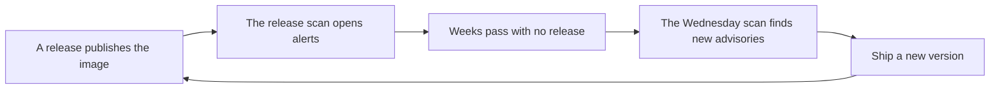
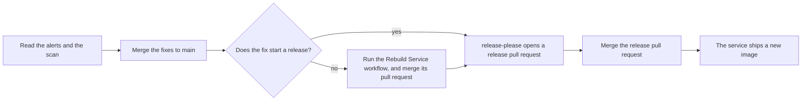

# Images and releases

This document explains how an image is built and released, and what to do when a published image has a finding. For the whole process, read [SECURITY-PROCESS.md](../../SECURITY-PROCESS.md).

No vulnerability scan and no version check covers how an image is built, or whether it is the image this repository shipped.

## How an image is built

Every service with a `deploy/Dockerfile` builds in stages. The early stages install the full toolchain and every dependency. The last stage starts from a fresh base image and copies in only the compiled output. A Python service has two stages. A Node.js service has five.

Four practices apply to every service:

- **The base image is pinned to one exact digest**, not to a tag such as `slim` or `latest`. A tag can point to a different image tomorrow. A digest cannot.
- **The build step removes the package manager from the final stage.** A Python image removes `pip`, and makes sure that Python can no longer import it. A Node.js image removes `npm` and `npx`. Code that reaches the running container then has no package manager to pull in more code.
- **The final stage runs `apt-get upgrade`** before it copies in application files. The pull request build and the release build run the final stage again on every build, with no build cache. Each build takes the newest operating system patches that exist at that time.
- **The container runs as a non-root user**, never as `root`.

## How a release works

A release starts when a `feat`, `fix`, or `build` commit changes a file in the service folder. release-please then opens a release pull request. The release starts when you merge that pull request.

The release does these steps:

1. It builds the image again, from the same Dockerfile. The build attaches a software bill of materials and a provenance record.
2. It pushes the image to two registries, GHCR and the Azure registry `uniquecr`. GHCR is the GitHub container registry.
3. It signs the image with Cosign, then makes sure that the signature is valid.
4. It pushes the matching Helm chart to those two registries and to the Azure registry `getunique`.
5. It runs the release image scan and the license scan against the image.

The build attaches two records to the image itself:

- **A software bill of materials, or SBOM.** It lists every package the image contains.
- **A provenance record.** It names the workflow, the commit, and the repository that produced the image.

The pipeline signs the image with [Cosign](https://github.com/sigstore/cosign). It uses a keyless GitHub Actions identity, not a stored key. The same job makes sure that the signature is valid, against that identity and against `main`.

A signature does not stop a deploy on its own. Anyone who deploys this image can run the same `cosign verify` command, with the same identity, to make sure that it came from this repository. A signature proves where an image came from. It does not prove that the image stays free of new findings.

The pull request build skips signing. A pull request never pushes an image, so there is nothing yet to sign.

The Manual Re-Run workflow of a service refuses a version that already has an image. An image never changes behind its tag.

## Which changes start a release

release-please reads a commit by the files it changes. A change starts a release only when it changes a file in the service folder.

| Change | Starts a release on its own |
|---|---|
| A `feat`, `fix`, or `build` commit that changes a file in the service folder | yes |
| A Dependabot update of a base image, which changes a Dockerfile | yes |
| A Python lockfile update, which changes `uv.lock` in the service folder | yes |
| The Rebuild Service workflow, which changes `rebuild-date` in the service folder | yes |
| A Node.js lockfile update, because `pnpm-lock.yaml` sits at the repository root | no |
| A new operating system patch, because no file changes | no |

## When a published image has a finding

An image does not change after we publish it. New vulnerabilities appear against it while nobody pushes a commit. The registry image scan finds them every Wednesday, at 06:00 UTC. It turns the run red and opens an alert in the Security tab. The release image scan uploads to the same alert category. Together they open and close the image alerts on `main`.

A second scan of the same image only adds findings. It never removes them. **To clear a finding in a published image, ship a new version.** A release builds the final stage again, so the new image takes new operating system patches and the locked dependencies on `main`. A fix in the tree does not change the image that we already published.

An alert of the `Trivy` tool is the only kind that needs a release. A Dependabot alert closes when the lockfile on `main` holds a fixed version. See [The operator routine](./operator-routine.md#how-to-clear-a-finding).

### What to do

Find the cause of the finding, then follow the matching row.

| Cause of the finding | What to do |
|---|---|
| A Python dependency | Raise the version in the service `uv.lock`. Merge the pull request. The merge starts a release. |
| A Node.js dependency | Raise the version in `pnpm-lock.yaml`, or add a pnpm override. The merge starts no release, so run the Rebuild Service workflow next. |
| An operating system package | Run the Rebuild Service workflow. The new build takes the patch. |
| The base image | Merge the Dependabot pull request for the base image. It changes a Dockerfile, so it starts a release. |
| A finding with no fix | Do nothing. The image scans skip it. |

### The Rebuild Service workflow

The Rebuild Service workflow, `[Release] Rebuild Service`, starts a release when no file in the service folder changes. It opens one pull request for each service that you name. Each pull request changes only the date file `services/<service>/deploy/rebuild-date`.

1. Run the Rebuild Service workflow. Enter the service names, or `all`.
2. Merge the pull request that the workflow opens for each service.
3. Merge the release pull request that release-please opens.

### The order of the work

Merge fixes first. Merge release pull requests last. A release builds the image from `main` at the moment you merge its release pull request.

