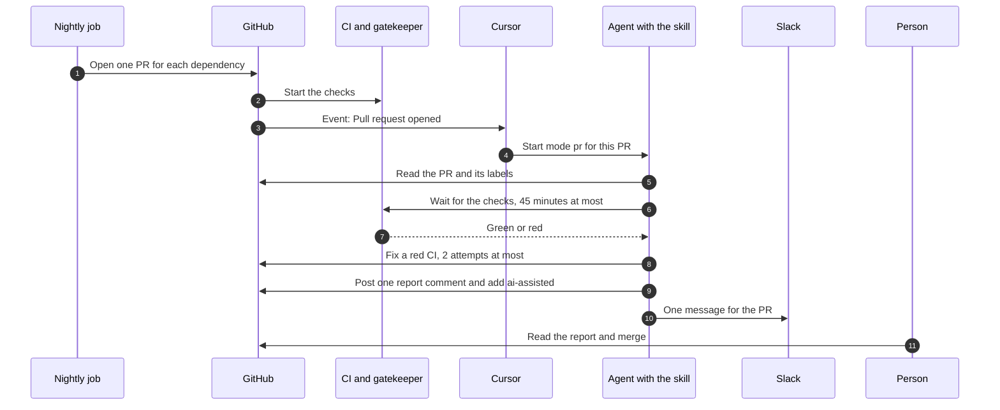
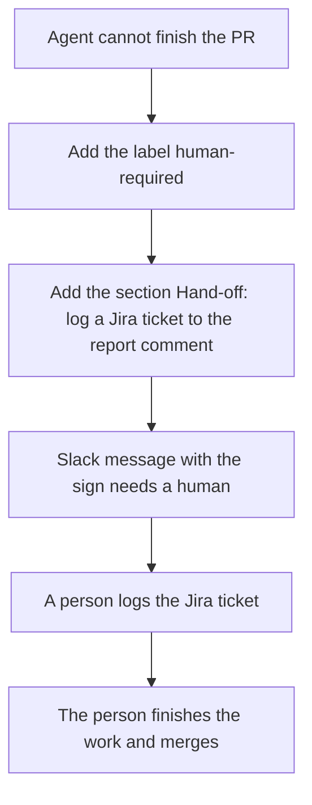
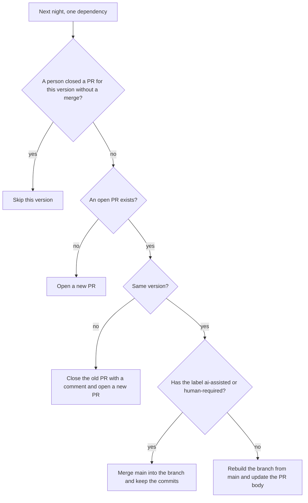
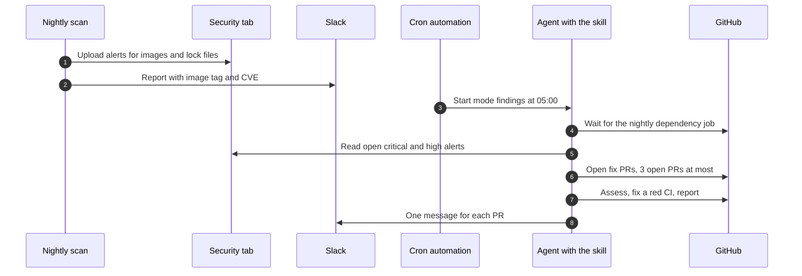
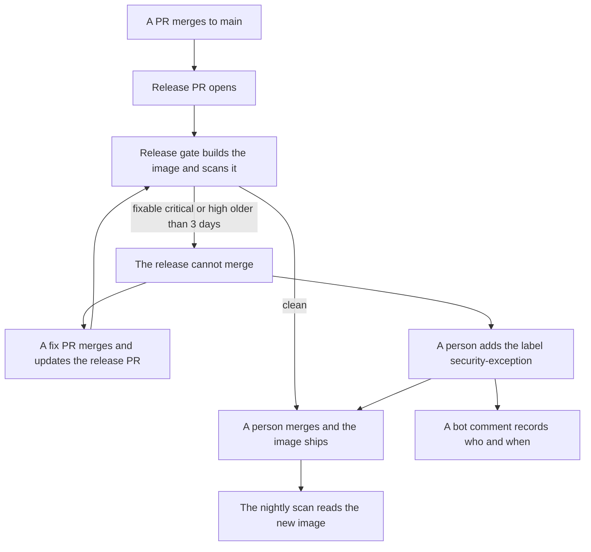

<!-- confluence-page-id: <NO CONFLUENCE ID REQUEST> -->
<!-- confluence-space-key: <NO CONFLUENCE ID REQUEST> -->

# How the parts work together

This page lists each interaction between the jobs, the agent, and the people. It shows who starts a step, what the step does, and what it changes. For the rules behind each step, read the three pages on [code](./code-vulnerabilities.md), [dependencies](./dependencies.md), and [images](./image-vulnerabilities.md). For the whole process, read [SECURITY-PROCESS.md](../../SECURITY-PROCESS.md).

## The parts

| Part | What it is | It starts when |
|---|---|---|
| Nightly dependency job | The workflow `deps-nightly.yaml` | 02:00 UTC |
| Nightly Trivy scan | The workflow `security-trivy-nightly.yaml` | 03:00 UTC |
| CI | The test, lint, and build workflows, the dependency review, and CodeQL | A PR opens or changes |
| Gatekeeper | The check that waits for all other checks | A PR opens or changes |
| Release gate | The workflow `security-release-gate.yaml` | A release PR opens or changes |
| PR automation | The Cursor automation `dependency-pr-assess` | A PR opens |
| Cron automation | The Cursor automation `nightly-vulna-patchy` | 05:00 UTC |
| The skill | `vulna-squash`: the instructions that both automations run | An automation starts |
| A person | An engineer with write access | A report, a Slack message, or a red check |

## 1. A nightly dependency PR

| Step | Who | What happens |
|---|---|---|
| 1 | Nightly job | It plans the updates. It opens one PR for each dependency or group. The PR has the labels `dependencies` and the ecosystem, for example `npm`. At most 5 new PRs open each night. |
| 2 | GitHub | It starts the checks. The gatekeeper stays red until every check passes. A red CI blocks the merge. |
| 3 | GitHub, Cursor | GitHub sends the event "Pull request opened". Cursor starts the PR automation. |
| 4 | Agent | It reads the PR. It stops with no change when the PR has no label `dependencies`. It also stops when the PR has `ai-assisted` or `human-required`. |
| 5 | Agent | It reads the release notes and our own usage of the dependency. It waits for the checks. |
| 6 | Agent | A red check that the bump caused gets a fix. The agent pushes the fix to the PR branch. The checks run again. After 2 attempts, the agent stops. |
| 7 | Agent | It posts one comment that starts with `<!-- vulna-squash-report -->`. It adds the label `ai-assisted`. A second run updates the same comment. |
| 8 | Agent | It posts one Slack message to the channel `C0C1PR9CNMP`. |
| 9 | Person | If the verdict is "safe to merge", the person reads the report and merges the PR. |

The agent never merges. It never approves a PR. It never edits a lock file by hand.

## 2. A PR that needs a person

The agent hands off when the verdict is "do not merge" or "safe with a gap". It also hands off when the CI is still red after 2 attempts, when a check times out, and when GitHub holds the runs.

The agent has no Jira access, so it creates no ticket. The section in the report comment lists the exact next steps. No one runs a second review by hand, because the report already holds the full result.

## 3. The next night

The nightly job runs again while a PR is open. It does this for each dependency, before it pushes anything.

| Case | Why |
|---|---|
| A new PR starts a new agent run. | The event "Pull request opened" fires for each new PR. |
| A rebuilt or updated PR starts no new run. | The event fires only when a PR opens. |
| A handled PR keeps its commits. | A rebuild from `main` deletes the fixes of the agent. |
| A closed version stays closed. | Closing a PR is the way to ignore one version. |

## 4. Trivy findings

| Step | What happens |
|---|---|
| 1 | The scan reads every published image, `pnpm-lock.yaml`, every `uv.lock`, and the Dockerfiles of `main`. It posts the report. It ends red when a fixable critical or high finding exists. |
| 2 | At 05:00 the cron automation starts the skill. The skill stops if the nightly dependency job still runs, or if the scan is 24 hours old or older. |
| 3 | The skill drops findings that need no PR. It drops a low severity, a finding with no fix, and a fix younger than 3 days. It also drops a fix that `main` already holds and a package that an open PR already changes. |
| 4 | It groups the rest into batches. All patch bumps go together. Up to 3 minor bumps go together. A major bump goes alone. Each service has its own rebuild. |
| 5 | It starts one subagent for each batch. At most 3 PRs with the label `vulna-squash` are open at one time. |
| 6 | Each subagent opens one PR, then does the assess, fix, report, and hand-off steps of section 1 and section 2. |

The PR automation also fires for these fix PRs. It stops at once, because they have the label `vulna-squash` and not `dependencies`.

## 5. A release

A person approves the workflow runs on the release PR. The gate reads the state at that moment. For the skip rules, read [Skip the release gate](./image-vulnerabilities.md#skip-the-release-gate).

## Labels

| Label | Set by | Read by | Meaning |
|---|---|---|---|
| `dependencies` | Nightly job | PR automation, gatekeeper title check | The PR comes from the nightly job. |
| `npm`, `uv`, `github-actions`, `docker` | Nightly job | A person | The ecosystem of the update. |
| `vulna-squash` | Agent | Skill | A fix PR from the patch run. The skill counts these PRs for the cap of 3. |
| `ai-assisted` | Agent | Agent, nightly job | The agent handled the PR. |
| `human-required` | Agent | Agent, nightly job, person | A person must finish the PR. |
| `security-exception` | Person | Release gate, dependency review | Skip the gate on this PR. |
| `title-exception` | Person | Gatekeeper title check | Skip the PR title check. |

## Where the state lives

| State | Where |
|---|---|
| The result of an agent run | The report comment on the PR, and the labels |
| What needs an image release | The Slack report and the Security tab |
| Which version a person rejected | A closed PR |
| Who skipped the release gate | The bot comment on the release PR |
| Which dependencies stay fixed | The pins: `override-dependencies` and `pnpm.overrides` |

## What can go wrong

| Problem | What you see | What to do |
|---|---|---|
| The PR from the GitHub App does not start the agent. | The PR has no report comment after the checks end. | Convert the PR to a draft, then mark it ready for review. |
| GitHub holds the workflow runs. | The report says that a maintainer must approve the runs. The PR has `human-required`. | Approve the runs. Then run the agent again. |
| The agent run crashes. | The PR has no label `ai-assisted`. | Run the agent again. |
| A handled PR has a conflict with `main`. | The nightly job warns in its summary. | Resolve the conflict, or close the PR to skip that version. |

To run the agent again, remove the labels `ai-assisted` and `human-required`. Then convert the PR to a draft and mark it ready for review.

## Files

| File | What it holds |
|---|---|
| `.github/workflows/deps-nightly.yaml` | The nightly dependency job |
| `.github/workflows/security-trivy-nightly.yaml` | The nightly scan and the Slack report |
| `.github/workflows/security-release-gate.yaml` | The release gate |
| `.github/workflows/ci-gatekeeper.yaml` | The gatekeeper |
| `.cursor/automations/workflows/nightly-vulna-patchy.yaml` | The cron automation |
| `agentic/skills/vulna-squash/SKILL.md` | The skill that both automations run |

The PR automation `dependency-pr-assess` lives in Cursor, not in a file. See [Setup that needs an admin](../../SECURITY-PROCESS.md#setup-that-needs-an-admin).
