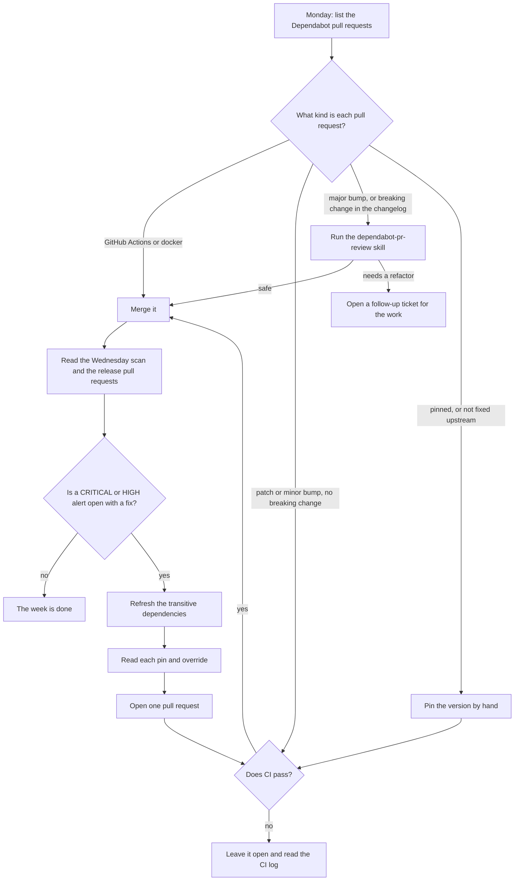

# The operator routine

This document explains how Dependabot works here, how to clear an alert, and what the operator does each week and every few weeks. An operator is a person with write access to this repository. For the whole process, read [SECURITY-PROCESS.md](../../SECURITY-PROCESS.md).

## Dependency management

Dependency management does not ask whether a version is safe. The dependency review asks that question, on the pull request Dependabot opens. See [Checks and pull requests](./checks-and-pull-requests.md).

### Dependabot raises versions

Dependabot watches five kinds of dependency, called ecosystems. It reads `.github/dependabot.yaml` for the list.

| Ecosystem | What it covers | Label |
|---|---|---|
| npm | the root `pnpm-lock.yaml`, and every `package.json` | `npm` |
| uv | Python dependencies, under `packages/mcp-credential-auth` and every service | `uv` |
| docker | the base image tag and digest in each Dockerfile | `docker` |
| github-actions | the actions this repository calls | `github-actions` |
| terraform | Terraform providers and modules, under each service | `terraform` |

Every pull request that Dependabot opens carries two labels: the ecosystem label above, and `dependencies`.

Dependabot does not watch Helm charts. Its Helm job fails on the OCI repository of the `base` chart. Update the version of that chart by hand.

### When Dependabot opens a pull request

Dependabot looks for a newer version in each ecosystem on a schedule, Friday at 06:00 Europe/Berlin. It can also open a pull request outside this time. A change to a manifest or a lock file on `main` can give it a new reason to run sooner.

Three settings shape what Dependabot does with what it finds:

- **A 3-day cooldown.** Dependabot waits 3 days after a version is out before it proposes that version. A version with a same-day problem does not reach you the same day.
- **A limit of 5 open pull requests, for each ecosystem.** Once 5 are open, Dependabot waits for one to close before it opens another.
- **One dependency for each pull request.** Dependabot does not combine unrelated packages into one change.

Dependabot does not rebase a pull request on its own. If `main` moves past it, do one of the following:

- Update the branch yourself.
- Comment `@dependabot recreate`. Dependabot builds the pull request again from `main`.

**Do not close a Dependabot pull request to get a new one.** A closed Dependabot pull request stays closed. Dependabot does not propose that version again.

### Dependabot alerts

Dependabot also reads the lockfiles already on `main`, all the time. When a new advisory appears for a version you already merged, an alert opens in the Security tab, under Dependabot. Raise the version to close it. No pull request check can stop this case, because no pull request touched that version.

### Transitive dependencies

A transitive dependency is a package that another package pulls in. It has no entry in a manifest, only in a lockfile.

| Question | Answer |
|---|---|
| Do we detect a vulnerable transitive dependency? | Yes. Dependabot alerts read the whole lockfile. The dependency review reads the lockfile change on a pull request. The image scans read every package in the image. |
| Does anything fix it for us? | No. A Dependabot version update works on a manifest entry. It does not change a transitive dependency. An operator fixes it by hand. |

A Dependabot alert shows `relationship: transitive` for these. The fix is a lockfile refresh. See [The manual refresh](#every-few-weeks-the-manual-refresh).

## How to clear a finding

| Finding | Fix | What clears it | Needs a release |
|---|---|---|---|
| A Dependabot alert on a direct dependency | Merge the Dependabot pull request. | Dependabot closes the alert when the lockfile on `main` holds a fixed version. | no |
| A Dependabot alert on a transitive dependency | Do [the manual refresh](#every-few-weeks-the-manual-refresh). | Merge the pull request. Dependabot closes the alert. | no |
| A `Trivy` code scanning alert | Use the table in [What to do](./images-and-releases.md#what-to-do). | Each service that reports the alert must ship a new version. | yes |
| A `CodeQL` alert | Fix the code, or dismiss the alert and give a reason. | The next scan of `main`. | no |

A `Trivy` alert can list more than one service. To see which services report alert `<n>`, run `gh api repos/Unique-AG/connectors/code-scanning/alerts/<n>/instances --jq '.[].category'`. Each category is `trivy-image/<service>`.

A release is still useful after a Dependabot fix. The published image keeps the old version until a new release replaces it, and the Trivy alerts for it stay open.

## The operator routine

Two routines exist. One runs every Monday. The other runs every few weeks, and always when a CRITICAL or HIGH alert has a fix.

### Every Monday

Dependabot opened its pull requests on Friday. The registry image scan ran on Wednesday.

1. List the open Dependabot pull requests: `gh pr list --label dependencies --state open`.
2. Sort each pull request with the table below.
3. Read the result of the Wednesday scan: `gh run list --workflow security-trivy-registry.yaml --limit 1`. If the result is `failure`, follow [When a published image has a finding](./images-and-releases.md#when-a-published-image-has-a-finding).
4. List the release pull requests: `gh pr list --label 'autorelease: pending' --state open`. Merge one only after every fix for its service is on `main`.

| The pull request is | What to do |
|---|---|
| A GitHub Actions update, or a docker update | Merge it. These updates are safe in almost all cases. |
| A patch or minor bump, and the changelog lists no breaking change | If CI passes, merge it. |
| A major bump, or a bump with a breaking change in the changelog | Run the `dependabot-pr-review` skill. Merge the pull request only if the skill says that it is safe. |
| The skill finds that the change needs a refactor | Do not merge. This change usually needs a rewrite of packages in this repository. Open a follow-up ticket for the work. |
| A dependency that is hard to update, or that upstream does not fix | Pin the version by hand. See [Pins and overrides](#pins-and-overrides). |

An open Dependabot pull request counts toward the limit of 5 for its ecosystem. A queue that nobody reads stops Dependabot from opening new pull requests.

To get a scan result that is newer than Wednesday, start the scan by hand: `gh workflow run security-trivy-registry.yaml -f services=all`.

#### The `dependabot-pr-review` skill

The skill reads one Dependabot pull request. It reads the release notes of every release in the range, and the CI result. It follows the dependency through the chain, down to our code. It then says if the change breaks our code. See [the skill](../../agentic/skills/dependabot-pr-review/SKILL.md).

The skill does not edit the repository, comment on the pull request, or merge. You do those.

Run `bash agentic/skill-management/setup.sh` once in each clone to install the skill. See [agentic/README.md](../../agentic/README.md).

### Every few weeks: the manual refresh

Do this every few weeks. Do it at once when a CRITICAL or HIGH alert has a fix. A Dependabot version update does not reach a transitive dependency. Its alert stays open until you refresh the lock files.

1. Read the alerts.
   - Dependabot alerts: `gh api 'repos/Unique-AG/connectors/dependabot/alerts?state=open' --jq '.[] | [.number, .security_advisory.severity, .dependency.package.name, .dependency.manifest_path, .dependency.relationship] | @tsv'`
   - Code scanning alerts: `gh api 'repos/Unique-AG/connectors/code-scanning/alerts?state=open' --jq '.[] | [.number, .rule.security_severity_level, .tool.name, .rule.id] | @tsv'`
2. Group the alerts by package. One package often causes many alerts, because each service lockfile reports it.
3. Refresh the npm lock file.
4. Refresh the Python lock file of each service that has an alert. For one package, run `uv lock --upgrade-package <package>` in the service folder.
5. Read each pin and override. See [Pins and overrides](#pins-and-overrides).
6. Open one pull request with all the changes. If CI passes, merge it.
7. Release the services that report `Trivy` alerts. See [The order of the work](./images-and-releases.md#the-order-of-the-work).

#### Pins and overrides

A pin or an override can become stale. Upstream can fix the problem, and then the entry is not necessary. The entry also holds the dependency at one version.

| Tool | Where the entries are |
|---|---|
| pnpm | `pnpm.overrides` in the root `package.json` |
| uv | `override-dependencies`, under `[tool.uv]`, in the `pyproject.toml` of each service |

For each entry, do these steps:

1. Remove the entry.
2. Resolve the lock file again.
3. If the lock file now resolves to a version outside the range of the advisory, keep the entry removed.
4. If the lock file still resolves to a vulnerable version, restore the entry.

If a parent package pins an exact version, a refresh does not change it. Only an override or a new upstream release fixes the alert.
