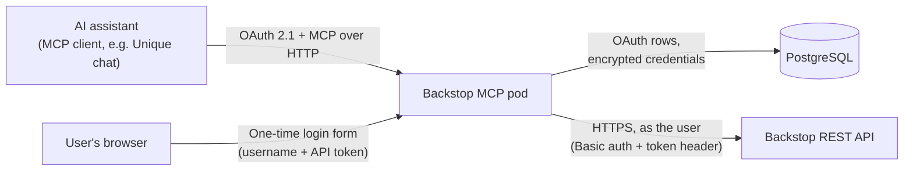

<!-- confluence-page-id: 2813722682 -->
<!-- confluence-space-key: PUBDOC -->

## Getting Started

| You want to | Read |
|---|---|
| Connect your AI assistant and log in | [Authentication: User Connection Flow](./operator/authentication.md#User-Connection-Flow) |
| Deploy the server, on Unique SaaS or self-managed, and configure it | [Operator Guide](./operator/README.md) |
| Understand how it works, what it can read and write, and every tool | [Technical Reference](./technical/README.md) |
| Find a quick answer | [FAQ](./faq.md) |
| Change the server's code | [Local Development](./operator/local-development.md), then the [developer documentation](#Developer-documentation) on GitHub |

## Overview

Backstop MCP is an MCP server that lets AI assistants read and write a firm's
[Backstop](https://www.backstopsolutions.com/) CRM through the Backstop REST API. It covers
organizations, people, activities (notes, meetings, calls, emails, documents, tasks), the
opportunity pipeline, funds and investor accounts, custom fields, and saved Report Center reports,
through 44 MCP tools. These pages say *AI assistant*, or just *assistant*, for the MCP client that
connects to the server, such as Unique chat.

Every tool call acts as the signed-in user. Each user connects once with their own Backstop
username and personal API token; the server never uses a shared service account, so a user sees
and changes exactly what Backstop allows them to.

Backstop has no OAuth of its own, so this server is the OAuth 2.1 authorization server for the
assistants that connect to it. It hosts a small login form, checks the submitted credential against
Backstop, stores it encrypted, and issues its own short-lived MCP tokens. See
[Authentication](./operator/authentication.md).

## Quick Summary

| Property | Detail |
|---|---|
| **What it does** | 44 tools: 27 read-only, 17 that create, change, or delete CRM records |
| **Who it acts as** | The connected user, with their own Backstop credential |
| **Deployment** | One Python (FastMCP) container on Kubernetes, installed with a Helm chart |
| **Durable state** | PostgreSQL only: OAuth clients and tokens, each user's encrypted Backstop credential, and recent login attempts |
| **Not needed** | No message queue, no Unique knowledge base, no Zitadel service account, no ingestion |
| **CRM data at rest** | None. Backstop data is fetched live per call. Reference catalogs are cached in memory, and report results are held in memory for up to an hour so a slow build can be collected |

## Requirements

### Backstop

| Requirement | Details |
|---|---|
| **Backstop tenant** | Reachable over HTTPS from the cluster, either on the tenant's own host or on the shared `api.backstopsolutions.com` |
| **Personal API token per user** | Created in Backstop under *Main Menu › System Tools › Administrative › Update Your Profile*, API Security section. The login form takes this token, never a password |
| **Each user's login must be a Backstop system user** | A *system user* is a staff login at your own firm, the kind of account your Backstop administrator manages under user administration. It is not a CRM contact or an employee record, and your firm's staff are the only people who have one. A login without a system user is refused at sign-in, because every activity the assistant logs has to be authored as that system user |

### Platform

| Requirement | Details |
|---|---|
| **Kubernetes + Helm** | The chart depends on Unique's `base` chart, which renders the Deployment, Service, Gateway API route, NetworkPolicy, and migration hook. The route and NetworkPolicy are off by default; the deployment's overlay turns them on |
| **A memory limit set by you** | The chart's default limit of 256 Mi, with a 128 Mi request, is too low for real use: reading a large custom-field catalog gets the pod OOM-killed. Set `resources` in your own values. Unique's deployments use a 512 Mi limit and a 256 Mi request. See [Memory](./operator/README.md#Memory) |
| **PostgreSQL** | One database. Schema migrations run as a Helm hook (`alembic upgrade head`) |
| **Public HTTPS URL** | The assistant and the user's browser must reach the server; the URL is the OAuth issuer (`mcpConfig.app.publicBaseUrl`) |

## What It Can Do

| Feature | Read | Write |
|---|---|---|
| [Contacts](./technical/features.md#Contacts) | Look up, search firm-wide, roster of an organization, employment history | Create, update, delete; add and end employment; edit addresses |
| [Activities and Tasks](./technical/features.md#Activities-and-Tasks) | Firm-wide or per-party search, full detail and attachments, last activity per party, tasks | Log notes, meetings, calls, tasks; attach documents and email files; update; delete |
| [Opportunities](./technical/features.md#Opportunities) | A party's deals with stage history, firm-wide search and counts, deals by id | Create, update (including stage moves), delete, backfill stage history |
| [Products and Accounts](./technical/features.md#Products-and-Accounts) | Products, a party's holdings, a product's investors, dated time series, subscriptions and redemptions | None |
| [Custom Fields](./technical/features.md#Custom-Fields) | Definitions, layout groups, values on records | Write values on people, organizations, and opportunities |
| [Saved Reports](./technical/features.md#Saved-Reports) | Run a saved Report Center report by name | None |
| [Backstop Links](./technical/features.md#Backstop-Links) | Build and parse links to the Backstop web app | None |

See [Features](./technical/features.md) for the questions each feature answers and how it behaves.

## How It Works

1. The user adds the server to their AI assistant. The assistant registers itself and starts an
   OAuth flow.
2. The browser opens the server's login form. The user enters their Backstop username and personal
   API token. The server checks them against Backstop and finds the user's system-user record.
3. The server stores the credential encrypted, and gives the assistant a 15-minute access token and
   a 30-day refresh token.
4. Each tool call loads that user's credential and calls Backstop as them.

See [Architecture](./technical/architecture.md) for components and request flow.

## Limitations

| Limitation | Details |
|---|---|
| **No shared service account** | Every user needs their own Backstop login and API token |
| **5 concurrent Backstop requests per user, per pod** | Backstop allows each user's token 5 requests at once, and every pod holds a gate of the same size. That gate counts one pod only, so two replicas can put 10 requests in flight for the same user. Backstop answers the excess with `429`, and the server retries those with backoff rather than preventing them. Read [Scaling](./operator/README.md#Scaling) before adding replicas |
| **Deletes are permanent** | Backstop has no recycle bin. The four delete tools show the record and ask the user to confirm, but only when the assistant can put a question to the user mid-task; otherwise they delete without asking |
| **Creates are not idempotent** | Repeating a create call makes a second record |
| **Read-only areas** | Funds, accounts, flows, reports, and catalogs (tags, categories, sources, users) cannot be written |
| **File size** | `attach_file` accepts files up to 3,096,576 bytes (about 2.95 MiB) |
| **Search ceiling** | Backstop's activity search stops at 10,000 rows. A larger result comes back marked as incomplete, so the assistant can tell the user the answer is partial and suggest a narrower question: a shorter date range, one party, or one activity type. The field carrying that mark is `coverage.ceiling_hit` |
| **Key employee is read-only** | Sending `is_key_employee` to a person or employment write fails the whole call with a validation error and writes nothing; the field is not quietly dropped, so the other fields in that call are not saved either. Set *Key employee* in the Backstop UI. The assistant can still read the current value |

## Related Documentation

- [FAQ](./faq.md)
- [Operator Guide](./operator/README.md)
  - [Authentication](./operator/authentication.md)
  - [Configuration](./operator/configuration.md)
  - [Disaster Recovery](./operator/disaster-recovery.md)
  - [Local Development](./operator/local-development.md)
- [Technical Reference](./technical/README.md)
  - [Architecture](./technical/architecture.md)
  - [Features](./technical/features.md)
  - [Tools](./technical/tools.md)

### Developer documentation

These pages live in the repository and are read on GitHub. They are for developers changing the
server, not for using or operating it.

| Document | What it covers |
|---|---|
| [Service README](https://github.com/Unique-AG/connectors/blob/main/services/backstop-mcp/README.md) | Code layout, the layering rule, and the steps for adding a feature or tool |
| [`AGENT_README.md`](https://github.com/Unique-AG/connectors/blob/main/services/backstop-mcp/AGENT_README.md) | The full guide to how features are structured, and the rules every feature follows |
| [Backstop Data Model](https://github.com/Unique-AG/connectors/blob/main/services/backstop-mcp/docs/technical/backstop-data-model/README.md) | How the Backstop REST API behaves, and Backstop's standard records, fields and errors |
| [`DEVELOP.md`](https://github.com/Unique-AG/connectors/blob/main/DEVELOP.md#python-services) | Repository-wide commands for Python services |

## Standard References

- [Model Context Protocol](https://modelcontextprotocol.io/)
- [OAuth 2.1](https://oauth.net/2.1/)
- [RFC 7636: PKCE](https://datatracker.ietf.org/doc/html/rfc7636)
- [RFC 7591: Dynamic Client Registration](https://datatracker.ietf.org/doc/html/rfc7591)
- [Backstop help centre: REST API](https://backstopsolutions.elevio.help/en/articles/1018)
