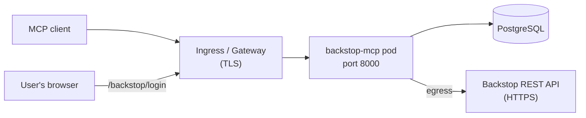

<!-- confluence-page-id: 2814214279 -->
<!-- confluence-space-key: PUBDOC -->

## Overview

This guide gets Backstop MCP running, either on **Unique SaaS** (Unique operates it) or
**self-managed** (you operate it in your own Kubernetes cluster).

The service is deliberately small. A deployment is one container, one PostgreSQL database, and one
public HTTPS hostname. There is no message queue, no ingestion pipeline, no Unique knowledge base,
and no service account in Backstop or Zitadel. The only Backstop-side setup is that each user has
their own personal API token.

For what the server does, see the [overview](../README.md).

## What a Deployment Looks Like



| Component | Why it is needed |
|---|---|
| **Pod** | Serves MCP on `/mcp`, the OAuth endpoints, and the login form. Container port `8000` (`PORT`), Service port `80` |
| **PostgreSQL** | Holds OAuth clients, hashed tokens, login attempts, and each user's encrypted Backstop credential. The pod is not ready without it (`/ready` returns `503`) |
| **Public hostname with TLS** | MCP clients and browsers reach the server here. It is also the OAuth issuer, set in `mcpConfig.app.publicBaseUrl` |
| **Egress to Backstop** | Every tool call is an HTTPS request to the Backstop API host, `mcpConfig.backstop.baseUrl` |

## Who Does What

| Task | Unique SaaS | Self-managed |
|---|---|---|
| Make sure each user has a Backstop personal API token and is a Backstop system user | Client | Client |
| Choose the Backstop API host and CRM UI host | Client provides, Unique configures | Client |
| Optional: employment relationship types, firm-specific tool guidance | Client provides, Unique configures | Client |
| Optional: a Backstop test login, so Unique can check the server before handing it over | Client provides | Not needed |
| Provision PostgreSQL | Unique | Client |
| Generate and store the encryption key | Unique | Client |
| Install the Helm chart, hostname, TLS, network policy | Unique | Client |
| Upgrades and database migrations | Unique | Client (a Helm hook runs migrations) |
| Add the server to the MCP client and log in | Each user | Each user |

## Unique SaaS

### What the client does

1. **Check your users.** Each person who will use the server needs:
   - a Backstop login that belongs to a Backstop **system user** (login is refused otherwise), and
   - a **personal API token**, created in Backstop under *Update Your Profile › API Security*. Your
     Backstop administrators control token expiry and can revoke tokens.

   The server acts with that user's Backstop permissions. Nothing needs to be granted to Unique.
2. **Send Unique Support or Solution Engineering:**
   - [ ] **Backstop API host**: your tenant host (`https://<firm>.backstopsolutions.com`) or the
     shared `https://api.backstopsolutions.com`. Sets [`mcpConfig.backstop.baseUrl`](./configuration.md#Chart-values).
   - [ ] **CRM UI host**: the address your users open Backstop on, so tools can return links to
     records. Sets [`mcpConfig.backstop.uiBaseUrl`](./configuration.md#Chart-values). Without it, links are
     only produced when the API host is already your tenant host.
   - [ ] *(Optional)* **Employment relationship types**: if your firm records departures with its own
     relationship types, their names or ids. See
     [Departed-contact detection](./configuration.md#Departed-Contact-Detection).
   - [ ] *(Optional)* **Firm-specific guidance**: short text about your Backstop setup (what a custom
     field means, how a fund is named) that is appended to the tool descriptions the AI reads. See
     [Tenant guidance](./configuration.md#Tenant-Guidance).
   - [ ] *(Optional)* **Test login**: a Backstop username and API token Unique can use to check the
     server end to end before sending you its URL. Use a system user with the least access you are
     comfortable with, share it over a secure channel, and revoke the token once Unique confirms the
     check is done. If your data policy does not allow this, let Unique know: Unique then checks the
     server together with you after deployment.
3. **Connect.** When Unique sends the server URL, each user adds it to their MCP client and logs in
   with their Backstop username and API token. See [Authentication](./authentication.md#User-Connection-Flow).

### What Unique does

1. Provisions a PostgreSQL database and wires it to the chart (`postgresql.connection`).
2. Generates a Fernet key and stores it as the `BACKSTOP_MCP_ENCRYPTION_KEY` secret.
3. Deploys the chart through Unique's deployment overlay, which sets the hostname, TLS, Gateway API
   route, and network policy, and sets `mcpConfig.app.publicBaseUrl` to that hostname.
4. Applies the client's Backstop settings and tenant guidance in `mcpConfig`.
   See [Configuration: Chart values](./configuration.md#Chart-values).
5. Verifies the deployment (see [Verify](#Verify)) and sends the client the MCP endpoint,
   `https://<host>/mcp`. Steps 1 to 3 of Verify need no Backstop login. Step 4 does:
   - **With a test login from the client**, Unique runs step 4 before sending the endpoint, then
     tells the client the check is done so they can revoke the test token.
   - **Without one**, Unique sends the endpoint after steps 1 to 3 and runs step 4 with the client:
     on a call, where a client user connects while Unique watches, or by email, where the client
     connects, calls `list_system_users`, and reports the result or the exact login error.

## Self-Managed

### 1. Prerequisites

- Kubernetes and Helm 3 or later.
- PostgreSQL 11 or later (tested on 17), with a database and a user that can create tables in it.
- A hostname with TLS that clients and browsers can reach. **Serve the server at the root of its own
  hostname.** Every route (`/mcp`, `/.well-known/...`, `/backstop/login`) is at `/`, and OAuth
  discovery expects the issuer at the root.
- Outbound HTTPS from the pod to your Backstop API host.

### 2. Generate the encryption key

`BACKSTOP_MCP_ENCRYPTION_KEY` is a Fernet key (URL-safe base64 of 32 bytes). It encrypts every
stored Backstop credential.

```bash
python3 -c "from cryptography.fernet import Fernet; print(Fernet.generate_key().decode())"
# or, without the Python cryptography package:
openssl rand -base64 32 | tr '+/' '-_'
```

Keep it safe. Changing it makes every stored credential unreadable, and users have to log in again.
See [Authentication: Encryption key](./authentication.md#Encryption-Key).

### 3. Create the Kubernetes secret

```bash
kubectl create namespace backstop-mcp
kubectl -n backstop-mcp create secret generic backstop-mcp-secrets \
  --from-literal=encryption-key='<fernet key>' \
  --from-literal=database-url='postgresql://<user>:<password>@<host>:5432/<database>?sslmode=verify-full'
```

The server reads TLS settings from the `sslmode` query parameter of the URL (`disable`, `allow`,
`prefer`, `require`, `verify-ca`, `verify-full`, `verify`), or from the chart's
`postgresql.connection.sslMode` when the URL has none. `verify-ca` and `verify-full` check the
certificate against the container's system CA bundle, or against the CA file in `DB_SSL_ROOT_CERT`
for a privately signed certificate. See [Database](./configuration.md#Database).

### 4. Write `values.yaml`

```yaml
mcpConfig:
  app:
    publicBaseUrl: https://backstop-mcp.example.com
  backstop:
    baseUrl: https://<firm>.backstopsolutions.com
    uiBaseUrl: https://<firm>.backstopsolutions.com

envVars:
  - name: BACKSTOP_MCP_ENCRYPTION_KEY
    valueFrom:
      secretKeyRef:
        name: backstop-mcp-secrets
        key: encryption-key

resources:
  limits:
    memory: 512Mi
  requests:
    memory: 256Mi

postgresql:
  enabled: true
  connection:
    url:
      fromSecret:
        name: backstop-mcp-secrets
        key: database-url
```

- `mcpConfig` holds the settings that differ per firm. The chart checks it against its schema, so a
  misspelt key fails the install instead of being ignored. Each value and the variable it sets is
  listed in [Configuration: Chart values](./configuration.md#Chart-values).
- Tuning settings (cache flags, timeouts, page sizes) go in `env`, which is merged with the chart
  defaults that already set `APP_ENV=production` and the cache flags. Every variable is listed in
  [Configuration](./configuration.md).
- The chart sets `PORT` from `ports.application` (`8000`) and overwrites any `env.PORT`. Change
  `ports.application` to move the port.
- `postgresql.connection.url` injects `DATABASE_URL` into both the server and the migration job.
- `resources` overrides the chart's 256 Mi memory limit, which is too low. See [Memory](#Memory).
- `APP_ENV=production` refuses to start if `mcpConfig.app.publicBaseUrl` is a loopback or `0.0.0.0`
  address.

### 5. Install

```bash
helm install backstop-mcp oci://ghcr.io/unique-ag/connectors/helm/backstop-mcp \
  --version <chart version> \
  --namespace backstop-mcp \
  -f values.yaml
```

Chart versions are the `backstop-mcp@<version>` tags on the
[releases page](https://github.com/Unique-AG/connectors/releases?q=backstop-mcp). The image is `ghcr.io/unique-ag/connectors/services/backstop-mcp`, tagged with the chart version.
Before the server starts, a pre-install and pre-upgrade hook job runs `alembic upgrade head` against
the same database.

### 6. Expose the service

The chart creates a `ClusterIP` Service named `backstop-mcp` on port `80`. Route your hostname to it
with your own ingress controller, load balancer, or mesh. The chart's built-in `routes` block targets
Unique's Kong gateway and plugins and is off by default.

- Forward the whole hostname without a path prefix, and terminate TLS in front of the pod.
- Allow request bodies of at least 4 MiB. The server enforces that limit itself, and `attach_file`
  needs most of it.
- Keep `/metrics` internal. It is served on the same port as `/mcp`.
- Allow tool calls to run for a minute or more. Reports can take up to about 50 seconds per call
  before returning `running`.

#### Network policy

The chart's `networkPolicy` block is off by default. With `enabled: true` it renders a
`CiliumNetworkPolicy` (`flavor: cilium`, the chart default, which needs the Cilium CRDs) with
default deny in both directions and the baseline rules below. The rest of this section assumes
Cilium.

For a standard Kubernetes `NetworkPolicy`, set `flavor: kubernetes` and `enableDefaultDeny: null`,
then write `policyTypes`, `ingress`, and `egress` yourself. That flavor adds no baseline rules and
does not support `toFQDNs`.

The pod needs:

| Direction | Peer | How the chart handles it |
|---|---|---|
| Ingress to port `8000` | Your ingress gateway | `internalServices.dependents.ingressGateway`. The chart default allows pods labelled `app.kubernetes.io/name: gateway` in namespace `system`; set `name` and `namespace` to match your gateway pods |
| Ingress to port `8000` | Prometheus | `networkPolicy.baseline.prometheus.namespace` (chart default `system`) and `matchLabels` |
| Egress | DNS | Allowed by `networkPolicy.baseline.dns`, on by default |
| Egress to port `5432` | PostgreSQL | With `postgresql.connection.url` the chart cannot derive the host from the secret, so it renders no PostgreSQL rule and neither the pod nor the migration hook can reach the database. Add the rule yourself and set `postgresql.networkPolicyEgressManaged: true` |
| Egress to port `443` | The Backstop API host (`mcpConfig.backstop.baseUrl`) | Add the rule yourself |

```yaml
networkPolicy:
  enabled: true
  baseline:
    prometheus:
      namespace: <prometheus namespace>
  egress:
    - toFQDNs:
        - matchName: <firm>.backstopsolutions.com
      toPorts:
        - ports:
            - port: "443"
              protocol: TCP
    - toFQDNs:
        - matchName: <postgres host>
      toPorts:
        - ports:
            - port: "5432"
              protocol: TCP

postgresql:
  networkPolicyEgressManaged: true

internalServices:
  dependents:
    ingressGateway:
      name: <gateway pods' app.kubernetes.io/name label>
      namespace: <gateway namespace>
```

### 7. Security checklist

- [ ] `BACKSTOP_MCP_ENCRYPTION_KEY` was generated with the command above and lives only in a Secret.
- [ ] `mcpConfig.app.publicBaseUrl` is the `https://` hostname clients use. The login form's CSRF
      cookie is marked `Secure` only when the URL is `https`.
- [ ] The database connection verifies the server certificate (`sslmode=verify-full`, or `verify-ca`
      when the hostname cannot match). A privately signed certificate needs its CA in
      `DB_SSL_ROOT_CERT`.
- [ ] `/metrics` is not reachable from outside the cluster.
- [ ] `LOGS_DIAGNOSTICS_DATA_POLICY` is `conceal` (the default), so tool-level events write Backstop
      logins as `sha256:<hex>`. The Backstop HTTP client's request and re-check events
      (`backstop.request.*`, `backstop.auth_recheck.*`) carry the plain username under either
      setting, so treat logs as containing Backstop logins. API tokens are never logged.
- [ ] Database backups follow your policy for credentials. The table `backstop_credentials` holds
      encrypted API tokens.

## Verify

1. `curl https://<host>/health` returns `200`.
2. `curl https://<host>/ready` returns `{"status": "healthy", "checks": {"database": true}}`.
3. `curl https://<host>/.well-known/oauth-authorization-server` shows `issuer` as your
   `mcpConfig.app.publicBaseUrl` with a trailing slash, and `authorization_endpoint`, `token_endpoint`,
   `registration_endpoint`, and `revocation_endpoint` on the same host.
4. Add `https://<host>/mcp` to an MCP client, complete the login form, and call `list_system_users`.
   It returns your firm's Backstop logins. On Unique SaaS without a client test login, this step is
   done together with the client (see [What Unique does](#What-Unique-does)).

If the login form says *"This Backstop login has no matching system user"*, the credential is valid
but the login is not a system user. If it says *"Backstop is unreachable"*, the pod cannot reach
the Backstop API host (`mcpConfig.backstop.baseUrl`). See the [FAQ](../faq.md#Connecting-and-Signing-In).

## Operating the Service

### Probes and monitoring

| Endpoint | Meaning | Used by the chart for |
|---|---|---|
| `/health` | The process is up | Liveness and startup probes |
| `/probe` | The process is up | Not used by the chart |
| `/ready` | PostgreSQL answers `SELECT 1` within 2 seconds | Readiness probe (timeout 3 seconds). A database outage takes the pod out of service without restarting it, and logs one WARNING when it starts and one INFO when it ends |
| `/metrics` | Prometheus metrics | Scraping, through a ServiceMonitor |

The ServiceMonitor and the alert rules are rendered only when the Prometheus Operator CRDs
(`monitoring.coreos.com/v1`) are installed. Without them, scrape `/metrics` on port `8000` yourself.

The alert rules are the base chart's generic Kubernetes and Argo CD application alerts (for example
`KubernetesPodOOMKilled`, `KubernetesPodNearMemoryLimit`, `KubeJobFailed`, and
`ArgoCDApplicationDegraded`) plus one for this service,
`BackstopFilterIgnored`, which fires when `backstop_filter_ignored_total` increases: Backstop
accepted a search filter but returned rows that do not match it. See
[Architecture: Observability](../technical/architecture.md#Observability).

### Upgrades

`helm upgrade` with a new chart version. The migration hook runs first; the new pods start after it
succeeds. No user has to reconnect for an upgrade unless the encryption key changes.

### Scaling

One replica is the default. Before adding replicas, know that some state lives in each pod's memory:

- **MCP sessions are per pod.** A session lives in the pod that handled the client's `initialize`.
  A request routed to another pod gets `404 Session not found` and the client has to start a new
  session, and a pending question asking the user to pick between matches is lost. Route with
  session affinity (on the `Mcp-Session-Id` header, or on client IP) before adding replicas.
- **Backstop's 5-concurrent-requests limit per user is enforced per pod.** Two pods can together send
  one user up to 10 concurrent requests. Backstop answers the excess with `429`; the server retries
  a `429` that Backstop marks as a concurrency limit, with backoff, up to `BACKSTOP_MAX_RETRY_ATTEMPTS`.
- **Catalog caches are per pod.** Each pod loads its own copy of the custom-field catalog.
- **A report still building belongs to the pod that started it.** If the follow-up `run_report` call
  lands on another pod, that pod starts the run again.

### Memory

The chart defaults to a 256 Mi limit and a 128 Mi request. That is too little for real use: on
Unique's deployments, reading a large custom-field catalog (several thousand definitions, for
example through `list_custom_fields`) pushed the pod past 256 Mi and it was OOM-killed. Unique's
deployments now run with:

```yaml
resources:
  limits:
    memory: 512Mi
  requests:
    memory: 256Mi
```

Use at least this. Each replica holds its own catalog caches, so every pod needs the full amount.

## Related

| Document | Description |
|---|---|
| [Overview](../README.md) | What the server does |
| [Authentication](./authentication.md) | How users connect, token lifetimes, reconnecting, the encryption key |
| [Configuration](./configuration.md) | Every environment variable, with app and chart defaults |
| [Disaster Recovery](./disaster-recovery.md) | What happens when the pod, the database, the key, or Backstop fails, what to back up, and how to rotate the encryption key |
| [Local Development](./local-development.md) | Running the server on your machine |
| [Architecture](../technical/architecture.md) | How the server is built: HTTP surface, request lifecycle, caching, observability |
| [FAQ](../faq.md) | Common questions and problems |
