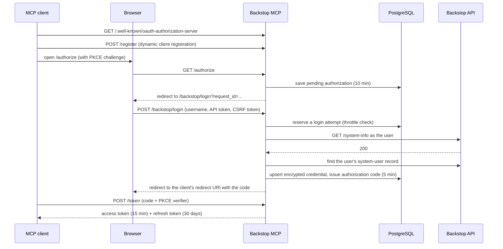

<!-- confluence-page-id: tobefilled -->
<!-- confluence-space-key: PUBDOC -->

## Overview

Two separate credentials are involved, and it helps to keep them apart:

| Credential | Between | Issued by | Stored as |
|---|---|---|---|
| **MCP tokens** (access + refresh) | MCP client and this server | This server, through OAuth 2.1 with PKCE | SHA-256 hashes in PostgreSQL |
| **Backstop credential** (username + personal API token) | This server and Backstop | The user, in Backstop | Fernet-encrypted in PostgreSQL |

Backstop has no OAuth, so the server cannot send the user to Backstop to sign in. Instead it is
its own OAuth authorization server: the browser step of the OAuth flow is a login form hosted by
the server, where the user types their Backstop username and API token. The client never sees the
Backstop credential, and Backstop never sees the MCP tokens.

There is nothing to register in Backstop or in an identity provider. The only operator tasks are
the encryption key (see [Encryption key](#Encryption-Key)) and a `PUBLIC_BASE_URL` that clients and
browsers can reach (see [Configuration: Required](./configuration.md#Required)).

Code: [`features/auth/provider.py`](https://github.com/Unique-AG/connectors/blob/main/services/backstop-mcp/src/backstop_mcp/features/auth/provider.py)
(login form) and the shared
[`mcp-credential-auth`](https://github.com/Unique-AG/connectors/blob/main/packages/mcp-credential-auth/src/mcp_credential_auth/provider.py)
package (OAuth endpoints, token storage, throttling, cleanup).

## What a User Needs

- A Backstop login that belongs to a Backstop **system user**.
- A **personal API token** for that login. The login form tells users where to create one: *Main
  Menu › System Tools › Administrative › Update Your Profile* (API Security section), and links to
  [Backstop's help article](https://backstopsolutions.elevio.help/en/articles/236).

Backstop passwords are not accepted. The server sends every request with the header `token: true`,
so only a personal API token works, whether or not the user signs in to Backstop through single
sign-on.

## User Connection Flow



### What the login form checks, in order

1. **The login link is still valid.** A pending authorization lives 10 minutes. After that the page
   says *"This login link is invalid or has expired. Please reconnect from your MCP client."*
2. **CSRF.** The form uses a double-submit token (hidden field plus a cookie scoped to
   `/backstop/login`). A mismatch re-renders the form with a fresh token rather than failing, so a
   user whose form sat open too long can simply submit again.
3. **Both fields are filled**, and the username is at most 320 characters.
4. **Throttle.** At most 10 failed attempts per username in 15 minutes. See
   [Login throttling](#Login-Throttling).
5. **The credential works.** The server calls `GET /system-info` on Backstop as the user.
   - `401` or `403`: *"Invalid username or API token."* Counts as a failed attempt.
   - Any other error status, or no connection: *"Backstop is unreachable right now"*. Does not
     count as a failed attempt.
6. **The login is a system user.** If not: *"This Backstop login has no matching system user, so it
   cannot be used to author activities."* The system-user record is stored with the credential, so
   write tools can set the author without looking it up again.

On success the credential is saved, keyed by Backstop username. A user who logs in again keeps the
same internal user id while their `backstop_credentials` row exists; their stored token is replaced
with the new one.

The login page is sent with `Referrer-Policy: no-referrer`, `Cache-Control: no-store`,
`X-Content-Type-Options: nosniff`, and `X-Frame-Options: DENY`.

## Token Lifetimes

| Item | Lifetime | Notes |
|---|---|---|
| Pending authorization (login link) | 10 minutes | Starts when the client opens `/authorize` |
| Authorization code | 5 minutes | Single use |
| Access token | 15 minutes | Sent as `Authorization: Bearer` on every `/mcp` request |
| Refresh token | 30 days | Rotated on every use: the old one is revoked, a new 30-day one is issued |

These lifetimes are fixed in code (`CredentialOAuthProvider`); there is no environment variable
for them.

Because refresh tokens rotate, a client that refreshes at least once every 30 days stays connected
indefinitely. Presenting a refresh token that was already used revokes every token in that grant
(the "family"), which protects against a stolen refresh token. There is no grace period.

The Backstop API token itself has whatever expiry your Backstop administrator set. The server does
not know it in advance; it finds out when Backstop rejects a call.

## How a Tool Call Authenticates

1. FastMCP validates the bearer token by looking up its SHA-256 hash. The row gives the internal
   user id (the token's `subject`).
2. When the tool first calls Backstop, the server reads and decrypts that user's credential.
3. Each Backstop request is sent with HTTP Basic authentication (`username:api_token`) and the header
   `token: true`, which tells Backstop the secret is a personal API token.
4. Requests pass through a per-user gate of 5 concurrent requests (`BACKSTOP_MAX_CONCURRENT_REQUESTS_PER_USER`),
   Backstop's own limit per user token.

## Reconnecting

Users reconnect by logging in again through their MCP client. The table lists every situation that
needs it, and what the user sees.

| Situation | What happens | What the user does |
|---|---|---|
| No valid MCP token | `/mcp` answers `401` before any tool runs, and the client starts the OAuth flow | Log in |
| Refresh token unused for 30 days | The client's refresh fails; it starts a new OAuth flow | Log in again |
| Backstop API token expired, revoked, or replaced in Backstop | See [When Backstop rejects the credential](#When-Backstop-rejects-the-credential). The server revokes the user's MCP tokens and answers that same call with HTTP `401` | Log in again with a valid token |
| A refresh token was reused | Every token in that grant is revoked | Log in again |
| The encryption key was changed | Stored credentials cannot be decrypted, so tool calls fail with an error that includes *"Credential blob failed authentication — wrong key, tampered, or malformed data"*. MCP tokens are **not** revoked automatically | Log in again if the operator followed the [rotation procedure](./disaster-recovery.md#Rotating-the-Encryption-Key); otherwise remove and re-add the server in the MCP client, then log in |
| The user's `backstop_credentials` row was deleted while their MCP tokens stayed valid (for example, the rotation SQL run without the `UPDATE`) | Tool error: *"No Backstop credential on file for this connection — please reconnect."* | Remove and re-add the server in the MCP client, then log in |

### When Backstop rejects the credential

Backstop's `/system-info` can return a spurious `401`, so a single `401` does not disconnect anyone.
When a tool call gets `401` from Backstop:

1. The server waits 1 second, then calls `GET /system-info` again as the user, doubling the wait
   between attempts. All attempts share a 10-second budget.
2. If any probe succeeds, or fails for a reason other than `401`/`403` (a timeout, a `5xx`), the
   session is kept and the tool returns *"Backstop temporarily rejected the request. Please retry."*
3. If every probe returns `401` or `403`, the server revokes all of that user's MCP tokens and
   rewrites the response to HTTP `401` with
   `WWW-Authenticate: Bearer error="invalid_token", error_description="credential_revoked"`.
   The client reconnects on that call instead of discovering the problem on the next one.

The stored credential row is kept. The next successful login overwrites it.

## Login Throttling

Anyone who can start an OAuth flow can submit the login form, and the form forwards the credential to
Backstop. Without a limit it would be a way to test guessed tokens against Backstop.

| Setting | Default | Variable |
|---|---|---|
| Failed attempts allowed per username | 10 | `AUTH_LOGIN_MAX_ATTEMPTS` |
| Window | 15 minutes | `AUTH_LOGIN_ATTEMPT_WINDOW_MINUTES` |

- Attempts are counted **per Backstop username**, not per IP address. Behind an ingress every caller
  shares one address, and `X-Forwarded-For` can be forged.
- When the limit is reached the form answers `429` with *"Too many failed attempts for this
  username. Please wait a few minutes and try again."*
- A credential that Backstop accepts clears the username's failed attempts, even if the login is
  then refused because it is not a system user.
- A *"Backstop is unreachable"* outcome is not counted.
- The source IP of each attempt is recorded for diagnosis only. Attempts older than twice the window
  are deleted by the cleanup sweep.

## Data Stored

| Table | Contents |
|---|---|
| `backstop_credentials` | Internal user id, Backstop username (plain), encrypted blob (username + API token), the user's Backstop system-user id and record as captured at login, timestamps |
| `mcp_auth_oauth_clients` | Dynamically registered OAuth clients |
| `mcp_auth_pending_authorizations` | OAuth requests waiting for the login form |
| `mcp_auth_authorization_codes` | Unredeemed authorization codes |
| `mcp_auth_oauth_tokens` | SHA-256 hashes of access and refresh tokens, expiry, revocation, rotation chain |
| `mcp_auth_login_attempts` | Username, source IP, and time of recent login attempts |

No Backstop CRM data is written to the database.

### Cleanup sweep

A background task runs once at startup and then every 6 hours (`AUTH_CLEANUP_INTERVAL_HOURS`), and
deletes:

- expired pending authorizations and authorization codes,
- token families in which every access and refresh token expired more than 30 days ago
  (`AUTH_TOKEN_RETENTION_DAYS`),
- login attempts older than twice the throttle window,
- registered clients older than 24 hours (`AUTH_UNUSED_CLIENT_RETENTION_HOURS`) that nothing
  references. A client in use always has a live token and is never deleted.

Expired rows are rejected the moment they expire. The sweep only controls how long they linger.

## Encryption Key

`BACKSTOP_MCP_ENCRYPTION_KEY` is a Fernet key: URL-safe base64 of 32 bytes. Fernet is AES-128-CBC
with an HMAC-SHA256 signature, so a blob that was tampered with or encrypted under another key is
rejected rather than decrypted wrongly.

```bash
python3 -c "from cryptography.fernet import Fernet; print(Fernet.generate_key().decode())"
# or, without the Python cryptography package:
openssl rand -base64 32 | tr '+/' '-_'
```

- The server refuses to start if the variable is missing or is not a valid Fernet key.
- Only one key is accepted. There is no rotation with an old and a new key side by side.
- **Changing the key disconnects every user.** Existing blobs can no longer be decrypted and tool
  calls fail. The MCP tokens stay valid unless you revoke them, so clients do not prompt a new login
  on their own. [Disaster Recovery: Rotating the encryption key](./disaster-recovery.md#Rotating-the-Encryption-Key)
  revokes them in the same step, so each client asks its user to log in again. A login after the
  change re-encrypts the credential under the new key. Plan a key change as a maintenance event and
  tell users in advance.

## Cutting Off a User

- **Revoke their API token in Backstop.** Their next tool call fails the re-check, and the server
  revokes their MCP tokens. This is the only step needed.
- To end their MCP session at once, without waiting for a tool call, revoke their MCP tokens in the
  database. Their client's next request gets `401` and its refresh is refused:

  ```sql
  UPDATE mcp_auth_oauth_tokens SET revoked_at = now()
  WHERE revoked_at IS NULL
    AND subject = (SELECT user_id FROM backstop_credentials WHERE backstop_username = '<login>');
  ```

  On its own this does not stop them: the login form accepts their API token again until it is
  revoked in Backstop.
- An MCP client can revoke its own tokens through the `/revoke` endpoint.

## Related

- [Operator Guide](./README.md)
- [Overview](../README.md)
- [Configuration: Authentication and Encryption](./configuration.md#Authentication-and-Encryption)
- [Disaster Recovery: Rotating the encryption key](./disaster-recovery.md#Rotating-the-Encryption-Key)
- [Architecture](../technical/architecture.md)
- [FAQ: Connection and login](../faq.md#Connection-and-Login)
