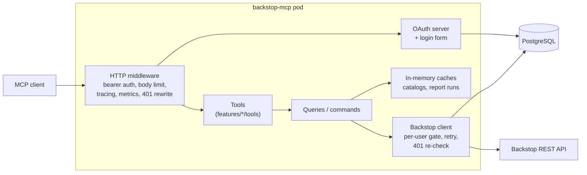
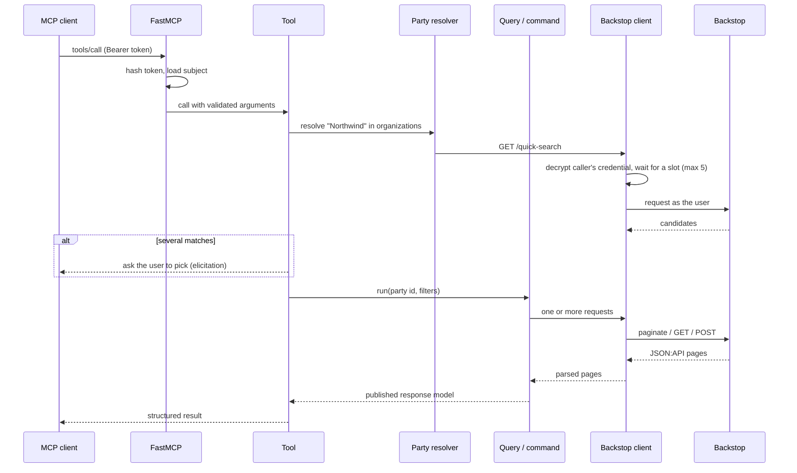

<!-- confluence-page-id: tobefilled -->
<!-- confluence-space-key: PUBDOC -->

## Overview

Backstop MCP is a single Python process: a [FastMCP](https://gofastmcp.com/) server on Starlette and
uvicorn, serving streamable HTTP on `/mcp`. It stores no CRM data beyond in-memory caches and the
caller's own system-user record. Each tool call reads or writes Backstop live, as the calling user,
through one shared HTTP client.



## Code Layout

```
src/backstop_mcp/
  app.py               builds the app: logging, metrics, FastMCP, tools, routes, lifespan
  main.py              entry point (`backstop-mcp`), loads .env, runs uvicorn
  config.py            one settings class per concern
  dependencies.py      cached providers: configs, engine, Backstop client factory, OAuth provider
  logging.py           JSON logging setup
  metrics.py           OpenTelemetry instruments exported on /metrics
  teardown.py          on shutdown, closes the HTTP pool and database engine, clears cached providers
  server/              how features are exposed over MCP
    instructions.py      server instructions sent to every client
    tools/registry.py    the registered tools (listed in Tools)
    tenant_guidance.py   appends per-deployment text to descriptions
    session_revoked.py   turns a revoked session into HTTP 401
  features/            what the server does, one package per domain
  backstop_client/     HTTP transport to Backstop
  caching/             TTL cache with single-flight fetch
  db/                  SQLAlchemy engine, models, Alembic migrations
  utils/               shared helpers, including log concealment of logins
```

The tree shows the main parts only; a few small top-level modules (`dates.py`, `models.py`, …) are
left out.

Settings are described in [Configuration](../operator/configuration.md); every tool is listed in
[Tools](./tools.md).

`features/` never imports `server/`, and `backstop_client/` never imports `features/` or `config`.
`tests/test_layering.py` enforces these rules, and that every tool file is registered. Features share
one shape (`queries/`, `commands/`, `responses`, `tools/`), each part present only when needed; see
[`AGENT_README.md`](https://github.com/Unique-AG/connectors/blob/main/services/backstop-mcp/AGENT_README.md).

| Feature package | Domain |
|---|---|
| `auth` | Login form, credential storage, encryption, cleanup |
| `party_resolver`, `resolution.py` | Turning a name, email, or id into one Backstop party; the ambiguity policy |
| `org_people`, `org_people_writes` | Organizations, people, employment, addresses |
| `data_hygiene` | Current vs former employment; `as_of` provenance |
| `activity_history`, `activity_writes`, `activity_tags`, `tasks` | Activities and tasks |
| `opportunities`, `opportunity_writes` | Opportunities (the pipeline) |
| `accounts` | Products, holdings, investors, time series, capital flows |
| `custom_fields` | Custom-field catalog, groups, value writes |
| `contact_categories`, `contact_sources`, `system_users`, `time_zones` | Reference vocabularies |
| `reports` | Saved Report Center reports |
| `ui_links` | Building and parsing Backstop UI URLs (no HTTP) |
| `collection_scan`, `bulk_writes`, `includes`, `elicitation_utils` | Shared mechanics: paging, bulk write outcomes, side-loads, delete confirmation |

## HTTP Surface

| Path | Methods | Purpose |
|---|---|---|
| `/mcp` | GET, POST, DELETE | MCP streamable HTTP endpoint. Requires a bearer token |
| `/.well-known/oauth-authorization-server` | GET | OAuth authorization server metadata |
| `/.well-known/oauth-protected-resource/mcp` | GET | Protected resource metadata for `/mcp` |
| `/register` | POST | Dynamic client registration (RFC 7591), open to any client |
| `/authorize` | GET, POST | Starts the OAuth flow; redirects to the login form |
| `/token` | POST | Exchanges codes and refresh tokens. PKCE `S256` |
| `/revoke` | POST | Token revocation |
| `/backstop/login` | GET, POST | The hosted Backstop credential form |
| `/health`, `/probe` | GET | Process is up |
| `/ready` | GET | PostgreSQL is reachable (`503` otherwise) |
| `/metrics` | GET | Prometheus metrics |

FastMCP places its own request-context and bearer-token middlewares outermost: every request carrying
a bearer token is hashed and looked up there, before any of the app's own middleware runs. The app
then adds four, outermost first:

1. **Request body limit**, 4 MiB, the same cap as the MCP SDK's streamable HTTP transport. It also
   bounds the unauthenticated login POST.
2. **OpenTelemetry ASGI** instrumentation.
3. **HTTP request metrics** from `unique_mcp.monitoring.setup_ops`.
4. **Session-revoked rewrite.** When a tool call confirms the user's Backstop credential is dead,
   this turns the in-flight `200` into `401` so the client reconnects at once. See
   [Authentication: When Backstop rejects the credential](../operator/authentication.md#When-Backstop-rejects-the-credential).

## Request Lifecycle



### Party resolution

Most party-scoped tools accept either `search` (a name or email) or a trusted `party_id` with its
`search_type` (`organizations`, `people`, `contacts`, or `employees`). The four collections have
separate id spaces.

| Input | Lookup |
|---|---|
| `party_id` | Trusted as given. Not looked up, except for an optional name fetch some tools use to echo the name back |
| An email | Exact match on each email field of that collection, separately, merged by id |
| A name | `GET /quick-search` limited to the collection. Quick search is prefix-based, so when it finds nothing, organizations fall back to `filter[name][like]` and people and employees to `filter[lastName][like]` (one page of up to 200). Contacts have no fallback |

The outcome follows one policy, in [`features/resolution.py`](https://github.com/Unique-AG/connectors/blob/main/services/backstop-mcp/src/backstop_mcp/features/resolution.py):

1. One match: resolved. The tool echoes the resolved id, type, and name so a wrong match is visible.
2. Several matches on a single-party call: the user is asked to pick, through MCP elicitation.
3. Several matches inside a batch: everything that resolved plus every unresolved item, in one
   payload, so the model asks once.
4. The client cannot elicit, the user declines or cancels, or nobody answers within
   `RESOLUTION_ELICIT_TIMEOUT_SECONDS`: the same structured candidate list as step 3.
5. No match: `not_found`, naming the query that was used.

The server supports both elicitation styles in the MCP specification: a mid-call `elicitation/create`
request (sent on the standalone GET stream for streamable HTTP), and, for clients on protocol
version 2026-07-28, an `InputRequiredResult` the client answers by calling the tool again.

Products resolve differently, through
[`accounts/resolve_product.py`](https://github.com/Unique-AG/connectors/blob/main/services/backstop-mcp/src/backstop_mcp/features/accounts/resolve_product.py):
quick search misses product short names, so a product name is matched in memory over the whole
product catalog, with an exact short name winning over a longer name that contains it.

## Backstop Client

[`backstop_client/`](https://github.com/Unique-AG/connectors/tree/main/services/backstop-mcp/src/backstop_mcp/backstop_client)
is the only code that talks HTTP to Backstop.

| Concern | Behaviour |
|---|---|
| **Connection pool** | One `httpx` client per process, up to 100 connections, 20 kept alive |
| **Headers** | `Accept` and `Content-Type: application/vnd.api+json`, and `token: true`. Backstop returns an HTML 404 page for `Accept: application/json` |
| **Authentication** | HTTP Basic with the caller's username and API token, resolved once per client call (`get`, `post`, `paginate`, …), so a 20-page `paginate()` walk decrypts once |
| **Per-user gate** | At most `BACKSTOP_MAX_CONCURRENT_REQUESTS_PER_USER` (5) requests in flight per username, per process. The slot is held for one HTTP request, not a whole tool call, and released while a retry backs off |
| **Timeouts** | `BACKSTOP_DEFAULT_TIMEOUT_SECONDS` (120), or `BACKSTOP_REPORTS_TIMEOUT_SECONDS` (600) for paths containing `/reports` or `/analytics` |
| **429** | Classified from the body as concurrency, minute, hour, or day. Only concurrency `429`s are retried. The wait is `Retry-After` (at least 1 s) or exponential backoff of 1 s, 2 s, 4 s… plus up to 1 s of jitter. A request gets at most `BACKSTOP_MAX_RETRY_ATTEMPTS` (5) attempts in total, and a retry happens only when the wait before jitter is at most `BACKSTOP_MAX_RETRY_WAIT_MS` (30 s) |
| **Nothing else retries** | 5xx responses, timeouts, network errors, and `429`s whose limit cannot be classified fail the call at once |
| **401** | Re-checked by probing `/system-info` with backoff (1 s, 2 s, 4 s…) within 10 seconds. The session is revoked, and the call answered with HTTP `401`, only if every probe returns `401` or `403`. Otherwise the call fails with a retryable tool error and the session is kept |
| **Pagination** | JSON:API `page[limit]` / `page[offset]`. Page size is `BACKSTOP_DEFAULT_PAGE_SIZE` (100), or `BACKSTOP_REPORT_PAGE_SIZE` (500, the maximum) for `/reports` and `/analytics`. Follows `links.next`, or fetches pages in parallel by offset where the total count is reliable. Offsets stay multiples of the page size, which Backstop requires. A walk stops at 10,000 records by default and marks the result truncated |
| **Errors** | Backstop's JSON:API `errors[]` are logged and surfaced to the model as tool errors |

## Paged Searches

`search_organizations`, `search_people`, `search_opportunities` (rows mode), and `search_activities`
(rows mode) return about `SEARCH_RESULT_SIZE` rows per call, plus a `continuation` with an opaque
`cursor` when more may match. The first three return at most that many. `search_activities` reads
whole pages until it has at least that many, so it can return up to about twice as many.

- Many filters are applied in memory after the read, because Backstop rejects them as query filters.
  A search therefore reads Backstop pages until it has a full page of matches or reaches the end.
- The cursor stores the position of the next unread record and a fingerprint of every other
  argument. Reusing it with different arguments is rejected rather than returning rows from a
  different query.
- Organizations, people, and opportunities are read in id order (`sort=id`). Backstop orders records
  that tie on a sort field differently between requests, and `/people` returns `500` for
  `sort=name`, so offset paging by name would repeat or skip rows.
- Aggregate modes (`mode="aggregate"`) read every match in one call and return counts, without a
  cursor.

## Caching

All caches are in process memory: each pod keeps its own, and they are lost on restart. Catalogs are
shared by every user of the pod; report runs are per caller.

| Cache | Contents | Lifetime |
|---|---|---|
| Custom-field definitions and groups | Tenant schema, shared by all users | 120 minutes, on by default |
| Activity tags, contact sources, contact categories, system users, time zones | Small vocabularies | 24 hours when enabled, off by default |
| Opportunity stages, entity-relationship types | Small vocabularies | 60 minutes, always on |
| Report runs | One running or finished `run_report` page, keyed by caller, report, date, limit, and offset | 1 hour, at most 1,000 runs |

Catalog caches use one shared fetch for concurrent callers. With the cache flag off, that sharing
still happens, but nothing is kept afterwards. The catalog caches hold instance-wide schema rather than
per-user data: custom-field definitions carry no permission attribute in Backstop.

If a refresh fails, a catalog whose cache is enabled keeps serving the previous value (the
response's `cache` field says `stale`). With the cache off, the default for the small vocabularies,
the failure reaches the caller. Opportunity stages and entity-relationship types never serve stale.

## Persistence

PostgreSQL holds only authentication state:

- `backstop_credentials`: one row per Backstop username, with the Fernet-encrypted credential and the
  system-user record captured at login.
- `mcp_auth_*`: OAuth clients, pending authorizations, authorization codes, hashed tokens, login
  attempts. These tables come from the shared
  [`mcp-credential-auth`](https://github.com/Unique-AG/connectors/tree/main/packages/mcp-credential-auth)
  package.

Every request with a bearer token reads the token table, which is why `/ready` depends on the
database. Schema changes are Alembic migrations in
[`db/migrations/versions/`](https://github.com/Unique-AG/connectors/tree/main/services/backstop-mcp/src/backstop_mcp/db/migrations/versions).
See [Authentication: Data stored](../operator/authentication.md#Data-Stored).

## Observability

### Logs

Structured JSON on stderr, through `unique_mcp.logging` (the chart labels pods so Loki parses it).
Events use dotted names with fields in `extra`, for example `auth.login.succeeded`,
`backstop.request.failed`, `backstop.auth_recheck.decision`, `resolution.elicit.timed_out`,
`tenant_guidance.applied`. Tool-level events conceal Backstop logins as `sha256:<hex>` unless
`LOGS_DIAGNOSTICS_DATA_POLICY=disclose`. Backstop client events (`backstop.request.*`,
`backstop.auth_recheck.*`) currently carry the username in clear. API tokens are never logged.

Each tool call also logs one completion line with its name, status, and duration.

### Metrics

Served on `/metrics` in Prometheus format. `setup_ops` contributes the HTTP request metrics and the
`mcp_*` tool metrics; the rest are defined in `metrics.py`.

| Metric | Type | What it tells you |
|---|---|---|
| `backstop_requests_total` | Counter (`method`, `route`, `status`) | Upstream Backstop calls and their status codes |
| `backstop_request_duration_seconds` | Histogram (`method`, `route`) | Latency of one Backstop request |
| `backstop_concurrency_wait_seconds` | Histogram (`route`) | Time waiting for a per-user slot. Rising values mean users hit the 5-request limit |
| `backstop_rate_limited_total` | Counter (`limit_kind`, `retried`) | `429`s. `retried=false` with `limit_kind=day` is a quota problem |
| `mcp_calls_total` | Counter (`kind`, `name`, `status`) | Tool calls by tool and outcome (the exception class name on failure) |
| `mcp_call_duration_seconds` | Histogram (`kind`, `name`) | Tool-call latency |
| `backstop_filter_ignored_total` | Counter (`endpoint`, `filter`) | `search_activities` found rows that contradict a filter Backstop accepted |
| `custom_field_schema_loads_total` | Counter (`source`) | Custom-field definition loads, by source (`backstop`, `stale`) |
| `catalog_get_duration_seconds` | Histogram (`catalog`, `served`) | Every catalog read and what answered it: `backstop`, `coalesced`, `cache`, `stale`, `error`, `cancelled` |
| `catalog_fetch_duration_seconds` | Histogram (`catalog`, `outcome`) | Actual catalog walks. Subtract its `_count` from the previous one for requests the cache avoided |

The chart's `BackstopFilterIgnored` alert fires when `backstop_filter_ignored_total` increases over
15 minutes. In `search_activities`, rows that contradict a filter are dropped and the filter is named
in `server_filter_ignored`.

### Traces

Several tools, queries, and commands open OpenTelemetry spans (for example `reports.run`,
`accounts.product_investors`, `opportunity_writes.command.update`), and the ASGI middleware spans each
HTTP request. The server does not install a trace exporter, so with the shipped
image these spans are not exported anywhere.

## Related Documentation

- [Technical Reference](./README.md)
- [Overview](../README.md)
- [Features](./features.md)
- [Tools](./tools.md)
- [Authentication](../operator/authentication.md)
- [Configuration](../operator/configuration.md)
