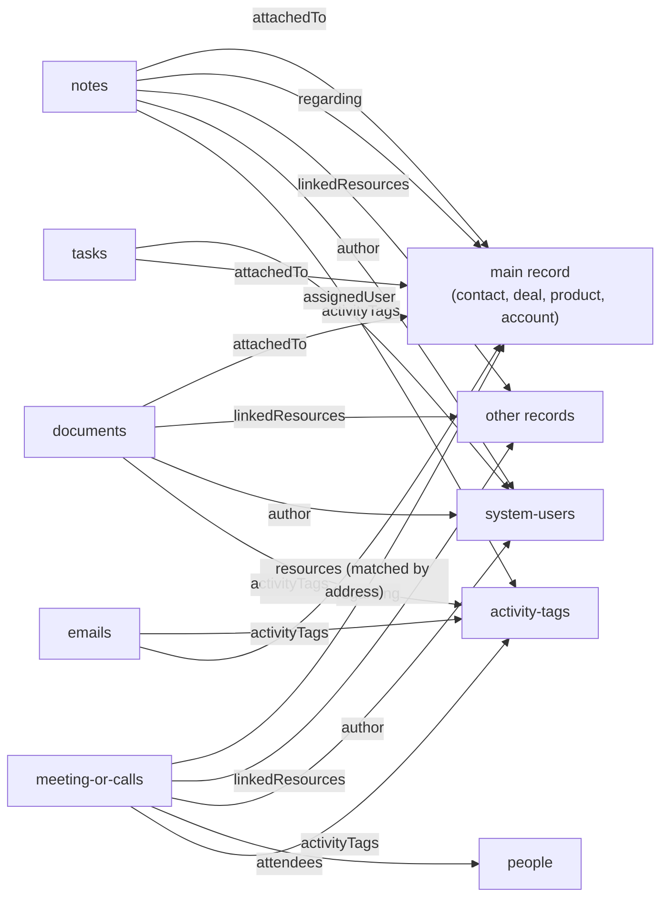

# Activities

> **Before you read.** [Reading the API](reading-the-api.md) (paging, filters, includes) and
> [Contacts](contacts.md) (people, organizations, system users). The section on inherited
> activities builds on [Entity relationships](entity-relationships.md#inherited-activities).

## The model

An **activity** is a dated record of an interaction or a piece of information, filed against one
or more records: contacts, deals, products or accounts. Backstop has four activity types plus
tasks, and three read-only ways of looking across them.

| Collection | What it is |
|---|---|
| `notes` | Free text with an HTML body, dated by `effectiveDate`. Emails saved from Outlook "as a note" land here. |
| `meeting-or-calls` | A meeting or a phone call. **One collection**; `type` tells them apart: `FACE_TO_FACE`, `PHONE_OUT`, `PHONE_IN`. |
| `emails` | A captured email message, from mailbox sync, the Outlook add-in or the API. Also holds **email blasts**, mass mailings sent from Backstop, stored once per recipient. See [Emails and email blasts](#emails-and-email-blasts). |
| `documents` | A stored file, or a link to an external file. |
| `tasks` | A to-do assigned to a system user, with a due date. Not part of activity lists or the activity search. |
| `/{record}/{id}/activities` | Read-only: one record's activity list (notes, meetings and calls, documents, some emails). |
| `POST /entity-activities` | Read-only search used by the web app's Activity Explorer. Firm-wide or for one record. |
| `GET /entity-activity-details/{id}` | Read-only: the full body and attachments of any activity. |

Supporting collections: `activity-tags` (labels), `activity-templates` (pre-filled bodies for notes
and meetings), `history-events` (audit trail), `meeting-or-call-invites`, `recurring-tasks`.



## Ids: read this before joining anything

Each activity type has its own id space, and the different read paths spell ids differently.

| Where | Id looks like |
|---|---|
| `/notes/{id}`, `/meeting-or-calls/{id}`, `/documents/{id}`, `/emails/{id}` | the bare number |
| A row of `/{record}/{id}/activities` | **`<collection>_<id>`**, e.g. `notes_123456`; `attributes.specificResource.resourceId` holds the bare number |
| A row of the activity search | the bare number |
| `/entity-activity-details/{id}` | the bare number, for every type |

- `GET /activities/123456` gives `400 Can not find resource type from 123456`; the composite
  form `GET /activities/notes_123456` is the one that works.
- For synced emails, the `/emails` id, the search row id, the details id and the `summaryId` used
  in attachment and web-app URLs are all the same number (*observed*).
- In search rows for emails, `author.id` repeats the email's own id. It is **not** a system user
  (*observed*).

## How activities attach to records

All parent pointers have the same shape: `{resourceType, resourceId, resourceLink, restricted}`.

| Field | On | Meaning |
|---|---|---|
| `attachedTo` | notes, documents, tasks | The main record. Required when creating. |
| `regarding` | meetings and calls (required when creating), notes | The contact the activity is about. On notes it equals `attachedTo`. |
| `linkedResources` | notes, meetings, documents | Further records the activity also shows under: people, organizations, deals, accounts. |
| `secondaryRegarding` | tasks | A second linked record. |
| `resources` | emails | The contacts an email belongs to. |
| `attendees` | meetings and calls | A relationship to **people** (never organizations). The firm's own staff attend through their people records. |
| `currentCcedRecords`, `historicalCcedRecords` | notes, meetings, documents | System users who were notified: `{ccedTimestamp, ccedParty}`. |

An activity appears in a record's activity list when it is attached to the record, linked to it,
or **inherited** through a relationship. The help centre calls these `ATTACHED`, `LINKED` and
`INHERITED` (*documented*, article 964). The usual case of inheritance: a meeting with a person also shows on
the person's organization. Search rows mark this with `isAttached`, `isLinked` and
`inheritedFrom`.

## One record's activity list (`/{record}/{id}/activities`)

The data behind each record's "Activities" tab. It exists on organizations, people, contacts,
employees, opportunities, products, accounts, funds and holdings. There is no top-level
`GET /activities`.

| Option | Behaviour |
|---|---|
| `filter[activityType][eq]=notes \| meetings \| calls \| documents` | One type. `meetings` and `calls` split the meeting collection by `type`. |
| `filter[effectiveDate][le]=…` or `filter[effectiveDate][ge]=…` | One bound only. `ge` and `le` together return nothing, so our connector sends `le` alone for a window and cuts the start date itself. |
| `filter[activityTagIds]=<id>,<id>` | Rows carrying **all** the listed tags. |
| `sort=-effectiveDate` | Newest first. |
| `include=activityTags` | Tag names, with `fields[activity-tags]=name`. |

Each row has `title`, `description` (the full HTML body, sometimes over a megabyte),
`effectiveDate`, `specificResource` (what the row really is), `linkedResources`, timestamps, and the
relationships `activityTags`, `author`, `createdBy`, `modifiedBy`.

What the list does **not** give you:

- `regarding`, `attachedTo`, meeting `type`, start time, location: read the activity itself.
- **Attendees.** `include=attendees` gives a 400. Read `/meeting-or-calls/{id}/attendees`, or use
  `include=attendees` on `/{record}/{id}/meetingOrCalls`.
- **CC lists.** `currentCcedRecords` is always empty here, even when the activity has CCs.

Paging quirks:

- With a date filter, `meta.totalResourceCount` reports "rows so far" and there is no `next`
  link. Keep requesting until a page comes back short.
- Offsets must be multiples of the limit.
- The per-type sub-routes (`/{record}/{id}/meetingOrCalls`) can give slightly different totals
  from the activity list. The cause is unknown.

## Notes (`notes`)

- Attributes: `title` (max 400), `description` (HTML), `effectiveDate`, `attachedTo`, `regarding`,
  `linkedResources`, CC lists, `isDraft`, `topOfList`, `otherId`, `regularCustomFieldValues`.
- Relationships: `author`, `createdBy`, `modifiedBy`, `permissionBucket`, `template`,
  `activityTags`, `documents`, `tasks`, `historyEvents`.
- **The collection must be filtered**: `GET /notes` alone gives
  `400 You can not query all notes without filter criteria.` Filter on `createdTimestamp`,
  `modifiedTimestamp` or `activityTagIds`. **`effectiveDate` is not filterable** on `/notes`.
- `filter[id][eq]` gives a 500. Fetch by id in the path instead.

## Meetings and calls (`meeting-or-calls`)

- Attributes: `title`, `type` (`FACE_TO_FACE`, `PHONE_OUT`, `PHONE_IN`), `startTimestamp`,
  `stopTimestamp` (with the offset of `timeZone`), `timeZone` (a Backstop time zone name such as
  `US/Eastern`), `effectiveDate` (the local start date), `location` (free text), `regarding`,
  `linkedResources`, `description`, CC lists.
- Relationships: `attendees` (people), `author`, `createdBy`, `modifiedBy`, `invite`, `template`,
  `permissionBucket`, `activityTags`, `documents`, `tasks`, `historyEvents`.
- Filters: `startTimestamp`, `createdTimestamp`, `modifiedTimestamp`, `activityTagIds`. **Not**
  `effectiveDate`, and **not** `type`: to get only calls, use the activity list's
  `filter[activityType][eq]=calls` or the activity search.
- `regarding` is an attribute: `/meeting-or-calls/{id}/regarding` gives a 401.

## Emails (`emails`)

- How emails arrive (*documented*, article 1423): mailbox sync through Microsoft Graph or IMAP
  (about every 30 minutes), the Backstop for Outlook add-in, or `POST /emails`. Backstop links a
  message to every contact whose address or organization domain matches the From, To or CC fields.
  Non-administrators only see emails that are linked to a contact.
- Attributes on a read: `subject`, `sentTimestamp`, `fromEmail`, `toEmails`, `ccEmails`,
  `hasAttachments`, `contentUrl` (download the original `.eml`). Relationships: `createdBy`,
  `activityTags`, `documents`, `tasks`. No `author`, no `attendees`.
- `GET /emails` must be filtered (`fromEmail`, `toEmails`, `ccEmails`, `subject`, `sentTimestamp`).
  A broad `sentTimestamp` filter can take minutes. Per contact, use `/{contact}/{id}/emails`, where
  our connector uses `filter[startDate]` and `filter[endDate]` (`YYYY-MM-DD`) and reports that
  `filter[sentTimestamp]` is ignored.
- On `/{contact}/{id}/emails`, `include=activityTags`, `include=attendees` and
  `filter[activityTagIds]` do not work. Our connector leaves emails out when a tag filter is set.
- The body and attachments come from `/entity-activity-details/{id}`.

### Emails and email blasts

The `emails` collection holds two different things:

| | Email | Email blast |
|---|---|---|
| What it is | One message a firm user sent or received | One mass mailing sent from Backstop to a list of contacts |
| How it gets in | Mailbox sync, the Outlook add-in, or `POST /emails` | Sent from Backstop itself |
| What it says about a contact | Someone at the firm corresponded with them | They were on the mailing list |
| Activity search `type` | `Email` | `Email Blast` |
| Activity search filter value | `email` (blasts are left out) | `email_blast` |

- **A blast is stored once per recipient.** Each blast row has exactly one address in
  `toAddresses`, so one mailing to 100 contacts is 100 rows (*observed*).
- **`/emails` does not tell them apart.** Blast rows come back from `/emails/{id}` and
  `/{contact}/{id}/emails` with the same attributes as ordinary emails, and no attribute is known
  to mark a blast. Only the activity search's `type` does. We matched ids found both in contacts'
  `/emails` pages and in the activity search (*observed*).
- **A contact's email list can be mostly blasts.** Counting `/{contact}/{id}/emails` counts
  mailings received, not conversations.
- **Some correspondence is not in `emails` at all.** An email saved from Outlook "as a note" is a
  `notes` record (see [Notes](#notes-notes)). To find every exchange with a contact, read their
  emails and their notes, and leave out blasts.

## Documents (`documents`)

- Attributes: `title`, `documentName` (file name), `documentUri` (a download link inside Backstop,
  or an external URL), `isExternalUri`, `effectiveDate`, `attachedTo`, `linkedResources`,
  `description`.
- `GET /documents` must be filtered. Unlike notes, documents **can** be filtered on
  `effectiveDate`. The help centre also lists `binaryHash`, `documentSize` and `inheritanceTypes`.
- A document can be an attachment of a note or a meeting. Its main record is then that note or
  meeting.
- A read never returns the file bytes, only `documentUri`.

## Tasks (`tasks`)

- A to-do: `name`, `details`, `dueDate`, `remindDate`, `status`, `completedTimestamp`,
  `attachedTo`, `secondaryRegarding`, `sendNotification`.
- Relationships: `assignedUser`, `assignedByUser`, `collaborators` (system users), `group`,
  `recurringTask`.
- No `effectiveDate`, `author` or tags, and not part of activity lists or the activity search.
- To read one contact's tasks, send **both** `filter[entityType][eq]=<Bean name, e.g. OrganizationBean>`
  and `filter[entityId][eq]=<id>`. Either one alone is ignored and returns every task.
- `status` is not filterable.

## Activity tags (`activity-tags`)

- The firm's labels for activities: `name`, `description`, `viewable`, and `quantityTagged` (how
  many activities carry the tag).
- The whole list fits in one request (`page[limit]=1000`). Filter `name`, including `like`.
- On activities, tags are the `activityTags` relationship. The activity list filters on them
  with `filter[activityTagIds]` (all listed tags must be present); the activity search uses
  `newFilters.activityTags` (any listed tag).
- The meaning of `viewable` is not documented.

## The activity search (`POST /entity-activities`)

This is how the web app's Activity Explorer finds activities across the whole firm. Although it is
a `POST` and answers `201`, it creates nothing.

```json
{
  "data": {
    "type": "entity-activities",
    "attributes": {
      "pageSize": 500,
      "pageNum": 1,
      "sorts": [{"columnName": "effectiveDate", "ascending": false}, {"columnName": "id", "ascending": true}],
      "newFilters": {
        "effectiveDate": {"startTimestamp": "2026-09-01T00:00:00", "endTimestamp": "2026-09-30T23:59:59"},
        "types": [{"searchValues": [{"value": "meeting"}, {"value": "meeting_call"}]}]
      },
      "includeFields": ["associatedWith", "allRelatedEntities"]
    }
  }
}
```

### Request

| Key | How it works |
|---|---|
| `pageSize`, `pageNum` | `pageNum` starts at 1. |
| `sorts` | A list. Columns `effectiveDate`, `id`, `title`, `createdAt`. Sort by date then id for stable paging. |
| `newFilters` | **The filters Backstop actually applies.** An older `filters` key is accepted and ignored. |
| `newFilters.effectiveDate` | `{startTimestamp, endTimestamp}` in `YYYY-MM-DDTHH:MM:SS`. |
| `newFilters.types` | Type values, combined with OR: `meeting` (meetings only), `meeting_call` (calls only), `note`, `document`, `email` (excluding blasts), `email_blast`. |
| `newFilters.activityTags` | `[{"searchValues": [{"value": "<tagId>"}]}]`, combined with OR. |
| `newFilters.authors` | `[{"searchValues": [{"value": "<user email>", "isEmail": true}]}]`. |
| `newFilters.attendees` | `[{"type": 0, "searchValues": [{"value": "PartyBean_<peopleId>"}]}]`. Only this form works. |
| `entityId` + `resourceType` | Limit to one record (`organizations`, `people`, …). Includes inherited activities. |
| `includeFields` | Extra row fields: `associatedWith`, `allRelatedEntities`, `inheritedFrom`, `inheritedTo`, `primaryEntity`, `description`. Unknown names are ignored. Our connector sends `associatedWith`, `inheritedFrom` and `primaryEntity`. |
| `shouldIncludeDescription` | `true`, together with `description` in `includeFields`, to get the body on each row. Our connector sends both when it asks for bodies. |

The body is checked strictly: an unknown key gives `400 Invalid field <x>`, a wrong value type
gives a 500. Wrong shapes inside a filter are sometimes **silently ignored** instead, so check that
returned rows actually match what you asked for.

### Response

`data` is a single object, `{attributes: {totalCount, results: [...]}}`. Each row has `id`,
`type` (the label shown in the UI: Note, Meeting, Call, Email, Email Blast, Document),
`activityType`, `title`, `author`, `createdBy`, `activityTags` (`{id, name}`), `attachmentsCount`,
and these per type:

- Meetings and calls: `startDate`, `stopDate`, `timeZone`, `location`, `meetingType` (Face to Face,
  Phone - Outbound, Phone - Inbound), `attendees` (**names only**), `primaryEntity`,
  `activityTemplate`, `shortDescription` (first 100 characters).
- Emails and blasts: `fromAddress`, `toAddresses` (a contact's name if matched, otherwise the raw
  address).
- With `includeFields`: `associatedWith` and `allRelatedEntities` give record ids. For meetings,
  the `people` entries in `allRelatedEntities` are the attendees' people ids.

**Dates in search rows are `M/D/YYYY` strings** (`effectiveDate`, `createdAt`, `modifiedAt`);
`startDate` and `stopDate` are ISO.

### The 10,000-row ceiling

- `totalCount` stops at 10,000 for any search that matches more. It has also stopped at 9,999
  (*observed*).
- Asking for a position past 10,000 (`pageNum × pageSize > 10000`) gives a 500.
- To read more than 10,000, narrow the filters. Splitting by date window does not work: Backstop
  **sorts on the UTC instant but filters on the local day**, so rows near midnight repeat **and go
  missing** between windows. Our connector resumes by offset (`pageNum`) inside one search, and
  stops at the ceiling.
- A page can come back one row short while `totalCount` flickers by one. This happens when an
  activity has no `regarding` record. A short page is not the end.

## Full body and attachments (`GET /entity-activity-details/{id}`)

- Works for every type, with the bare id.
- Returns `type` (`meeting` also for calls, `note`, `document`, `email`), `title`, the full HTML
  `description`, and `attachments`: `{name, url, mimeType}`. Inline images count as attachments.
- An unknown id answers **200 with `data: null`**, not a 404.
- Meeting times, location and attendees are not here. Read `/meeting-or-calls/{id}` and its
  `attendees`.

## Things that trip people up

- Meetings and calls are one collection. Filter them apart through the activity list or the
  search, not on `/meeting-or-calls`.
- Activity list rows have composite ids; everything else uses the bare number.
- `effectiveDate` is filterable on documents and on activity lists, but not on `/notes` or
  `/meeting-or-calls`.
- Attendees cannot be included on activity lists.
- Email blasts can dominate any activity count, because each one is a row per recipient. Leave
  out `email_blast` when you mean interactions, and keep it when the question is about mailings.
  See [Emails and email blasts](#emails-and-email-blasts).
- Activity search dates are `M/D/YYYY`; REST dates are ISO.
