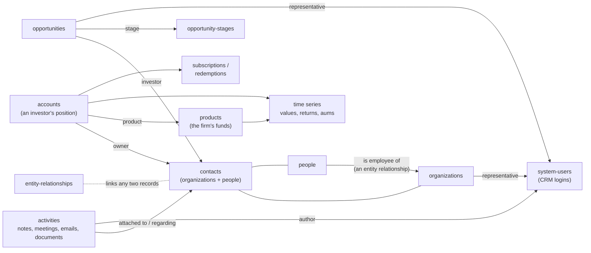

# Basics

> **Before you read.** Nothing. This is the starting point.

## What Backstop is

Backstop is a hosted platform for investment firms. It keeps a firm's contacts, its interactions
with them, the funds it runs or researches, the investors in those funds, and its sales pipeline
in one database. Fund managers use it for investor relations and fundraising; allocators use it
to research and track the funds they invest in (*documented*, articles 1040 and 276).

Each client firm gets its own **tenant**: its own database and its own web address, for example
`https://<firm>.backstopsolutions.com`. A tenant can rename lists, add custom fields and switch
features on or off, so two tenants can look quite different through the same API.

## The record families

The help centre groups Backstop's data into these families (*documented*, article 1040):

| Family | What it holds | Main collections |
|---|---|---|
| People and organizations | Everyone the firm deals with: investors, consultants, banks, and the firm's own staff | `organizations`, `people`, `contacts`, `employees` |
| Activities | Interactions and work items: notes, meetings and calls, emails, documents, tasks | `notes`, `meeting-or-calls`, `emails`, `documents`, `tasks` |
| Opportunities | The sales pipeline: one row per deal with an investor | `opportunities`, `opportunity-stages` |
| Products and investor accounts | Funds the firm runs, and each investor's position in them, with balances and money movements | `products`, `accounts`, `hedge-fund-account-subscriptions` |
| Portfolios and investment vehicles | Third-party funds the firm researches or invests in, and its holdings in them | `funds`, `investment-vehicles`, `portfolio-holdings` |
| Reference data | Lists that other records point to: stages, categories, custom field definitions, lists of values | `custom-field-definitions`, `lov-owned-sets`, `entity-types` |
| System | Logins, permissions, search, reports | `system-users`, `permission-buckets`, `quick-search`, `reports` |

The two "fund" families are easy to mix up. **Products** are the firm's *own* funds, the ones
that have investor accounts. **Funds** and **investment vehicles** are *other managers'* funds that
the firm researches or holds. A fund manager mostly uses products; an allocator mostly uses funds.

## How the main records connect

In words:

- A **contact** is either an **organization** or a **person**. Both share one id space.
- People are tied to organizations through **entity relationships**, typed links such as
  "is employee of". There is no "company id" column on a person.
- The firm's own users are **system users** (CRM logins), separate from people records. A system
  user is the **representative** (owner) of contacts and deals and the **author** of activities.
- **Activities** hang off contacts (and off deals, products and accounts).
- An **opportunity** is a deal with one investor contact, sitting in one **stage** of the pipeline.
- An **account** is one investor contact's position in one **product**. Balances and returns are
  **time series** on the account; money in and out are **subscriptions** and **redemptions**.
- Almost every record also carries **custom fields**, which each tenant defines for itself.

Each of these gets its own chapter. [Contacts](contacts.md) and
[Entity relationships](entity-relationships.md) cover the people side.
[Activities](activities.md), [Products and accounts](products-and-accounts.md) and
[Opportunities](opportunities.md) cover the rest.

## Records, collections and ids

Every record lives in a **collection**, addressed by a plural, hyphenated name:
`/organizations/{id}`, `/meeting-or-calls/{id}`. Ids are integers (in practice they fit in 32
bits) and are only unique *within an id space*.

Some collections are **views** over other collections and share their ids:

| View (read-only) | Shares ids with | How a row says what it really is |
|---|---|---|
| `contacts` | `organizations` and `people` | `attributes.specificResource.resourceType` |
| `employees` | `people` (only people who currently have an employer) | — |
| `products` | `hedge-fund-products` (and the private-equity product types) | `specificResource.resourceType` |
| `accounts` | `hedge-fund-accounts` (and the private-equity account types) | `specificResource.resourceType` |
| `hedge-fund-account-transactions` | `hedge-fund-account-subscriptions`, `…-redemptions`, `…-transfers` | `specificResource.resourceType` |

So `GET /contacts/123` and `GET /people/123` return the same person. Views are read-only: write
through the underlying collection.

Ids from different spaces are **not** interchangeable. A person id is not an account id, and a
note id is not a meeting id. Asking the wrong collection gives `404 Resource people not found by id …`.

## Backstop's vocabulary

These words appear throughout the API and these docs. They are Backstop's terms, explained in
plain English.

| Term | Meaning |
|---|---|
| Contact | A person or an organization. Internally Backstop calls it a *party* (`PartyBean`). |
| Internal organization | The tenant firm's own organization record (`internalOrganization: true`). |
| Representative | The system user who owns a contact or a deal on the firm's side. |
| System user | A login to the Backstop web application. Not a people record. |
| Entity relationship | A typed, directional link between two records, such as "is employee of". |
| Activity | A note, meeting or call, email, or document. Tasks are related but separate. |
| Regarding / Attached to | The main record an activity belongs to. |
| Linked resources | Further records an activity also shows up under. |
| Activity tag | A label the firm puts on activities to classify them. |
| Opportunity | A deal being pursued with one investor. |
| Stage | Where a deal is in the pipeline. Some stages are marked closed. |
| Product | A fund the firm runs, with investor accounts. |
| Account | One investor's position in one product. |
| Time series | Dated values on a record: account balances, returns, fund AUM. |
| Custom field | A field the tenant added. Its value is stored on the record in `regularCustomFieldValues`. |
| List of values (LOV) | The option list behind a dropdown custom field. |
| Entity type | A record type, optionally split by the tenant into subtypes (shown in the UI as Contact Type, Opportunity Type, Vehicle Type). |
| Permission bucket | A named visibility group every record belongs to. |
| Bean name | Backstop's internal Java class name for a type, such as `OrganizationBean`. Some read filters take these names; write payloads never do. |

## Where knowledge comes from

Four sources describe Backstop, and they disagree often enough that it matters which you trust.

| Source | Good for | Weak on |
|---|---|---|
| A live API response | The truth for this tenant, today | Only shows what you asked |
| The help centre (`backstopsolutions.elevio.help`, REST API category) | Concepts, documented limits, worked examples | Only about 40 articles are visible to an API account; nothing on CRM concepts such as relationships or custom fields |
| The swagger file (`GET <API root>/backstop-api-swagger.json`, over a thousand paths; the API root is described in [Reading the API › Addresses](reading-the-api.md#addresses)) | A starting list of routes, and of the filter and sort fields it knows about | The rest of the API. It lists a sort that crashes, omits operators and fields that work, and gives incomplete required fields |
| `GET /resource-metadata` (several hundred entries) | Field names, types, UI labels, required flags, maximum lengths, enum options | Filters, sorts, includes |

The rule we follow: **a live response beats the help centre, and the help centre beats the
swagger.** When the docs say "swagger lists X", treat X as a hint to verify.

Three more facts about the swagger and metadata:

- The swagger does not document the full functionality of the API. A route, field or operator
  missing from it can still work. We probed resource types on versions other than the one this
  swagger describes, and sometimes the API still returned a response (*observed*).
- They describe the API version of the tenant that serves them. A tenant's administrator upgrades resource types one
  at a time in "REST API Version Manager", and an upgrade cannot be undone (*documented*, article
  408). Another tenant can expose a slightly different shape.
- The help centre shown to an API account is a cut-down subset. Articles on permissions, the
  Advanced Permission Module and Report Builder are refused to it.

## Next

Read [Reading the API](reading-the-api.md) before you make your first request.
