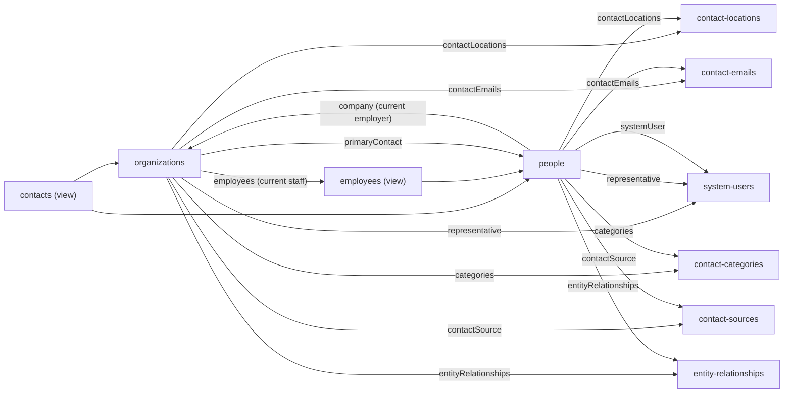

# Contacts: organizations and people

> **Before you read.** [Basics](basics.md) (views and id spaces) and
> [Reading the API](reading-the-api.md) (filters, includes, sparse fields).
> How people are tied to organizations is in [Entity relationships](entity-relationships.md);
> this chapter summarises it.

## The model

Backstop calls every person or company in the CRM a **contact**. A contact is either an
**organization** or a **person**, and all of them share one id space. Four collections give
different views of the same records:

| Collection | What it returns | Writable |
|---|---|---|
| `/organizations` | Contacts that are companies or institutions | Yes |
| `/people` | Contacts that are individuals | Yes |
| `/contacts` | Both, with only the fields they have in common | No |
| `/employees` | A person *in their role at their current employer*, with employment dates | No |



Key points:

- `GET /contacts/{id}`, `GET /people/{id}` and `GET /employees/{id}` all return the same person.
  Asking `/people` for an organization id gives a 404.
- **A person has no employer column.** Employment is an
  [entity relationship](entity-relationships.md) of type "is employee of", from the person to
  the organization. The person's `company` and `companyName` and the organization's `employees`
  list are all derived from those rows.
- **Addresses and phone numbers** are in `contact-locations` (several per contact, one primary).
  **Email addresses** are in `contact-emails`.
- The firm-side owner of a contact is its `representative`, a system user.

## Organizations

A company, institution, pension plan, consultant, bank, fund of funds: any contact that is not a
person, including the tenant's own firm.

### Attributes

| Attribute | Meaning |
|---|---|
| `name` | Display name. Required when creating. |
| `legalName` | Legal name. |
| `internalOrganization` | `true` on the tenant firm's own record ("Is this an Internal Organization?" in the UI). Not filterable. |
| `matchingDomains` | Email domains such as `@example.com`. Backstop uses them to file synced emails and calendar meetings under this organization. |
| `investableAssets` | The organization's assets or AUM, as a number. |
| `ria` | Registered Investment Adviser flag. |
| `numberOfEmployees` | A typed-in number, not a count of the `employees` list. |
| `website`, `email`, `email2`, `email3`, `phone`, `fax` | Contact details. |
| `streetAddress`, `city`, `state`, `postalCode`, `country`, `locationTitle` | **A copy of the primary contact location.** Change the location, not these. |
| `contactDescription` | Free-text description. |
| `otherId` | An external or legacy id. |
| `regularCustomFieldValues` | Custom field values. |
| `createdTimestamp`, `modifiedTimestamp` | Audit timestamps. |

### Relationships

| Relationship | Points to | Notes |
|---|---|---|
| `employees` | `employees` (people) | Current staff only: people with a current "is employee of" row to this organization |
| `primaryContact` | `people` | The main person, the same as the "primary contact for" relationship |
| `representative` | `system-users` | Firm-side owner |
| `contactLocations`, `contactEmails`, `categories` | | Addresses, emails, tags |
| `contactSource`, `referralSource` | `contact-sources`, `contacts` | How the contact came to the firm |
| `clientDefinedEntityType` | `entity-types` | The Contact Type (Organization unless the tenant made subtypes) |
| `permissionBucket` | `permission-buckets` | Visibility group |
| `entityRelationships` | `entity-relationships` | Every typed link where this organization is the source |
| `activities`, `notes`, `meetingOrCalls`, `emails`, `documents`, `tasks` | | Activity lists (see [Activities](activities.md)) |
| `opportunities` | `opportunities` | Deals where this organization is the investor |
| `aums` | time series | AUM history |
| `createdBy`, `modifiedBy` | `system-users` | |

### Reading organizations

| Need | Request |
|---|---|
| Name contains a word | `filter[name][like]=acme` (case-insensitive substring) |
| Exact name | `filter[name][eq]=…` (case-sensitive) |
| By email domain | `filter[matchingDomains][eq]=example.com` (with or without `@`) |
| By city | `filter[contactLocations.city][eq]=London` (exact, case-sensitive; any of the organization's locations) |
| Exact primary email | `filter[email][eq]=…` (primary address only) |
| Changed recently | `filter[modifiedTimestamp][ge]=2026-10-01` |
| Sort | `name`, `id`, `createdTimestamp`, `modifiedTimestamp`, `email`, `otherId`, `matchingDomains` |

Not filterable: `email2`, `country`, `state`, `website`, `legalName`,
`internalOrganization`, `ria`, representative, and any custom field. Of the location fields, only `city` and `address` are
filterable.

## People

An individual: investor-side staff, consultants, and the firm's own colleagues.

### Attributes

| Attribute | Meaning |
|---|---|
| `name` | Display name, in the form **"Last, First"** |
| `legalName` | Usually "First Last" |
| `firstName`, `lastName`, `middleName`, `prefix`, `suffix`, `nickName`, `salutation` | Name parts. `lastName` is required when creating. |
| `gender` | `UNSPECIFIED`, `FEMALE` or `MALE`. Required when creating. |
| `jobTitle`, `department` | Role at the current employer |
| `companyName` | Name of the current employer (read-only copy) |
| `isEmployee` | "Employee of your Organization": the person works at the tenant firm |
| `email`, `email2`, `email3` | The first three addresses in `contact-emails` |
| `phone`, `mobilePhone`, `fax`, address fields | Primary location copy, as for organizations |
| `regularCustomFieldValues`, `otherId`, timestamps | As for organizations |

### Relationships

As for organizations, without `employees`, `primaryContact` and `aums`, plus:

| Relationship | Points to | Notes |
|---|---|---|
| `company` | `organizations` | The **current** employer. Empty if the person only has a former employment. If there are several current employers, one is shown. |
| `systemUser` | `system-users` | The person's own CRM login, if they have one |

### Reading people

| Need | Request |
|---|---|
| Last name contains | `filter[lastName][like]=smi` |
| Exact display name | `filter[name][eq]=Smith, Anna` (`like` is not allowed on `name`) |
| Exact email | `filter[email][eq]=…`, also `email2`, `email3`. Combined email filters are AND, so "any of the three" takes three requests. |
| Email domain | `filter[emailDomains][eq]=example.com` |
| Sort | `lastName`, `id`, `createdTimestamp`, `modifiedTimestamp`, `email`. **Not `name`: `sort=name` returns a 500.** |

Not filterable: `firstName`, `jobTitle`, `department`, `companyName`, location fields other than
city and address.

## Contacts (the combined view)

- One row per organization or person. `type` is always `contacts`; the real kind is in
  `attributes.specificResource.resourceType` (`organizations` or `people`).
- Only the shared fields: no `firstName`, `lastName` or `jobTitle`.
- **No name filter.** Filter on `entityTypeId` (`10` contact, `12` person, `14` organization on a
  standard tenant), `emailDomains`, `excludeContactsWithoutLocations`, timestamps or `otherId`.
- Read-only: `PATCH /contacts/{id}` gives `403 contacts is read only.`
- Use it when you have an id and do not know whether it is a person or an organization. Deals and
  accounts point to their investor through `contacts` for the same reason.

## Employees (person at their employer)

- `GET /organizations/{id}/employees` is the organization's current staff list. This is the
  reliable roster; `numberOfEmployees` is not.
- Each row is a person plus the employment: `startDate`, `endDate`, `isKeyEmployee`, `company`.
- `GET /employees/{personId}` works only if the person has a current employer; otherwise 404.
- `GET /employees` with no filter returns an empty list and no `meta`. The collection is not
  meant to be listed.
- Read-only: `PATCH /employees/{id}` gives `403 employees is read only.`
- **Key employee** (`isKeyEmployee`) is stored on the employment relationship. It can be read on
  the roster, but an API token cannot change it: the update answers 200 and nothing is saved.

## Addresses, emails, categories, sources

### Contact locations (`contact-locations`)

- One row per address: `locationTitle` (a label such as "Office", at most 30 characters, unique per
  contact), `address`, `city`, `state`, `postalCode`, `country`, `countryCode` (ISO two-letter
  code), `phoneNumber`, `secondaryPhoneNumber`, `fax`, `isPrimaryLocation`.
- Read through `/{organizations|people}/{id}/contactLocations` or `include=contactLocations`.
  `GET /contact-locations` without an id gives `400 Find all contact-locations is not allowed.`
- `country` is free text, so one country can be spelled several ways. Use `countryCode` in code.
- Deleting a contact does not delete its locations: they become orphans that error on later
  access. Delete locations first.

### Contact emails (`contact-emails`)

- An ordered list of a contact's addresses: `email`, `sortOrder` (from 0), `retired`.
- Do not confuse it with the `emails` relationship on a contact: that is the list of **email
  activities** (messages), which can run into thousands.

### Contact categories (`contact-categories`)

- Tags shared by organizations and people, often used as distribution lists. Only a `name`.
- A contact can have many. Read `/{contact}/{id}/categories`, or list all with
  `filter[name][like]=…`.

### Contact sources (`contact-sources`)

- The list behind "how did this contact come to us" (`contactSource`) and "who referred them"
  (`referralSource`, which points to another contact). Attributes `name`, `description`.
- Access depends on the user's permissions. A user without it gets
  `403 You are not allowed to perform GET on this resource` on the list *and* on any contact request
  that includes `contactSource` or `referralSource`.

## The firm's own people

Three different things describe the firm's own staff. Keep them apart:

| Record | What it is |
|---|---|
| The **internal organization** | The firm's organization record, `internalOrganization: true`. `/system-info` also points to it as `ownerOrganization`. |
| A **person** with `isEmployee: true` | A colleague as a contact, employed by the internal organization. This is how colleagues appear as meeting attendees. |
| A **system user** | A colleague's login. Authors activities, owns contacts and deals as `representative`. |

### System users (`system-users`)

- Attributes: `userName` (the login), `name`, `firstName`, `lastName`, `email`, `disabled`,
  `timeZone`, `targetCurrency`.
- Relationships: `associatedPerson` (their people record, often empty), `licenseType`,
  `userGroups`, `defaultPermissionBucket`.
- Filters: `name` and `lastName` with `like` were seen to work (*observed*), but
  `system_users_service.py` says `/system-users` takes no search filter, and this server walks the
  whole roster instead. **`userName` is not filterable**: list the users (there are rarely more
  than a few hundred) and match the login in your own code.
- `/system-users/me` does not exist (400). There is no "who am I" endpoint;
  `/system-info` is what our connector uses to check a token.
- A disabled user still shows as `representative` and `author` on old records.

## Finding contacts

When you only have a name or an email:

| You have | Do this |
|---|---|
| An exact email | `GET /people?filter[email][eq]=…` (then `email2`, `email3`) |
| A person's last name | `GET /people?filter[lastName][like]=…` |
| An organization name or part of it | `GET /organizations?filter[name][like]=…` |
| A name of anything | `GET /quick-search` (below) |

### Quick search (`/quick-search`)

The web app's search box. It searches several record types at once.

```
GET /quick-search?filter[searchText][eq]=acme glob&filter[searchTypes][eq]=ORGANIZATION,FUND_PRODUCT&page[limit]=20
```

- `searchTypes` must be upper-case values from: `ALL, ACCOUNT, ASSET_GROUP, FUND_PRODUCT, HOLDING,
  OPPORTUNITY, DEAL, ORGANIZATION, PERSON_FIRST_NAME, PERSON_LAST_NAME, PHONE_NUMBER,
  EMAIL_ADDRESS, STRATEGY, PROJECT, VEHICLE, PRODUCT`. Several can be joined with commas. Leaving it
  out searches everything.
- **Matching is anchored at the start of the name.** "Acme Glob" finds "Acme Global Macro Fund";
  "Global" alone does not, because the name does not start with it.
- The operator is ignored (`like` behaves as `eq`).
- This server also sends `filter[limit][eq]`, `filter[showAll][eq]` and
  `filter[enhanceSearchTypes][eq]` (plus `filter[filterType][eq]` when set). Their effect is not
  documented.
- `EMAIL_ADDRESS` with `filter[fullEmailMatch][eq]=true` finds people and organizations by exact
  email.
- Rows have `type: quick-search` and an id like `organizations_101`. Use
  `attributes.resourceType` and `attributes.resourceId` for the follow-up `GET`; the raw id gives a
  400.
- `meta.totalResourceCount` is not a real count. Stop when a page comes back short.

## Things that trip people up

- `/people?sort=name` returns 500. Sort by `lastName`.
- `/contacts` cannot be searched by name.
- `numberOfEmployees` is not a head count; count `/organizations/{id}/employees`.
- An organization's address fields are a copy of its primary location.
- A person's `company` shows one current employer even when there are several; read the
  relationships for the full picture.
- `/parties/{id}` is not part of this API (401). Use `/contacts/{id}`.
