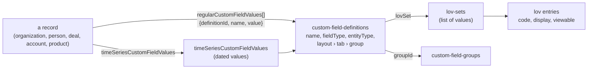

# Custom fields and reference data

> **Before you read.** [Reading the API](reading-the-api.md) (filters, Bean names in filters)
> and at least one record chapter, for example [Contacts](contacts.md), so you have seen
> `regularCustomFieldValues` on a record.

Every tenant extends Backstop with its own fields and lists. This chapter explains how those
extensions are described and how their values appear on records. It also covers the other
reference lists that records point to: entity types, permission buckets, and the system
information record.

## Custom fields in one picture



- A **definition** describes one field: its name, type, the record type it applies to, where it
  sits on the screen, and for dropdowns its **list of values**.
- A record carries its values inline in `regularCustomFieldValues`.
- Fields marked as time series keep **dated** values, read from a separate sub-route.

## Definitions (`custom-field-definitions`)

### Attributes

| Attribute | Meaning |
|---|---|
| `name` | Field label. **Not unique**: the same name ("Notes", "Status") can exist many times in different groups. |
| `entityType` | The Bean name of the record type: `OrganizationBean`, `PersonBean`, `PartyBean`, `OpportunityBean`, `ProductBean`, `AccountBean` |
| `resourceType` | The matching collection name |
| `fieldType`, `fieldTypeDisplay` | The type, see below |
| `isTimeSeries` | `true` if values are dated |
| `layoutName`, `tabName`, `groupName`, `groupId` | Where the field sits in the web app: layout › tab › group |
| `selectOptions`, `selectOptionsWithMetadata` | For list types, the visible options (`{id, code, display, level}`) |
| `defaultValue`, `validation`, `required`, `clientRequired`, `systemDefined`, `newToolCreatedField` | Configuration flags |

### Which records a definition's values appear on

| `entityType` | `resourceType` | Values appear on |
|---|---|---|
| `OrganizationBean` | `organizations` | organizations |
| `PersonBean` | `people` | people (and the `employees` view) |
| `PartyBean` | `contacts` | **both organizations and people** |
| `OpportunityBean` | `opportunities` | opportunities |
| `ProductBean` | `products` | products |
| `AccountBean` | `bsg-individual-accounts` (*observed*) | accounts |

Fields defined for `PartyBean` are shared by people and organizations and are listed only under
`contacts`. To list every field a person can have, ask for both `people` and `contacts`.

### Field types

`DROPDOWN`, `MULTI_SELECT`, `SMALL_TEXT`, `LARGE_TEXT`, `RICH_TEXT`, `DATE`, `DECIMAL`, `MONEY`,
`PERCENT`, `HYPER_LINK`, `ENTITY` (a link to another record). The help centre also documents
radio-button, check-box and user-list fields (*documented*, article 1074).

### Reading definitions

```
GET /custom-field-definitions?filter[resourceTypes][eq]=opportunities&include=lovSet
GET /custom-field-definitions?filter[entityType][eq]=OpportunityBean
GET /custom-field-definitions/{id}/lovSet
```

- **Paging is ignored.** Without a filter you get the whole catalogue, which can be several
  megabytes, whatever `page[limit]` says.
- The two filters that work are `filter[resourceTypes][eq]=<collection>` (note the plural
  parameter name) and `filter[entityType][eq]=<Bean name>`. A collection name in `entityType`
  gives a 400.
- Other filters (`resourceType` singular, `fieldType`, `isTimeSeries`, any `like`) are **silently
  ignored** and return the full catalogue.
- `include=lovSet` is the only include.
- Definitions are read-only through the API.
- `custom-field-groups` lists the groups with `name` and `fullPathName` (`[layout, tab, group]`).

## Values on records (`regularCustomFieldValues`)

```json
"regularCustomFieldValues": [
  {"definitionId": 100101, "name": "Client Status", "value": "Active Client"},
  {"definitionId": 100102, "name": "Target Allocation", "value": "250 USD"}
]
```

- Only fields **with a value** are listed. An unset field is absent, not null.
- **Always key by `definitionId`**, never by `name`.
- `fields=` drops the list unless you include `regularCustomFieldValues`.
- You cannot filter records by a custom field value on the server.
  `filter[regularCustomFieldValues.definitionIds][eq]=<id>,<id>` only trims the list on each record.

How each type is written in `value`:

| Type | `value` | Example |
|---|---|---|
| Dropdown | The option's display text | `"Active Client"` |
| Multi-select | One string, options joined with a pipe character | `"Pension\|Endowment"` |
| Small or large text | String, may contain line breaks | |
| Rich text | HTML string | `"<p>…</p>"` |
| Date | Local-midnight timestamp string | `"2026-06-30T00:00:00.000-0400"` |
| Decimal | JSON number | `1234567.89` |
| Money | `"<amount> <currency>"` | `"5000000 USD"` |
| Percent | Three decimals and `%` (may contain a thousands comma) | `"2.500%"` |
| Entity | A link object `{resourceType, resourceId, resourceLink, restricted}` | |

A value can be an option that has since been **hidden** from the list. It still reads back as its
display text, but `include=lovSet` will not list it (see below).

## Dated values (`timeSeriesCustomFieldValues`)

- For definitions with `isTimeSeries: true`.
- `GET /{collection}/{id}/timeSeriesCustomFieldValues`, optionally
  `filter[definitionIds][eq]=<id>`.
- Rows: `definitionId`, `name`, `effectiveDate`, `value`, `fieldType`.
- There is no `sort`. Sort by `effectiveDate` yourself.

## Lists of values

| Collection | What it is |
|---|---|
| `lov-sets` | What `include=lovSet` returns: `lovName`, `reusable`, `entriesList` |
| `lov-owned-sets` | The tenant's own lists. The default listing is filtered; `filter[showAllSets][eq]=true` returns all of them. |
| `lov-system-sets` | Backstop's built-in lists (read-only) |
| `lov-overridden-system-sets` | Built-in lists the tenant has relabelled |
| `lov-entries` | One option. By id only: listing gives `400 Find all lov-entries is not allowed.` |

An entry is `{id, setId, code, display, defaultDisplay, position, viewable}`. `code` is a short
string ordinal (`"1"`, `"2"`, …) and has gaps once options are removed.

**Hidden options.** `entriesList` and `include=lovSet` contain only *viewable* entries. Options
that were retired are in `GET /lov-owned-sets/{id}/hiddenEntries`. Old records can still carry
them, so when you validate or group values, either read the hidden entries or accept display
texts you do not recognise.

## Entity types (`entity-types`)

- One row per record type that maps to a collection: `name`, `pluralName`, `resourceType`,
  `active`, and `parentEntityType` for subtypes.
- A tenant can split a type into **subtypes**. The UI calls them Contact Type, Opportunity Type and
  Vehicle Type, and records point to theirs through `clientDefinedEntityType`. On a tenant with no
  subtypes, every record points to the base type.
- Filter collections by subtype with `filter[entityTypeId][eq]=<id>`.
- Standard ids seen: Contact 10, Person 12, Organization 14, Opportunity 16 (*observed*).
- `/system-info?include=entityTypes` lists more types, including internal ones that have no
  collection.

## Permission buckets (`permission-buckets`)

- Every contact, location, activity, deal, product and account has a `permissionBucket`.
- A bucket has a `name`, `isPublic`, and `users` (system users). Per-user access levels are in
  `user-bucket-permissions` (`NONE`, `VIEW`, `MODIFY`, `FULL`, `DELETE`).
- A record in a bucket the caller cannot see answers
  `403 You don't have permission to operate the entity <id>` on a direct `GET`. Whether such records
  are silently left out of lists and totals has not been tested.
- Link objects carry `restricted: true` for records the caller cannot open.
- Backstop also has an Advanced Permission Module (APM) with field-level permissions. The help
  centre shown to an API account lists its articles by title but refuses to open them. To read
  them, search the tenant's help centre for "APM: Advanced Permission Module Overview" and "APM:
  Field Level Permissions Overview".

## System information and features

- `GET /system-info` returns one record (id 1000): `timeZone` (the tenant's time zone), and the
  relationships `ownerOrganization` (the tenant firm, the same record as the internal
  organization), `entityTypes`, `enabledFeatures`, `enabledGlobalFeatures`,
  `enabledUserFeatures`.
- Feature flags can only be read here: `GET /system-info/1000/enabledFeatures`. The `/features`
  collections refuse to list (`400 Find all features is not allowed.`) and `/features/{key}`
  returns a 500. Only enabled features are listed.
- Our connector uses `/system-info` to check that a token works. It can occasionally return a 401
  for a valid token. Mid-session, our connector re-probes `/system-info` with backoff (1 s, 2 s,
  4 s, …) for up to 10 s, and revokes the token only if every probe returns 401 or 403. The check
  at login does not retry.
