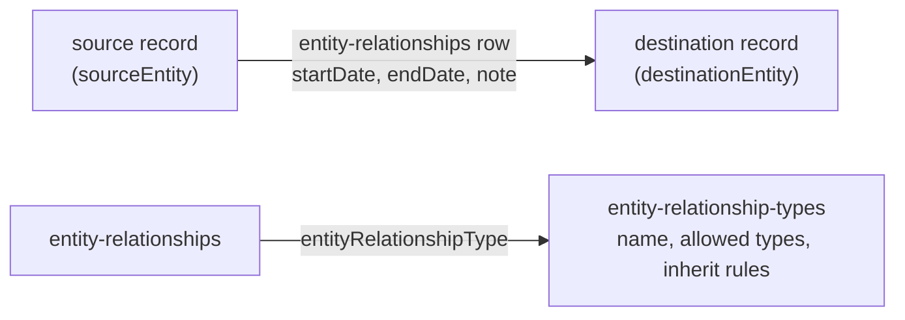

# Entity relationships

> **Before you read.** [Contacts](contacts.md) (organizations, people, the `contacts` view) and
> [Reading the API](reading-the-api.md#related-data-follow-the-link-or-include-it) (includes).

## What they are

An **entity relationship** is a typed, directional link from one record (the *source*) to another
(the *destination*), optionally with dates and a note. It is how Backstop records facts such as:

- a person **is employee of** an organization;
- a person **is primary contact for** an organization, account or deal;
- an organization **owns account** a fund account;
- an organization **is investor of** a deal;
- a consultant is linked to the investor it advises, through a type the tenant added.

Each link has a **type** (`entity-relationship-types`), which the tenant can extend. The type
decides which record types may be source and destination.



## A relationship row

```json
{
  "type": "entity-relationships",
  "attributes": {
    "sourceEntity":      {"resourceType": "people",        "resourceId": "…", "resourceLink": "…", "restricted": false},
    "destinationEntity": {"resourceType": "organizations", "resourceId": "…", "resourceLink": "…", "restricted": false},
    "startDate": "2021-03-01T00:00:00.000-0500",
    "regularCustomFieldValues": []
  },
  "relationships": { "entityRelationshipType": {…}, "createdBy": {…}, "modifiedBy": {…} }
}
```

| Field | Meaning |
|---|---|
| `sourceEntity`, `destinationEntity` | The two ends, as `{resourceType, resourceId}`. **They are attributes**, so they cannot be `include`d. Any record type can appear: `people`, `organizations`, `hedge-fund-accounts`, `hedge-fund-products`, `opportunities`. |
| `startDate`, `endDate` | Optional dates of the link. |
| `note`, `otherId` | Optional text and external id. |
| `status`, `userDefined`, `deliveryMethods` | Exist in the schema; their meaning is not documented. |
| `restricted` | `true` when the caller is not allowed to see that end. |

## Every relationship is stored twice

This is the most surprising part, and it affects every query.

For every relationship type `X` there is a hidden type `X (mirror)` with source and destination
swapped. Its id is usually the forward id plus 2. Creating one relationship creates **two rows**:
the forward row and a mirror row, with adjacent ids (*observed*).

- `GET /entity-relationship-types` lists only the forward types. Mirror types can be fetched by id
  (`GET /entity-relationship-types/<id+2>` returns "is employee of (mirror)").
- The global `/entity-relationships` total is therefore about twice the number of real
  relationships.
- When you read a record's `entityRelationships`, you get the rows **where that record is the
  source**. On a person you see "is employee of" (person → organization); on the organization you
  see "is employee of (mirror)" (organization → person). It is the same fact.
- Code that matches rows by type id must include the mirror ids. Matching on the type name works
  for both, as long as you allow the " (mirror)" suffix.

## Reading relationships

| Need | Request |
|---|---|
| All links of one record | `GET /organizations/{id}/entityRelationships` (also on `people` and `contacts`) |
| …with their type names | add `include=entityRelationshipType` on the sub-route. On a contact `GET`, use `include=entityRelationships,entityRelationships.entityRelationshipType`. Including `entityRelationships` alone leaves the type link empty. |
| All rows of one type | `GET /entity-relationships?filter[entityRelationshipTypeId][eq]=<id>` (forward rows only; use the mirror id for mirror rows) |
| Count of a type | the same with `page[limit]=1`, read `meta.totalResourceCount` |
| The list of types | `GET /entity-relationship-types` (filter `name`, sort `id` or `name`) |

Limits:

- There is no server-side filter by source or destination. To find "who is linked to X", read
  X's own `entityRelationships`.
- `filter[entityRelationshipType][eq]=…` gives `400 Can not convert … to EntityRelationshipTypeDto`.
  The working field is `entityRelationshipTypeId`.
- On rows, `include=` accepts only `entityRelationshipType`, `createdBy`, `modifiedBy`.

## Relationship types

| Attribute | Meaning |
|---|---|
| `name` | The phrase read from source to destination ("is employee of") |
| `entityRestrictions` | `sourceEntityResourceTypes` and `destinationEntityResourceTypes`: allowed record types. Empty means any. Restrictions name `funds` where rows say `hedge-fund-products`. |
| `systemReserved` | `true` for types Backstop ships; `false` for types the tenant added |
| `sourceEntityInheritRules`, `destinationEntityInheritRules` | Which activity types roll up across the link (below) |
| `usedForCorrespondence` | A flag whose effect is not documented |

### Inherited activities

A relationship type can make one end **inherit** the other end's activities. "Is employee of"
does this by default: a meeting logged on a person also shows on the person's organization. In
the activity search such rows are marked as inherited (see [Activities](activities.md#how-activities-attach-to-records)).
This is why an organization's activity list includes things that were never filed against the
organization itself.

## Employment

Employment deserves its own section because everything about "who works where" comes from it.

- **Current employment** is a row of type "is employee of" from the person to the organization.
- The person's `company`, the organization's `employees` roster and the `employees` view are all
  derived from those rows.
- **Departures** can be recorded two ways: by setting `endDate` on the row, or by adding a row of a
  separate "former employee" type that the tenant defines. Tenants differ; check which one yours
  uses. Our connector treats a current row with an `endDate` in the past as former.
- A person can have several current employers. `company` shows only one.
- The **type of an existing row cannot be changed**: `400 Relationship type can not be modified`.
  To record a move, end or remove the old row and add a new one.
- The "key employee" flag lives on the employment row and cannot be written with an API token
  (see [Contacts › Employees](contacts.md#employees-person-at-their-employer)).

## Relationships that duplicate other fields

Some relationship types record the same fact as a plain field. Both exist and are normally kept
in step by Backstop (*inferred*):

| Relationship type | Same fact as |
|---|---|
| "is employee of" | `people.company`, `organizations.employees` |
| "primary contact for" | `organizations.primaryContact` |
| "owns account" | `accounts.owner` |
| "investor of" | `opportunities.investor` |
