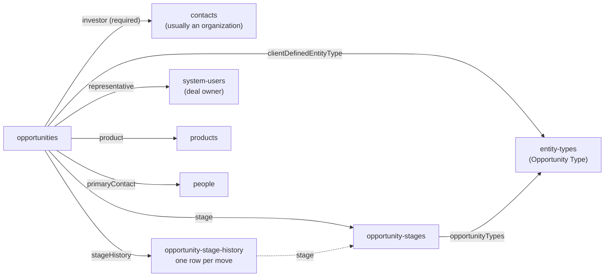

# Opportunities

> **Before you read.** [Reading the API](reading-the-api.md) (filters, includes) and
> [Contacts](contacts.md) (the `contacts` view and system users). Custom fields on deals are
> explained in [Custom fields](custom-fields-and-reference-data.md).

## The model

An **opportunity** is a deal in the sales pipeline: the firm is pitching something to one
investor. It sits in one **stage** at a time, and every stage move is recorded in its **stage
history**. Users also call it a "deal".

## Attributes

| Attribute | Meaning |
|---|---|
| `name` | Deal name. Required. |
| `currencyCode`, `isErisa` | Required when creating. |
| `requestedAmount` | The amount being pitched. Shown as "Amount" in the UI. |
| `probability` | 0 to 1. Starts from the stage's default probability but is stored on the deal and can be edited. |
| `weightedValue` | `requestedAmount × probability`, calculated by Backstop. |
| `allocatedAmount`, `weightedAllocatedValue` | Allocation amounts. |
| `isOpen` | Calculated: `true` while the current stage is not a closed stage. |
| `closedDate` | Only on closed deals: the date of the move into the closed stage. |
| `dateEnteredCurrentStage`, `daysInCurrentStage`, `daysOpen` | Calculated from the stage history. |
| `previousStage` | The **name** of the stage the deal **left** in its latest move. Missing if the deal never moved. It describes the latest move only. |
| `effectiveDate` | The day the deal was created. |
| `expectedInvestmentDate` | When the money is expected. |
| `type` | The deal's *classification* (a short text, "Opportunity Classification" in the UI). Not the JSON `type`. |
| `description`, `aliases`, `otherId`, `associationType`, `waitlistId` | Rarely used. |
| `stageEffectiveDate` | Write-only: back-dates a stage change (see [Writing data](writing-data.md#opportunities-and-stage-history)). Never returned. |
| `regularCustomFieldValues` | Deal custom fields. A tenant can keep its own pipeline vocabulary here. |

Dates other than the timestamps are local-midnight timestamps that stand for a calendar day.

## Relationships

| Relationship | Points to | Notes |
|---|---|---|
| `investor` | `contacts` | Required. A contacts id; `specificResource` says organization or person. |
| `stage` | `opportunity-stages` | Current stage |
| `stageHistory` | `opportunity-stage-history` | Every move |
| `representative` | `system-users` | The deal owner on the firm's side. Can differ from the investor organization's own `representative`. |
| `product` | `products` | The fund being pitched. Optional; check whether your tenant fills it. |
| `primaryContact` | `people` | |
| `referralSource` | `contacts` | |
| `investorType` | `investor-types` | |
| `clientDefinedEntityType` | `entity-types` | Opportunity Type (subtype). The base type unless the tenant created subtypes. |
| `ccedUsers` | `system-users` | "Notify User" in the UI |
| `permissionBucket`, `createdBy`, `modifiedBy` | | |
| activity lists, `entityRelationships`, `timeSeriesCustomFieldValues` | | |

## Reading opportunities

The server filters very little:

| Filter | Works |
|---|---|
| `filter[createdTimestamp]`, `filter[modifiedTimestamp]` | Yes |
| `filter[entityTypeId][eq]=<id>` | Yes (selects an Opportunity Type) |
| `filter[otherId]` | Yes |
| `filter[representative.name][eq]=<login>` | Yes. The system user's **login**, exact and case-sensitive. A display name returns nothing. |
| `filter[isOpen]`, stage, product, investor, `filter[dateEnteredCurrentStage]`, `filter[name][like]`, custom fields | **No** (400 `Invalid filter field`, or not available) |

So the usual way to answer "the open pipeline for strategy X" is to page through all
opportunities (a pipeline is rarely more than a few thousand deals) and filter in code on
`isOpen`, stage and custom fields.

- Sort: `id`, `createdTimestamp`, `modifiedTimestamp`, `otherId`. The default is `id` ascending,
  oldest deals first. This server still sends `sort=id` whenever it pages, because the default
  order is not documented as stable.
- Every relationship can be included, including nested ones:
  `include=investor,investor.representative,stage`.
- `filter[regularCustomFieldValues.definitionIds][eq]=<id>,<id>` trims each deal's custom fields to
  those definitions. It does **not** remove deals.
- Several deals at once: `GET /opportunities/101,102`.
- A contact's deals: `GET /organizations/{id}/opportunities`. On that sub-route `sort` is ignored
  and `filter[isOpen]` gives a 400.

## Stages (`opportunity-stages`)

- A tenant-defined ordered list. Attributes: `name`, `sortOrder`, `probability` (default for deals
  entering the stage), `closed` (a final stage), `numberOfOpportunities` (a live count),
  `deletable`.
- Relationship `opportunityTypes` (to `entity-types`): which Opportunity Types the stage applies
  to. Each type can have its own stage list.
- There is **no status field**. "Won" and "lost" are simply which closed stage a deal ended in.
- There is no `/opportunity-types` endpoint. Opportunity Types are `entity-types` rows.

## Stage history

- One row per move: `effectiveDate`, plus `stage` and `opportunity` as embedded links
  (`{resourceType, resourceId}`), not relationships.
- Read with `GET /opportunities/{id}/stageHistory`, or `include=stageHistory` on the collection
  (fifty deals and their histories in one call).
- There is no top-level list of stage history.
- **This sub-route rejects every parameter it does not know**, including `sort`
  (`400 Invalid filter field effectiveDate`). Sort the rows yourself by `(effectiveDate, id)`.
- Normally the current stage is the stage of the newest row; `dateEnteredCurrentStage` is its date
  and `closedDate` (on closed deals) equals it. `previousStage` is the stage of the row before.
  Rows added with `POST /bulk-opportunity-stage-history`, or a back-dated `PATCH`, can break this
  (see [Writing data](writing-data.md#opportunities-and-stage-history)). Trust `stage`, not the
  newest row.
- Deals do not have to start at the first stage, and can move backward.
- To answer "which deals changed stage in a window", `dateEnteredCurrentStage` and `previousStage`
  only describe the latest move. For earlier moves, read each deal's `stageHistory`.
- Some cached `resourceLink` values point to an internal host. Use `resourceId`.

## Things that trip people up

- `isOpen` and stage cannot be filtered on the server.
- `previousStage` is the stage the deal left, not the current one.
- Closed deals keep the probability they had, so their `weightedValue` is not zero. Sum weighted
  values over open deals only.
- `representative.name` is a login, not a display name.
- Adding stage history rows does **not** move the current stage (see
  [Writing data](writing-data.md#opportunities-and-stage-history)).
