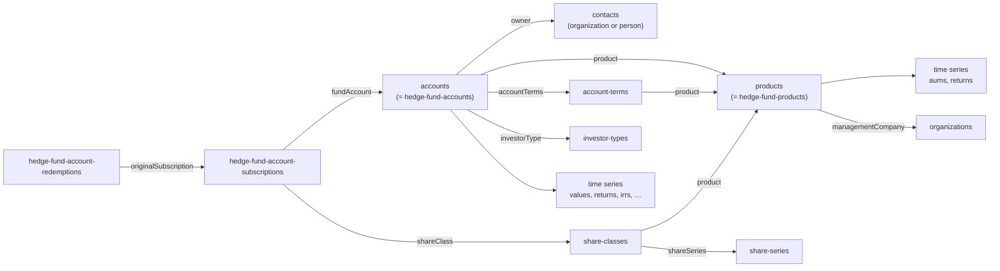

# Products and accounts

> **Before you read.** [Basics](basics.md) (the difference between products and funds; views
> such as `products` and `accounts`), [Reading the API](reading-the-api.md) (filters, includes,
> sparse fields) and [Contacts](contacts.md) (the `contacts` view, which is how an account points
> to its investor).

## The model

A **product** is a fund the firm runs and offers to investors: a feeder, a master fund, a fund of
one, a managed account. An **account** is one investor's position in one product. It has exactly
one **owner** (a contact, usually an organization) and exactly one **product**.

Money facts hang off accounts and products as **time series**: an account's month-end balance
(`values`), its returns and IRRs, fees; a product's AUM and returns. Money moving in and out is
recorded as **subscriptions** and **redemptions** on the account. A product is divided into
**share classes** (each with dated **share series**), and **account terms** hold the fee schedule
an account is on.



Do not confuse this family with **funds**, **investment vehicles** and **portfolio holdings**.
Those describe third-party funds the firm researches or invests in. A tenant that only manages its
own funds can have none of them. `/funds` is not the list of the firm's products.

## Views and typed collections

| Read-only view | Writable typed collection | Notes |
|---|---|---|
| `/products` | `/hedge-fund-products`, `/private-equity-products`, `/legacy-private-equity-products` | Same ids |
| `/accounts` | `/hedge-fund-accounts`, `/private-equity-accounts`, `/legacy-private-equity-accounts`, `/managed-accounts` | Same ids |
| `/hedge-fund-account-transactions` | `/hedge-fund-account-subscriptions`, `/…-redemptions`, `/…-transfers` | Same ids |

The typed row has more relationships than the view. For example `hedge-fund-accounts` adds
`subscriptions`, `redemptions`, `transactions` and `transfers`. Links inside responses usually
use the typed names (`hedge-fund-accounts/…`) even when you asked through the view.

## Products

### Attributes

| Attribute | Meaning |
|---|---|
| `name` | Legal or display name of the fund |
| `configuration.productShortName` | The firm's short code for the fund. The most useful key for people, but **not filterable** and not guaranteed unique. |
| `configuration.masterProductName`, `configuration.fiscalYearStartMonth` | Configuration values. |
| `productType` | Onshore or offshore, combined with the accounting basis, for example `ONSHORE_BALANCE_DRIVEN_TMV`, `OFFSHORE_BALANCE_DRIVEN_SHARE` or `ONSHORE_INCOME_DRIVEN`. Required. |
| `isOnshore` | Boolean. Can disagree with the name. |
| `inceptionDate`, `defaultProductCurrency` | Required. |
| `returnCalculationMethodology` | `TWRR_MV_MR`, `TWRR_QV_QR` or `TWRR_MV_QR` (time-weighted return, monthly or quarterly). |
| `latestClosedPeriodDate` | Last closed accounting period. |
| `description` | An object: `fundDescription`, `managerBio`, `thesis`, `investmentMethodology`. |
| `location`, `riskFreeRate`, `serviceProviders`, `otherId` | |
| `regularCustomFieldValues` | Product custom fields |

### Relationships

- To one: `managementCompany` (organizations), `fundManager` (people), `primaryProduct` (the
  master or main vehicle), `assetType`, `benchmarkA` to `benchmarkH`, `investorTypeForFormPf`,
  `permissionBucket`.
- To many: `accounts`, `accountTerms`, `sidePocketProducts`, `portfolioHoldings`, `exposures`, the
  activity lists, `entityRelationships`.
- Time series: `aums`, `returns` (typed collection), `benchmarkAReturns` … `benchmarkHReturns`,
  `expenseDataPoints`, `incomeDataPoints`.

### Reading products

- `filter[name][like]=…` (substring, case-insensitive), `filter[name][eq]`, `filter[otherId]`,
  `filter[modifiedTimestamp]`. Sort `name` works.
- **Not filterable:** short name, `productType`, `isOnshore`, `inceptionDate`, custom fields. A
  tenant rarely has more than a few hundred products, so read them all and filter in code.
- `fields=` drops custom field values unless you list `regularCustomFieldValues`.
- Quick search does not search short names.
- Never put a short name where an id goes: `/products/ABC` gives
  `400 Resource products with id ABC is invalid`.

## Share classes, share series and account terms

- **Share class** (`share-classes`): a class of interests within a product, differing in fees,
  liquidity or eligibility. `name`, `description`, `currencyType`, `defaultInitialSharePrice`,
  `newIssueEligibility`, `seriesSubscriptionRule`, `closedDate`, `historicalAccountTerms`.
  Relationships `product` and `shareSeries`. Filter by `product.id`.
- **Share series** (`share-series`): a dated issue within a class: `name`, `periodDate`,
  `isBaseSeries`, `closedDate`, `consolidateDate`.
- **Account term** (`account-terms`): a fee schedule: `name`, `managementFeePercent` and
  `performanceFeePercent` as **fractions** (0.02 means 2%), `hurdleRate`, `isDefault`.
  Relationship `product`. Sort by `id` only; no filters.
- An account's `historicalAccountTerms` lists `{effectiveDate, accountTermId}` over time.
  `/accounts/{id}/accountTerms` returns the current term as a single record.

## Accounts

### Attributes

| Attribute | Meaning |
|---|---|
| `name` | The account's registration name. **Not** reliably the investor's name: follow `owner`. |
| `currency` | Required. Every amount on the account is in this currency. |
| `accountStartDate` | When the account was funded |
| `closedDate` | Only present on closed accounts. **An open account has no `closedDate` key.** |
| `ownershipType` | `SOLE`, `JOINT_TENANTS_IN_COMMON`, `JOINT_TENANTS_WITH_RIGHTS_OF_SURVIVORSHIP` |
| `newIssueEligible` | `ELIGIBLE`, `NOT_ELIGIBLE`, `UNKNOWN`, `N/A`, `10%_RESTRICTED` |
| `investorQualification` | `{status, option}` |
| `isEmployeeAccount`, `isGpAccount`, `usDomiciled`, `amlCheckComplete`, `blueSkyCompliant`, `erisaPercent`, … | Regulatory and operational flags |
| `taxId`, `primaryBankInfo`, `secondaryBankInfo` | Sensitive |
| `historicalAccountTerms` | Fee term history |
| `otherId` | An external id, for example the fund administrator's account id |
| `regularCustomFieldValues` | Account custom fields |

### Relationships

| Relationship | Points to | Notes |
|---|---|---|
| `owner` | `contacts` | The investor. Required. Check `specificResource` on the contact to see if it is an organization or a person. |
| `product` | `products` | Required |
| `investorType`, `investorTypeForFormPf` | `investor-types`, `form-pf-investor-types` | Investor classification lists (below) |
| `primaryContact` | `people` | |
| `accountTerms` | `account-terms` | The current fee term |
| `historicalOwners` | `historical-account-owners` | Ownership history |
| activity lists, `entityRelationships`, `timeSeriesCustomFieldValues` | | |
| 17 time series | `time-series` | See below |

### Reading accounts

| Need | Request |
|---|---|
| Investors in one product | `GET /accounts?filter[product.id][eq]=<productId>` or `GET /products/{id}/accounts` |
| …by short name | `filter[product.shortName][eq]=<code>` (the only place a short name is filterable) |
| Accounts of one investor | `filter[owner.id][eq]=<contactId>` (works, though the swagger does not list it; *observed*). This server does not rely on it: it reads every `/accounts` page and matches the owner in code. `filter[owner][eq]` gives a 400. |
| With owner names | `include=owner&fields[contacts]=name` (owners arrive as `contacts`) |
| Account name contains | `filter[name][like]=…` |
| Sort | `id`, `name`, `createdTimestamp`, `modifiedTimestamp`, `otherId` |

There is no open/closed filter. Check for `closedDate` in code.

## Time series

Dated numbers live in sub-routes, one series per request:

```
GET /accounts/{id}/values?filter[date][ge]=2026-01-01&sort=-date
GET /products/{id}/aums
```

| On | Series |
|---|---|
| Accounts | `values` (balance), `returns`, `irrs`, `currentMonthIrrs`, `currentMonthNetAssests` (Backstop's spelling), `earnings`, `grossValues`, `startingValues`, `totalInvested`, `totalRedemptions`, `managementFees`, `incentiveFees`, `incentiveFeesCharged`, `performanceFeeAccrued`, `highwaterMarks`, `newIssueIncomes`, `percentageOfFundHistory` |
| Products | `aums`, `benchmarkAReturns` … `benchmarkHReturns`, `expenseDataPoints`, `incomeDataPoints`. Also `returns` (on `hedge-fund-products`), `startingValues` and `values` (*observed*; this server's list in `time_series_name.py` has these three for accounts only). |

- A row is `{date, value}`, with extras: `valueStatus` (`ACTUAL` or `ESTIMATE`) and
  `valueOverridden` on account values, `source` on product AUM (for example "AUM from Accounts").
- Dates are period ends, at local midnight.
- `value` is a number **without a currency**. Use the account's `currency` or the product's
  `defaultProductCurrency`.
- `returns`, `irrs` and `percentageOfFundHistory` are fractions (0.0088 means 0.88%).
- Default order is oldest first. `sort=date` and `sort=-date` work; `filter[date][op]` works with
  two clauses for a window.
- **Placeholder rows.** Backstop creates rows for the current and next period end before the
  number exists. The newest rows of `returns` and `irrs` often have a `date` and no `value`. Look
  for the newest row that has a value.
- **Estimates.** Recent months of `values` can be `ESTIMATE`, and an estimate can exist for a
  month that has not ended yet.
- There is **no NAV series**. `/accounts/{id}/navs` returns an HTML 404. An account's NAV is its
  `values`; a fund's size is its `aums`.
- `GET /time-series` on its own gives `400 Find all time-series is not allowed.`

## Subscriptions and redemptions

| Collection | Holds |
|---|---|
| `hedge-fund-account-subscriptions` | Money in, including transfers in |
| `hedge-fund-account-redemptions` | Money out, including transfers out |
| `hedge-fund-account-transfers` | Account-to-account transfers |
| `hedge-fund-account-transactions` | Read-only union of all of these |

- **A date filter is required**: without one,
  `400 You can not query this resource without filter criteria.` Use
  `filter[transactionDate][ge]=…&filter[transactionDate][le]=…`.
- There is **no product, account or status filter**. Read the whole window and narrow in code,
  or use `/hedge-fund-accounts/{id}/subscriptions` for one account.
- Ties on the same date reorder between requests, so offset paging over a sorted window can skip
  rows. Read the window whole when you can.

Fields:

- Subscriptions: `amount`, `transactionDate` (dealing date), `noticeDate`, `confirmationDate`,
  `numberOfShares`, `status`, `description`, `legacyTransactionType` (`SUBSCRIPTION`,
  `TRANSFER_SUBSCRIPTION`). Relationships `fundAccount` (the account), `shareClass`, `shareSeries`,
  `transactionType`.
- Redemptions: the same, plus `liquidating` (a full redemption) and `legacyTransactionType`
  `REDEMPTION` or `TRANSFER_REDEMPTION`. **A redemption has no `fundAccount`**: reach the account
  through `originalSubscription.fundAccount`, for example
  `include=originalSubscription.fundAccount.owner`.
- `status`: `TENTATIVE`, `COMMITTED`, `COMPLETED`, `CANCELED`. Count `COMPLETED` as actual.
- `amount` has no currency; use the account's.
- Share class and series are **relationships**, not attributes.

## A contact's holdings in one call (`bsg-account-table-data`)

The web app's account table uses an endpoint that is not in the swagger:

```
GET /bsg-account-table-data?entityId=<organization or person id>
```

It returns one row with `openCount`, `closedCount`, `allCount` and an `accounts` list. Each entry
has `investor`, `account`, `product` (with `shortName`), `organization`, `accountTerm`,
`fundedDate`, `closedDate`, `closed`, `otherId`, `associationType`, `customFieldValues`, and money
objects `balance`, `commitment`, `unfundedCommitment` (`{amount, currency, currencySymbol,
formattedValue}`), plus `percentageOfProduct` and `percentageOfMaster`.

Be careful:

- It **fails open**: a product id, an unknown id, or a contact with no accounts all return 200 with
  an empty table. You cannot tell them apart.
- `meta.totalResourceCount` is always 0. Use the counts inside the row.
- Without `entityId`: `400 entityId must be provided for this repository.`
- The documented way to get the same facts is the owner's accounts plus each account's latest
  `values` and `percentageOfFundHistory`. That route has no commitment or share of master.

## Investor types

- `investor-types`: the firm's list of investor classifications, `{classificationType (label),
  investorType}` where `investorType` is a coarse code (`corporate`, `endowment`, `individual`,
  `unknown`). Used by `accounts.investorType`.
- `form-pf-investor-types`: the SEC Form PF beneficial-owner categories, `{responseOption}`.
- These classify **accounts**, not organizations. A tenant may keep a separate "investor type"
  custom field on organizations, and the two need not agree.
