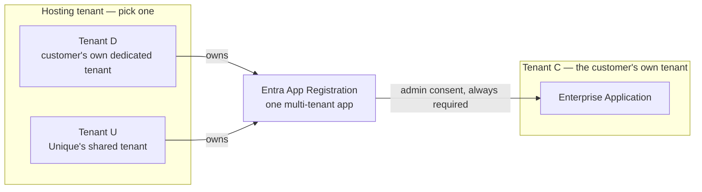

<!-- confluence-page-id: 2760507523 -->
<!-- confluence-space-key: PUBDOC -->

# Office 365 MCP

!!! danger "Documentation Disclaimer"
    This feature is `EXPERIMENTAL` and under active development. It may change significantly, be
    discontinued, or have breaking changes without notice.

## Overview

office-365-mcp is a Python MCP server, built on FastMCP. It connects Microsoft 365 to MCP clients
through the Microsoft Graph API.

- **Reaches:** Outlook mail, calendar, and contacts. Microsoft Teams. SharePoint and OneDrive.
  OneNote. The identity of the signed-in user.
- **Size:** 121 tools in total.
- **Selection:** A deployment turns on a fixed subset of the tools. It picks one or more
  **presets**, which are named bundles of tools, or an exact **list** of tools.
- **Always on:** The tool `get_me` is on in every deployment.
- **Live data:** Every call goes to Microsoft Graph at once. The server keeps no copy of mail or
  messages. It stores only an OAuth token.

## Choose a preset

1. Find your area in the index below: Teams, Outlook, SharePoint and OneDrive, or OneNote.
2. Pick the smallest preset that does the job. A preset that builds on another preset holds all of
   its tools. To cover more than one area, pick one preset for each area.
3. Read the Admin consent column. If it says Yes, a tenant administrator must grant consent before
   any user signs in.
4. Set the preset in the Helm values. See [Deployment](#deployment).

Rules for the selection:

- A deployment sets exactly one of `preset` or `enabled`. It never sets both, and it never sets
  neither. The Helm chart schema, the Terraform module, and the startup check of the server enforce
  this rule.
- A deployment can name several presets in a comma-separated list, for example
  `teams-write,outlook-read`, or in a YAML list. It gets the union of their tools and of their permissions. The union
  needs admin consent when at least one of the presets needs it.
- A deployment cannot combine presets with the `enabled` list. It cannot add or remove one tool of a
  preset. For a mix of tools that no presets cover, name every wanted tool in the `enabled` list.
- Four presets are opt-in: `outlook-delete`, `outlook-rules`, `outlook-calendar-manage`, and
  `onenote-delete`. Each one is a base preset plus the tools that remove an item, write an inbox
  rule, forward an event, or share a calendar. No other preset holds these tools. A list of presets
  gets them only when the list names one of these four.

## Preset index

Each row links to the section of that preset. The count of tools does not include `get_me`, which every deployment turns on.

**Teams.** Chats, channels, meetings, transcripts, and the files of a channel.

| Preset | Use it to | Tools | Admin consent |
| --- | --- | --- | --- |
| [`teams`](#teams) | Read chats, channels, messages, transcripts, and recordings. | 12 | ⚠️ Yes |
| [`teams-chat`](#teams-chat) | List chats and the members of one chat. | 2 | No |
| [`teams-messages`](#teams-messages) | Find and read Teams messages. | 5 | ⚠️ Yes |
| [`teams-channels`](#teams-channels) | Walk teams and read channel posts. | 4 | ⚠️ Yes |
| [`teams-transcripts`](#teams-transcripts) | Find a meeting and read its transcript. | 3 | ⚠️ Yes |
| [`teams-recordings`](#teams-recordings) | See whether a meeting was recorded. | 2 | ⚠️ Yes |
| [`teams-meetings`](#teams-meetings) | Read transcripts and recording details of a meeting. | 4 | ⚠️ Yes |
| [`teams-write`](#teams-write) | Post messages and reactions in chats and channels. | 8 | No |
| [`teams-write-files`](#teams-write-files) | Post messages with files from SharePoint. | 13 | ⚠️ Yes |
| [`teams-edit`](#teams-edit) | Edit and delete your own Teams messages. | 12 | ⚠️ Yes |
| [`teams-meetings-write`](#teams-meetings-write) | Create, change, and delete Teams online meetings. | 6 | No |
| [`teams-chat-admin`](#teams-chat-admin) | Create chats, and manage their members and names. | 6 | ⚠️ Yes |
| [`teams-files`](#teams-files) | Find and read the files of a channel. | 7 | ⚠️ Yes |

**Outlook mail.** Messages, folders, drafts, and sending.

| Preset | Use it to | Tools | Admin consent |
| --- | --- | --- | --- |
| [`outlook-read`](#outlook-read) | Read and search mail. No change to the mailbox. | 10 | No |
| [`outlook-write`](#outlook-write) | Mark, file, and copy mail. Create and change drafts. | 20 | No |
| [`outlook-delete`](#outlook-delete) | `outlook-write`, plus moving a folder to Deleted Items. | 21 | No |
| [`outlook-send`](#outlook-send) | `outlook-write`, plus sending a draft. | 21 | No |

**Outlook mailbox settings.** Inbox rules, the automatic reply, and categories.

| Preset | Use it to | Tools | Admin consent |
| --- | --- | --- | --- |
| [`outlook-mailbox`](#outlook-mailbox) | Read inbox rules, the automatic reply, and categories. | 3 | No |
| [`outlook-automate`](#outlook-automate) | Set the automatic reply, turn off a rule, create a category. | 6 | No |
| [`outlook-rules`](#outlook-rules) | Create, change, and erase inbox rules. | 9 | No |

**Outlook calendar.** Calendars, events, availability, rooms, and sharing.

| Preset | Use it to | Tools | Admin consent |
| --- | --- | --- | --- |
| [`outlook-calendar`](#outlook-calendar) | Read calendars, events, and free time. | 12 | No |
| [`outlook-calendar-write`](#outlook-calendar-write) | Create, change, and cancel events. Answer invitations. | 16 | No |
| [`outlook-calendar-manage`](#outlook-calendar-manage) | `outlook-calendar-write`, plus forward, delete, and share. | 21 | No |
| [`outlook-calendar-delegate`](#outlook-calendar-delegate) | `outlook-calendar-write`, plus events for another person. | 17 | No |
| [`outlook-calendar-rooms`](#outlook-calendar-rooms) | `outlook-calendar-write`, plus finding meeting rooms. | 17 | ⚠️ Yes |
| [`outlook-group-calendar`](#outlook-group-calendar) | Read the calendar of a team. | 2 | No |

**Outlook contacts.** The default Contacts folder.

| Preset | Use it to | Tools | Admin consent |
| --- | --- | --- | --- |
| [`outlook-contacts`](#outlook-contacts) | Read your contacts. | 2 | No |
| [`outlook-contacts-write`](#outlook-contacts-write) | Create and change contacts. | 4 | No |

**SharePoint and OneDrive.** Files, folders, sharing, and sites.

| Preset | Use it to | Tools | Admin consent |
| --- | --- | --- | --- |
| [`sharepoint-search`](#sharepoint-search) | Find files and list folders. | 3 | ⚠️ Yes |
| [`sharepoint-read`](#sharepoint-read) | `sharepoint-search`, plus reading a file. | 4 | ⚠️ Yes |
| [`sharepoint-write`](#sharepoint-write) | Create, rename, move, copy, and delete files and folders. | 11 | ⚠️ Yes |
| [`sharepoint-share`](#sharepoint-share) | `sharepoint-write`, plus sharing links and invitations. | 13 | ⚠️ Yes |
| [`sharepoint-sites`](#sharepoint-sites) | `sharepoint-read`, plus finding SharePoint sites. | 5 | ⚠️ Yes |

**OneNote.** Notebooks, sections, and pages.

| Preset | Use it to | Tools | Admin consent |
| --- | --- | --- | --- |
| [`onenote-read`](#onenote-read) | Read notebooks, sections, and pages. | 8 | No |
| [`onenote-write`](#onenote-write) | Create, edit, and copy notebooks, sections, and pages. | 19 | No |
| [`onenote-delete`](#onenote-delete) | `onenote-write`, plus erasing a page. | 20 | No |

## How to read a preset section

Each preset section has the same parts, in this order.

| Part | What it gives |
| --- | --- |
| Header line | The count of tools, the admin consent rule, and the preset that this preset builds on. The count does not include `get_me`. |
| You can | What a user can do with the preset. |
| Tools | The tools of the preset. A preset that builds on another preset lists only the new tools. |
| What it needs | The Graph permissions, the admin consent rule, and the user approval rule. |

The tables use these symbols.

| Column | Symbol | Meaning |
| --- | --- | --- |
| Kind | 🟢 Read | The tool reads data. |
| Kind | 🟠 Add | The tool adds data, or the change is safe to repeat. |
| Kind | 🔴 Change | The tool changes or removes data. |
| Admin consent | ⚠️ | An administrator must grant consent. |
| User approval | ✋ | The tool asks the user every time. |
| User approval | 🤝 | The tool asks the user in some cases only. The text next to the symbol gives the case. |
| User approval | — | The tool never asks the user. |

Two facts about these columns:

- The Kind column is a hint to the calling client. It does not control access to the tool.
- A tool that acts on things that belong to other people asks the user to approve first. The question
  shows what will happen. If the user declines, the tool changes nothing.

The Kind hint also sets the error text that the model gets when Microsoft 365 fails or does not
answer. For a change that is not safe to repeat, the text tells the model to make sure that the
change is not already there. If a tool of the deployment can show the change, the text names that
tool. If not, the text tells the model to ask the user.

## Teams presets

Chats, channels, meetings, transcripts, and the files of a channel.

### `teams`

**12 tools** · Admin consent: ⚠️ **required**

**You can**

- Find a chat, and read its newest messages and members.
- Walk the channels of a team, and read the posts and replies of a channel.
- Search every Teams message that you can see.
- Read the transcript of a meeting, and see whether a recording exists.

**Note:** This preset holds every Teams tool of the Read kind, except `teams_get_channel_files_folder` and `teams_read_meeting`.

**Tools**

| Tool | Kind | User approval | What it does |
| --- | --- | --- | --- |
| `teams_list_chats` | 🟢 Read | — | Lists your chats, newest first. Shows the last message, the sender, and the read status. |
| `teams_list_chat_messages` | 🟢 Read | — | Reads the newest messages of one chat. Can go further back with `sent_before`. |
| `teams_list_chat_members` | 🟢 Read | — | Lists the members of one chat, with user id, name, email address, and roles. |
| `teams_list_my_teams` | 🟢 Read | — | Lists the teams that you are a member of. |
| `teams_list_channels` | 🟢 Read | — | Lists the channels of one team that you can access. |
| `teams_browse_channel` | 🟢 Read | — | Reads the newest 50 posts of one channel, with their replies. |
| `teams_list_message_replies` | 🟢 Read | — | Reads up to 50 replies to one channel post, oldest first. |
| `teams_search_messages` | 🟢 Read | — | Searches the text of every chat and channel message that you can see. |
| `teams_read_message` | 🟢 Read | — | Reads one message in full, from a handle that another tool gave. |
| `teams_list_meeting_transcripts` | 🟢 Read | — | Says whether a meeting has a transcript. Gives a handle for each transcript. |
| `teams_read_transcript` | 🟢 Read | — | Reads one page of a transcript, as timestamped turns with the speaker named. |
| `teams_list_meeting_recordings` | 🟢 Read | — | Says whether a recording exists, how long it runs, and who can download it. Never returns the video. |

**What it needs**

- **Graph permissions (8):** `Channel.ReadBasic.All`, `ChannelMessage.Read.All`, `Chat.Read`, `OnlineMeetingRecording.Read.All`, `OnlineMeetingTranscript.Read.All`, `OnlineMeetings.Read`, `Team.ReadBasic.All`, `User.Read`
- **Admin consent:** ⚠️ Required for `ChannelMessage.Read.All`, `OnlineMeetingRecording.Read.All`, `OnlineMeetingTranscript.Read.All`. A tenant administrator must grant consent before any user signs in.
- **User approval:** None. No tool of this preset asks the user.

### `teams-chat`

**2 tools** · Admin consent: **not required**

**You can**

- List your Teams chats.
- List the members of one chat.

**Note:** This preset cannot read a chat message.

**Tools**

| Tool | Kind | User approval | What it does |
| --- | --- | --- | --- |
| `teams_list_chats` | 🟢 Read | — | Lists your chats, newest first. Shows the last message, the sender, and the read status. |
| `teams_list_chat_members` | 🟢 Read | — | Lists the members of one chat, with user id, name, email address, and roles. |

**What it needs**

- **Graph permissions (2):** `Chat.Read`, `User.Read`
- **Admin consent:** Not required.
- **User approval:** None. No tool of this preset asks the user.

### `teams-messages`

**5 tools** · Admin consent: ⚠️ **required**

**You can**

- Search for a message anywhere, and read it in full.
- List the newest messages of a chat.
- Read the replies to a channel post.

**Tools**

| Tool | Kind | User approval | What it does |
| --- | --- | --- | --- |
| `teams_list_chats` | 🟢 Read | — | Lists your chats, newest first. Shows the last message, the sender, and the read status. |
| `teams_list_chat_messages` | 🟢 Read | — | Reads the newest messages of one chat. Can go further back with `sent_before`. |
| `teams_list_message_replies` | 🟢 Read | — | Reads up to 50 replies to one channel post, oldest first. |
| `teams_search_messages` | 🟢 Read | — | Searches the text of every chat and channel message that you can see. |
| `teams_read_message` | 🟢 Read | — | Reads one message in full, from a handle that another tool gave. |

**What it needs**

- **Graph permissions (3):** `ChannelMessage.Read.All`, `Chat.Read`, `User.Read`
- **Admin consent:** ⚠️ Required for `ChannelMessage.Read.All`. A tenant administrator must grant consent before any user signs in.
- **User approval:** None. No tool of this preset asks the user.

### `teams-channels`

**4 tools** · Admin consent: ⚠️ **required**

**You can**

- List your teams and their channels.
- Read the posts in one channel.
- Read the replies to one post.

**Tools**

| Tool | Kind | User approval | What it does |
| --- | --- | --- | --- |
| `teams_list_my_teams` | 🟢 Read | — | Lists the teams that you are a member of. |
| `teams_list_channels` | 🟢 Read | — | Lists the channels of one team that you can access. |
| `teams_browse_channel` | 🟢 Read | — | Reads the newest 50 posts of one channel, with their replies. |
| `teams_list_message_replies` | 🟢 Read | — | Reads up to 50 replies to one channel post, oldest first. |

**What it needs**

- **Graph permissions (4):** `Channel.ReadBasic.All`, `ChannelMessage.Read.All`, `Team.ReadBasic.All`, `User.Read`
- **Admin consent:** ⚠️ Required for `ChannelMessage.Read.All`. A tenant administrator must grant consent before any user signs in.
- **User approval:** None. No tool of this preset asks the user.

### `teams-transcripts`

**3 tools** · Admin consent: ⚠️ **required**

**You can**

- Find a meeting from its chat.
- See whether the meeting has a transcript.
- Read the transcript, one page at a time.

**Tools**

| Tool | Kind | User approval | What it does |
| --- | --- | --- | --- |
| `teams_list_chats` | 🟢 Read | — | Lists your chats, newest first. Shows the last message, the sender, and the read status. |
| `teams_list_meeting_transcripts` | 🟢 Read | — | Says whether a meeting has a transcript. Gives a handle for each transcript. |
| `teams_read_transcript` | 🟢 Read | — | Reads one page of a transcript, as timestamped turns with the speaker named. |

**What it needs**

- **Graph permissions (4):** `Chat.Read`, `OnlineMeetingTranscript.Read.All`, `OnlineMeetings.Read`, `User.Read`
- **Admin consent:** ⚠️ Required for `OnlineMeetingTranscript.Read.All`. A tenant administrator must grant consent before any user signs in.
- **User approval:** None. No tool of this preset asks the user.

### `teams-recordings`

**2 tools** · Admin consent: ⚠️ **required**

**You can**

- Find a meeting from its chat.
- See whether a recording exists, how long it runs, and who can download it.

**Note:** The preset never returns the video.

**Tools**

| Tool | Kind | User approval | What it does |
| --- | --- | --- | --- |
| `teams_list_chats` | 🟢 Read | — | Lists your chats, newest first. Shows the last message, the sender, and the read status. |
| `teams_list_meeting_recordings` | 🟢 Read | — | Says whether a recording exists, how long it runs, and who can download it. Never returns the video. |

**What it needs**

- **Graph permissions (4):** `Chat.Read`, `OnlineMeetingRecording.Read.All`, `OnlineMeetings.Read`, `User.Read`
- **Admin consent:** ⚠️ Required for `OnlineMeetingRecording.Read.All`. A tenant administrator must grant consent before any user signs in.
- **User approval:** None. No tool of this preset asks the user.

### `teams-meetings`

**4 tools** · Admin consent: ⚠️ **required**

**You can**

- Find a meeting from its chat.
- Read the transcript of the meeting.
- See whether a recording exists, and who can download it.

**Tools**

| Tool | Kind | User approval | What it does |
| --- | --- | --- | --- |
| `teams_list_chats` | 🟢 Read | — | Lists your chats, newest first. Shows the last message, the sender, and the read status. |
| `teams_list_meeting_transcripts` | 🟢 Read | — | Says whether a meeting has a transcript. Gives a handle for each transcript. |
| `teams_read_transcript` | 🟢 Read | — | Reads one page of a transcript, as timestamped turns with the speaker named. |
| `teams_list_meeting_recordings` | 🟢 Read | — | Says whether a recording exists, how long it runs, and who can download it. Never returns the video. |

**What it needs**

- **Graph permissions (5):** `Chat.Read`, `OnlineMeetingRecording.Read.All`, `OnlineMeetingTranscript.Read.All`, `OnlineMeetings.Read`, `User.Read`
- **Admin consent:** ⚠️ Required for `OnlineMeetingRecording.Read.All`, `OnlineMeetingTranscript.Read.All`. A tenant administrator must grant consent before any user signs in.
- **User approval:** None. No tool of this preset asks the user.

### `teams-write`

**8 tools** · Admin consent: **not required**

**You can**

- Find a chat or a channel.
- Post a new message to a chat or to a channel, or reply in a thread.
- Add or remove a reaction.
- List the messages and the members of a chat.

**Tools**

| Tool | Kind | User approval | What it does |
| --- | --- | --- | --- |
| `teams_list_chats` | 🟢 Read | — | Lists your chats, newest first. Shows the last message, the sender, and the read status. |
| `teams_list_chat_messages` | 🟢 Read | — | Reads the newest messages of one chat. Can go further back with `sent_before`. |
| `teams_list_chat_members` | 🟢 Read | — | Lists the members of one chat, with user id, name, email address, and roles. |
| `teams_list_my_teams` | 🟢 Read | — | Lists the teams that you are a member of. |
| `teams_list_channels` | 🟢 Read | — | Lists the channels of one team that you can access. |
| `teams_send_chat_message` | 🟠 Add | ✋ Always | Posts a plain-text message to a chat. Supports mentions, a subject, and an importance. |
| `teams_send_channel_message` | 🟠 Add | ✋ Always | Posts a message to a channel, or a reply in a thread. Supports mentions, a subject, and an importance. |
| `teams_react_to_message` | 🔴 Change | ✋ Always | Adds or removes one reaction on a chat message, a channel post, or a reply. |

**What it needs**

- **Graph permissions (6):** `Channel.ReadBasic.All`, `ChannelMessage.Send`, `Chat.Read`, `ChatMessage.Send`, `Team.ReadBasic.All`, `User.Read`
- **Admin consent:** Not required.
- **User approval:** Asks ✋ every time for `teams_send_chat_message`, `teams_send_channel_message`, `teams_react_to_message`.

### `teams-write-files`

**13 tools** · Admin consent: ⚠️ **required** · Builds on [`teams-write`](#teams-write)

**You can**

- Do everything in `teams-write`.
- Post a message with files that are already in SharePoint.
- Find the file to attach, and list the drives that hold it.

**Tools added by this preset**

| Tool | Kind | User approval | What it does |
| --- | --- | --- | --- |
| `teams_send_chat_message_with_files` | 🟠 Add | ✋ Always | Posts a message to a chat with files that are already in SharePoint. Uploads nothing. |
| `teams_send_channel_message_with_files` | 🟠 Add | ✋ Always | Posts a message to a channel with files that are already in SharePoint. Uploads nothing. |
| `sharepoint_search_files` | 🟢 Read | — | Searches the files and folders that you can see, across OneDrive and SharePoint. |
| `sharepoint_browse_folder` | 🟢 Read | — | Lists one level of one folder, sorted by name, date, or size. |
| `sharepoint_list_drives` | 🟢 Read | — | Lists your drives, with a handle for each. |

**What it needs**

- **Graph permissions (7):** `Channel.ReadBasic.All`, `ChannelMessage.Send`, `Chat.Read`, `ChatMessage.Send`, `Files.Read.All`, `Team.ReadBasic.All`, `User.Read`
- **Admin consent:** ⚠️ Required for `Files.Read.All`. A tenant administrator must grant consent before any user signs in.
- **User approval:** Asks ✋ every time for `teams_send_chat_message`, `teams_send_channel_message`, `teams_send_chat_message_with_files`, `teams_send_channel_message_with_files`, `teams_react_to_message`.

### `teams-edit`

**12 tools** · Admin consent: ⚠️ **required** · Builds on [`teams-write`](#teams-write)

**You can**

- Do everything in `teams-write`.
- Edit or delete a message that you sent.
- Read the posts of a channel and the replies to a post, to find the message to change.

**Tools added by this preset**

| Tool | Kind | User approval | What it does |
| --- | --- | --- | --- |
| `teams_browse_channel` | 🟢 Read | — | Reads the newest 50 posts of one channel, with their replies. |
| `teams_list_message_replies` | 🟢 Read | — | Reads up to 50 replies to one channel post, oldest first. |
| `teams_edit_message` | 🔴 Change | ✋ Always | Replaces the text of one message that you sent. |
| `teams_delete_message` | 🔴 Change | ✋ Always | Deletes one message that you sent. Teams shows it as deleted. This connector cannot restore it. |

**What it needs**

- **Graph permissions (9):** `Channel.ReadBasic.All`, `ChannelMessage.Read.All`, `ChannelMessage.ReadWrite`, `ChannelMessage.Send`, `Chat.Read`, `Chat.ReadWrite`, `ChatMessage.Send`, `Team.ReadBasic.All`, `User.Read`
- **Admin consent:** ⚠️ Required for `ChannelMessage.Read.All`, `ChannelMessage.ReadWrite`. A tenant administrator must grant consent before any user signs in.
- **User approval:** Asks ✋ every time for `teams_send_chat_message`, `teams_send_channel_message`, `teams_react_to_message`, `teams_edit_message`, `teams_delete_message`.

### `teams-meetings-write`

**6 tools** · Admin consent: **not required**

**You can**

- Find a meeting chat, and read one meeting with its attendance.
- Create a Teams online meeting.
- Change or delete a meeting that you organize.
- List the members of a chat, to find the id of an attendee.

**Tools**

| Tool | Kind | User approval | What it does |
| --- | --- | --- | --- |
| `teams_list_chats` | 🟢 Read | — | Lists your chats, newest first. Shows the last message, the sender, and the read status. |
| `teams_list_chat_members` | 🟢 Read | — | Lists the members of one chat, with user id, name, email address, and roles. |
| `teams_read_meeting` | 🟢 Read | — | Reads one meeting and its attendance reports. Only the organizer gets attendance. |
| `teams_create_meeting` | 🟠 Add | ✋ Always | Creates a Teams online meeting with the attendees that you name. It sends no invitation and uses no calendar. |
| `teams_update_meeting` | 🔴 Change | ✋ Always | Changes the subject, the time, or the attendees of a meeting that you organize. |
| `teams_delete_meeting` | 🔴 Change | ✋ Always | Deletes a Teams online meeting that you organize. It never deletes a calendar event. |

**What it needs**

- **Graph permissions (5):** `Chat.Read`, `OnlineMeetingArtifact.Read.All`, `OnlineMeetings.Read`, `OnlineMeetings.ReadWrite`, `User.Read`
- **Admin consent:** Not required.
- **User approval:** Asks ✋ every time for `teams_create_meeting`, `teams_update_meeting`, `teams_delete_meeting`.

### `teams-chat-admin`

**6 tools** · Admin consent: ⚠️ **required** · Builds on [`teams-chat`](#teams-chat)

**You can**

- Do everything in `teams-chat`.
- Create a one-to-one chat or a group chat.
- Add a member to a chat, or remove one.
- Rename a group chat.

**Tools added by this preset**

| Tool | Kind | User approval | What it does |
| --- | --- | --- | --- |
| `teams_create_chat` | 🟠 Add | ✋ Always | Creates a one-to-one chat or a group chat. It posts no message. |
| `teams_add_chat_member` | 🟠 Add | ✋ Always | Adds one person to a chat, with the `owner` role. Microsoft refuses this for a one-to-one chat. |
| `teams_remove_chat_member` | 🔴 Change | ✋ Always | Removes one member from a chat. Microsoft refuses this for a one-to-one chat. |
| `teams_rename_chat` | 🔴 Change | ✋ Always | Changes the topic of a group chat. |

**What it needs**

- **Graph permissions (5):** `Chat.Create`, `Chat.Read`, `Chat.ReadWrite`, `ChatMember.ReadWrite`, `User.Read`
- **Admin consent:** ⚠️ Required for `ChatMember.ReadWrite`. A tenant administrator must grant consent before any user signs in.
- **User approval:** Asks ✋ every time for `teams_create_chat`, `teams_add_chat_member`, `teams_remove_chat_member`, `teams_rename_chat`.

### `teams-files`

**7 tools** · Admin consent: ⚠️ **required**

**You can**

- Find a channel, and the SharePoint folder that holds its files.
- List that folder, and read one file.
- Search for a file, and list your drives.

**Tools**

| Tool | Kind | User approval | What it does |
| --- | --- | --- | --- |
| `teams_list_my_teams` | 🟢 Read | — | Lists the teams that you are a member of. |
| `teams_list_channels` | 🟢 Read | — | Lists the channels of one team that you can access. |
| `teams_get_channel_files_folder` | 🟢 Read | — | Gives the SharePoint folder of one channel. It does not list the files. |
| `sharepoint_search_files` | 🟢 Read | — | Searches the files and folders that you can see, across OneDrive and SharePoint. |
| `sharepoint_browse_folder` | 🟢 Read | — | Lists one level of one folder, sorted by name, date, or size. |
| `sharepoint_list_drives` | 🟢 Read | — | Lists your drives, with a handle for each. |
| `sharepoint_read_file` | 🟢 Read | — | Reads one file of 10 MB or less, in its original format or as PDF. |

**What it needs**

- **Graph permissions (4):** `Channel.ReadBasic.All`, `Files.Read.All`, `Team.ReadBasic.All`, `User.Read`
- **Admin consent:** ⚠️ Required for `Files.Read.All`. A tenant administrator must grant consent before any user signs in.
- **User approval:** None. No tool of this preset asks the user.

## Outlook mail presets

Messages, folders, drafts, and sending.

### `outlook-read`

**10 tools** · Admin consent: **not required**

**You can**

- Find a message, and read it in full.
- Walk the folder tree, list a folder, and read a whole thread.
- List and read attachments.
- Find the email address behind a name.
- Read MailTips, and list the senders that have a fixed inbox tab.

**Tools**

| Tool | Kind | User approval | What it does |
| --- | --- | --- | --- |
| `outlook_search_mail` | 🟢 Read | — | Searches your mailbox, or a shared mailbox, with a KQL query. Filters by importance, flag, category, and attachments. |
| `outlook_read_mail` | 🟢 Read | — | Reads one message in full. Lists its attachments and headers, but never their bytes. |
| `outlook_list_attachments` | 🟢 Read | — | Lists the attachments of one message, with name, size, and type. |
| `outlook_read_attachment` | 🟢 Read | — | Reads one mail attachment of 10 MB or less, with its real media type. |
| `outlook_browse_folders` | 🟢 Read | — | Lists one level of the mail folder tree, with a handle for each folder. |
| `outlook_find_recipient` | 🟢 Read | — | Finds the email address behind a display name. |
| `outlook_read_thread` | 🟢 Read | — | Reads the messages of one conversation, with a short preview of each body. |
| `outlook_list_mail` | 🟢 Read | — | Lists the newest messages of one folder. Filters by importance, flag, attachments, and category. |
| `outlook_get_mail_tips` | 🟢 Read | — | Reads the MailTips of recipients, for example an automatic reply or a full mailbox. Sends nothing. |
| `outlook_list_focused_overrides` | 🟢 Read | — | Lists the senders that have a fixed inbox tab, Focused or Other. |

**What it needs**

- **Graph permissions (4):** `Mail.Read`, `Mail.Read.Shared`, `People.Read`, `User.Read`
- **Admin consent:** Not required.
- **User approval:** None. No tool of this preset asks the user.

### `outlook-write`

**20 tools** · Admin consent: **not required** · Builds on [`outlook-read`](#outlook-read)

**You can**

- Do everything in `outlook-read`.
- Mark mail read, flag it, set its importance, and set its categories.
- Move mail, and copy mail, between folders.
- Create and rename mail folders.
- Draft a new message, a reply, a reply to all, or a forward, and change a draft.
- Set the inbox tab of a sender.

**Note:** This preset cannot send mail.

**Tools added by this preset**

| Tool | Kind | User approval | What it does |
| --- | --- | --- | --- |
| `outlook_mark_mail` | 🔴 Change | 🤝 Shared mailbox | Sets the read status, the follow-up flag, the importance, and the categories of messages. |
| `outlook_move_mail` | 🔴 Change | 🤝 Shared mailbox | Moves messages into another folder. Moving to Deleted Items is the only way to erase mail. |
| `outlook_copy_mail` | 🟠 Add | 🤝 Shared mailbox | Copies messages into another folder. The original stays. |
| `outlook_create_folder` | 🟠 Add | 🤝 Shared mailbox | Creates one mail folder, at the top level or inside another folder. |
| `outlook_rename_folder` | 🟠 Add | 🤝 Shared mailbox | Renames one mail folder. Refused for a folder that every mailbox has, such as Inbox. |
| `outlook_set_focused_override` | 🟠 Add | — | Sets the inbox tab, Focused or Other, for all future mail from one sender. |
| `outlook_draft_mail` | 🟠 Add | 🤝 Shared mailbox | Composes a new message into Drafts. It cannot send it and cannot add files. |
| `outlook_draft_reply` | 🟠 Add | 🤝 Shared mailbox | Composes a reply or a forward into Drafts. A forward keeps the attachments of the original. |
| `outlook_draft_reply_all` | 🟠 Add | 🤝 Shared mailbox | Composes a reply to everyone on one message into Drafts. |
| `outlook_update_draft` | 🔴 Change | 🤝 Shared mailbox | Changes the subject, text, recipients, importance, or categories of one draft. |

**What it needs**

- **Graph permissions (6):** `Mail.Read`, `Mail.Read.Shared`, `Mail.ReadWrite`, `Mail.ReadWrite.Shared`, `People.Read`, `User.Read`
- **Admin consent:** Not required.
- **User approval:** Asks 🤝 in some cases for `outlook_mark_mail`, `outlook_move_mail`, `outlook_copy_mail`, `outlook_create_folder`, `outlook_rename_folder`, `outlook_draft_mail`, `outlook_draft_reply`, `outlook_draft_reply_all`, `outlook_update_draft`.

### `outlook-delete`

**21 tools** · Admin consent: **not required** · Builds on [`outlook-write`](#outlook-write)

**You can**

- Do everything in `outlook-write`.
- Move a mail folder, with all of its items and subfolders, to Deleted Items.

**Note:** Opt-in preset. No other preset holds this tool.

**Tools added by this preset**

| Tool | Kind | User approval | What it does |
| --- | --- | --- | --- |
| `outlook_delete_folder` | 🔴 Change | ✋ Always | Moves one mail folder, with its items and subfolders, to Deleted Items. Never erases anything. |

**What it needs**

- **Graph permissions (6):** `Mail.Read`, `Mail.Read.Shared`, `Mail.ReadWrite`, `Mail.ReadWrite.Shared`, `People.Read`, `User.Read`
- **Admin consent:** Not required.
- **User approval:** Asks ✋ every time for `outlook_delete_folder`. Asks 🤝 in some cases for `outlook_mark_mail`, `outlook_move_mail`, `outlook_copy_mail`, `outlook_create_folder`, `outlook_rename_folder`, `outlook_draft_mail`, `outlook_draft_reply`, `outlook_draft_reply_all`, `outlook_update_draft`.

### `outlook-send`

**21 tools** · Admin consent: **not required** · Builds on [`outlook-write`](#outlook-write)

**You can**

- Do everything in `outlook-write`.
- Send a draft, after the user approves the send.

**Tools added by this preset**

| Tool | Kind | User approval | What it does |
| --- | --- | --- | --- |
| `outlook_send_draft` | 🔴 Change | ✋ Always | Sends one draft. This is the only tool that puts mail on the wire. |

**What it needs**

- **Graph permissions (9):** `Mail.Read`, `Mail.Read.Shared`, `Mail.ReadBasic`, `Mail.ReadWrite`, `Mail.ReadWrite.Shared`, `Mail.Send`, `Mail.Send.Shared`, `People.Read`, `User.Read`
- **Admin consent:** Not required.
- **User approval:** Asks ✋ every time for `outlook_send_draft`. Asks 🤝 in some cases for `outlook_mark_mail`, `outlook_move_mail`, `outlook_copy_mail`, `outlook_create_folder`, `outlook_rename_folder`, `outlook_draft_mail`, `outlook_draft_reply`, `outlook_draft_reply_all`, `outlook_update_draft`.

## Outlook mailbox settings presets

Inbox rules, the automatic reply, and categories.

### `outlook-mailbox`

**3 tools** · Admin consent: **not required**

**You can**

- See the rules and the automatic reply that act on the mailbox.
- List every category, with its name and color.
- List the time zones that the mailbox supports.

**Tools**

| Tool | Kind | User approval | What it does |
| --- | --- | --- | --- |
| `outlook_get_mailbox_settings` | 🟢 Read | — | Reads the inbox rules, the automatic reply, the category names, the time zone, and the working hours. |
| `outlook_list_categories` | 🟢 Read | — | Lists every category of the mailbox, with its name and color. |
| `outlook_list_time_zones` | 🟢 Read | — | Lists the time zones that the mailbox server supports. |

**What it needs**

- **Graph permissions (2):** `MailboxSettings.Read`, `User.Read`
- **Admin consent:** Not required.
- **User approval:** None. No tool of this preset asks the user.

### `outlook-automate`

**6 tools** · Admin consent: **not required** · Builds on [`outlook-mailbox`](#outlook-mailbox)

**You can**

- Do everything in `outlook-mailbox`.
- Turn the automatic reply on for a fixed period, or off.
- Turn one inbox rule off.
- Create a category.

**Tools added by this preset**

| Tool | Kind | User approval | What it does |
| --- | --- | --- | --- |
| `outlook_set_automatic_reply` | 🟠 Add | 🤝 When it turns the reply on | Turns the out-of-office reply on for a fixed period, or off. It never runs with no end date. |
| `outlook_disable_mail_rule` | 🟠 Add | — | Turns one inbox rule off. It cannot turn a rule on or create one. |
| `outlook_create_category` | 🟠 Add | — | Creates one category, with a name and a color. |

**What it needs**

- **Graph permissions (3):** `MailboxSettings.Read`, `MailboxSettings.ReadWrite`, `User.Read`
- **Admin consent:** Not required.
- **User approval:** Asks 🤝 in some cases for `outlook_set_automatic_reply`.

### `outlook-rules`

**9 tools** · Admin consent: **not required** · Builds on [`outlook-automate`](#outlook-automate)

**You can**

- Do everything in `outlook-automate`.
- Create, change, and erase an inbox rule.

**Note:** A rule can forward or redirect mail to other people. The tools ask the user to approve such a rule, and every erasure. Opt-in preset.

**Tools added by this preset**

| Tool | Kind | User approval | What it does |
| --- | --- | --- | --- |
| `outlook_create_mail_rule` | 🟠 Add | 🤝 A forward or redirect rule | Creates one inbox rule. The delete action of a rule moves mail to Deleted Items. |
| `outlook_update_mail_rule` | 🟠 Add | 🤝 An enabled forward or redirect rule | Changes the name, order, state, conditions, exceptions, or actions of one inbox rule. |
| `outlook_delete_mail_rule` | 🔴 Change | ✋ Always | Erases one inbox rule. This connector cannot restore it. No mail is erased. |

**What it needs**

- **Graph permissions (4):** `Mail.ReadBasic`, `MailboxSettings.Read`, `MailboxSettings.ReadWrite`, `User.Read`
- **Admin consent:** Not required.
- **User approval:** Asks ✋ every time for `outlook_delete_mail_rule`. Asks 🤝 in some cases for `outlook_set_automatic_reply`, `outlook_create_mail_rule`, `outlook_update_mail_rule`.

## Outlook calendar presets

Calendars, events, availability, rooms, and sharing.

### `outlook-calendar`

**12 tools** · Admin consent: **not required**

**You can**

- List every calendar that the mailbox reaches, and read what sits on one.
- Check free time, and ask for suggested meeting times.
- List the dates of a series, the reminders, and the calendar groups.
- See who can see a calendar.
- List and read the attachments of an event.

**Tools**

| Tool | Kind | User approval | What it does |
| --- | --- | --- | --- |
| `outlook_list_time_zones` | 🟢 Read | — | Lists the time zones that the mailbox server supports. |
| `outlook_list_calendars` | 🟢 Read | — | Lists every calendar that the mailbox reaches, with a handle for each. |
| `outlook_list_calendar_groups` | 🟢 Read | — | Lists your calendar groups, with the calendars in each group. |
| `outlook_list_calendar_shares` | 🟢 Read | — | Lists the people who can see one calendar that you own, with their roles. |
| `outlook_list_events` | 🟢 Read | — | Lists the occurrences on one calendar over a time window. |
| `outlook_list_event_instances` | 🟢 Read | — | Lists the dates of one recurring series over a time window. |
| `outlook_read_event` | 🟢 Read | — | Reads one event in full, with every attendee and each reply. |
| `outlook_list_event_attachments` | 🟢 Read | — | Lists the attachments of one event, with name, size, and type. |
| `outlook_read_event_attachment` | 🟢 Read | — | Reads one event attachment of 10 MB or less, with its real media type. |
| `outlook_list_reminders` | 🟢 Read | — | Lists your event reminders over a time window. |
| `outlook_check_availability` | 🟢 Read | — | Reads free and busy status, and working hours, of one or more mailboxes. Books nothing. |
| `outlook_suggest_meeting_times` | 🟢 Read | — | Asks Microsoft for meeting times that fit you and the attendees. Books nothing. |

**What it needs**

- **Graph permissions (4):** `Calendars.Read`, `Calendars.Read.Shared`, `Calendars.ReadBasic`, `User.Read`
- **Admin consent:** Not required.
- **User approval:** None. No tool of this preset asks the user.

### `outlook-calendar-write`

**16 tools** · Admin consent: **not required** · Builds on [`outlook-calendar`](#outlook-calendar)

**You can**

- Do everything in `outlook-calendar`.
- Create an event, with attendees, rooms, or a series.
- Change an event that you organize, or add a Teams meeting to it.
- Cancel an event that you organize.
- Accept, decline, or tentatively accept an invitation.

**Tools added by this preset**

| Tool | Kind | User approval | What it does |
| --- | --- | --- | --- |
| `outlook_create_event` | 🟠 Add | 🤝 The event has attendees, a room, or a location | Creates one event on your own calendar and sends the invitations. Supports series and rooms. |
| `outlook_update_event` | 🟠 Add | 🤝 The event has attendees, or the change sets a location | Changes one event that you organize: time, location, body, attendees, and more. |
| `outlook_cancel_event` | 🔴 Change | 🤝 The event has attendees | Cancels one event that you organize. Mails a cancellation to the attendees. |
| `outlook_respond_to_invite` | 🟠 Add | 🤝 When it sends a response | Accepts, declines, or tentatively accepts an invitation that you received. |

**What it needs**

- **Graph permissions (5):** `Calendars.Read`, `Calendars.Read.Shared`, `Calendars.ReadBasic`, `Calendars.ReadWrite`, `User.Read`
- **Admin consent:** Not required.
- **User approval:** Asks 🤝 in some cases for `outlook_create_event`, `outlook_update_event`, `outlook_cancel_event`, `outlook_respond_to_invite`.

### `outlook-calendar-manage`

**21 tools** · Admin consent: **not required** · Builds on [`outlook-calendar-write`](#outlook-calendar-write)

**You can**

- Do everything in `outlook-calendar-write`.
- Forward an event.
- Remove an event from its calendar.
- Share a calendar, and stop a share.
- Remove an empty calendar.

**Note:** Opt-in preset. No other preset holds these tools.

**Tools added by this preset**

| Tool | Kind | User approval | What it does |
| --- | --- | --- | --- |
| `outlook_forward_event` | 🟠 Add | ✋ Always | Forwards the meeting request of one event to new recipients. This connector cannot recall it. |
| `outlook_delete_event` | 🔴 Change | ✋ Always | Removes one event that you organize from its calendar. Attendees get a cancellation. |
| `outlook_share_calendar` | 🟠 Add | ✋ Always | Shares one of your calendars with one person, with a role. |
| `outlook_unshare_calendar` | 🔴 Change | ✋ Always | Stops one share of a calendar of yours, also the share of a delegate. |
| `outlook_delete_calendar` | 🔴 Change | ✋ Always | Removes one calendar that you own, only if it holds no event. |

**What it needs**

- **Graph permissions (5):** `Calendars.Read`, `Calendars.Read.Shared`, `Calendars.ReadBasic`, `Calendars.ReadWrite`, `User.Read`
- **Admin consent:** Not required.
- **User approval:** Asks ✋ every time for `outlook_forward_event`, `outlook_delete_event`, `outlook_share_calendar`, `outlook_unshare_calendar`, `outlook_delete_calendar`. Asks 🤝 in some cases for `outlook_create_event`, `outlook_update_event`, `outlook_cancel_event`, `outlook_respond_to_invite`.

### `outlook-calendar-delegate`

**17 tools** · Admin consent: **not required** · Builds on [`outlook-calendar-write`](#outlook-calendar-write)

**You can**

- Do everything in `outlook-calendar-write`.
- Create an event on a calendar that another person delegated to you.

**Tools added by this preset**

| Tool | Kind | User approval | What it does |
| --- | --- | --- | --- |
| `outlook_create_event_on_behalf` | 🟠 Add | ✋ Always | Creates an event on a calendar that another person delegated, sent under that person's name. |

**What it needs**

- **Graph permissions (6):** `Calendars.Read`, `Calendars.Read.Shared`, `Calendars.ReadBasic`, `Calendars.ReadWrite`, `Calendars.ReadWrite.Shared`, `User.Read`
- **Admin consent:** Not required.
- **User approval:** Asks ✋ every time for `outlook_create_event_on_behalf`. Asks 🤝 in some cases for `outlook_create_event`, `outlook_update_event`, `outlook_cancel_event`, `outlook_respond_to_invite`.

### `outlook-calendar-rooms`

**17 tools** · Admin consent: ⚠️ **required** · Builds on [`outlook-calendar-write`](#outlook-calendar-write)

**You can**

- Do everything in `outlook-calendar-write`.
- Find a meeting room, with its address, capacity, and equipment.

**Tools added by this preset**

| Tool | Kind | User approval | What it does |
| --- | --- | --- | --- |
| `outlook_find_rooms` | 🟢 Read | — | Lists the meeting rooms of the organization, with address, capacity, floor, and equipment. |

**What it needs**

- **Graph permissions (6):** `Calendars.Read`, `Calendars.Read.Shared`, `Calendars.ReadBasic`, `Calendars.ReadWrite`, `Place.Read.All`, `User.Read`
- **Admin consent:** ⚠️ Required for `Place.Read.All`. A tenant administrator must grant consent before any user signs in.
- **User approval:** Asks 🤝 in some cases for `outlook_create_event`, `outlook_update_event`, `outlook_cancel_event`, `outlook_respond_to_invite`.

### `outlook-group-calendar`

**2 tools** · Admin consent: **not required**

**You can**

- Find a team.
- List the events on the calendar of the Microsoft 365 group of that team.

**Tools**

| Tool | Kind | User approval | What it does |
| --- | --- | --- | --- |
| `teams_list_my_teams` | 🟢 Read | — | Lists the teams that you are a member of. |
| `outlook_list_group_events` | 🟢 Read | — | Lists the events on the calendar of one Microsoft 365 group over a time window. |

**What it needs**

- **Graph permissions (3):** `Calendars.Read`, `Team.ReadBasic.All`, `User.Read`
- **Admin consent:** Not required.
- **User approval:** None. No tool of this preset asks the user.

## Outlook contacts presets

The default Contacts folder.

### `outlook-contacts`

**2 tools** · Admin consent: **not required**

**You can**

- List the contacts in your default Contacts folder.
- Read one contact in full.

**Tools**

| Tool | Kind | User approval | What it does |
| --- | --- | --- | --- |
| `outlook_list_contacts` | 🟢 Read | — | Lists the contacts in your default Contacts folder. Can filter by one email address. |
| `outlook_read_contact` | 🟢 Read | — | Reads one contact in full, including postal addresses, birthday, and notes. |

**What it needs**

- **Graph permissions (2):** `Contacts.Read`, `User.Read`
- **Admin consent:** Not required.
- **User approval:** None. No tool of this preset asks the user.

### `outlook-contacts-write`

**4 tools** · Admin consent: **not required** · Builds on [`outlook-contacts`](#outlook-contacts)

**You can**

- Do everything in `outlook-contacts`.
- Create a contact.
- Change a contact.

**Tools added by this preset**

| Tool | Kind | User approval | What it does |
| --- | --- | --- | --- |
| `outlook_create_contact` | 🟠 Add | — | Creates one contact with names, email addresses, phone numbers, company, and job title. |
| `outlook_update_contact` | 🔴 Change | — | Changes only the given fields of one contact. Cannot clear a name, company, job title, or mobile number. |

**What it needs**

- **Graph permissions (3):** `Contacts.Read`, `Contacts.ReadWrite`, `User.Read`
- **Admin consent:** Not required.
- **User approval:** None. No tool of this preset asks the user.

## SharePoint and OneDrive presets

Files, folders, sharing, and sites.

### `sharepoint-search`

**3 tools** · Admin consent: ⚠️ **required**

**You can**

- Find a file in OneDrive or on a SharePoint site.
- List one level of a folder.
- List your drives.

**Tools**

| Tool | Kind | User approval | What it does |
| --- | --- | --- | --- |
| `sharepoint_search_files` | 🟢 Read | — | Searches the files and folders that you can see, across OneDrive and SharePoint. |
| `sharepoint_browse_folder` | 🟢 Read | — | Lists one level of one folder, sorted by name, date, or size. |
| `sharepoint_list_drives` | 🟢 Read | — | Lists your drives, with a handle for each. |

**What it needs**

- **Graph permissions (2):** `Files.Read.All`, `User.Read`
- **Admin consent:** ⚠️ Required for `Files.Read.All`. A tenant administrator must grant consent before any user signs in.
- **User approval:** None. No tool of this preset asks the user.

### `sharepoint-read`

**4 tools** · Admin consent: ⚠️ **required** · Builds on [`sharepoint-search`](#sharepoint-search)

**You can**

- Do everything in `sharepoint-search`.
- Read one file, in its own format or as PDF.

**Tools added by this preset**

| Tool | Kind | User approval | What it does |
| --- | --- | --- | --- |
| `sharepoint_read_file` | 🟢 Read | — | Reads one file of 10 MB or less, in its original format or as PDF. |

**What it needs**

- **Graph permissions (2):** `Files.Read.All`, `User.Read`
- **Admin consent:** ⚠️ Required for `Files.Read.All`. A tenant administrator must grant consent before any user signs in.
- **User approval:** None. No tool of this preset asks the user.

### `sharepoint-write`

**11 tools** · Admin consent: ⚠️ **required** · Builds on [`sharepoint-read`](#sharepoint-read)

**You can**

- Do everything in `sharepoint-read`.
- Find the item behind a sharing link.
- Create a folder or a text file.
- Rename, move, and copy an item.
- Move an item to the recycle bin.

**Tools added by this preset**

| Tool | Kind | User approval | What it does |
| --- | --- | --- | --- |
| `sharepoint_resolve_url` | 🟢 Read | — | Finds the file or folder that a sharing link opens. Changes nothing. |
| `sharepoint_create_folder` | 🟠 Add | ✋ Always | Creates one empty folder inside a folder. |
| `sharepoint_create_text_file` | 🟠 Add | ✋ Always | Creates one new text file. It cannot replace a file or upload a binary file. |
| `sharepoint_rename_item` | 🔴 Change | ✋ Always | Renames one file or folder. The item stays in its folder. |
| `sharepoint_move_item` | 🔴 Change | ✋ Always | Moves one file or folder into another folder of the same drive. |
| `sharepoint_copy_item` | 🟠 Add | ✋ Always | Starts a copy of one file or folder, in the same drive or another drive. |
| `sharepoint_delete_item` | 🔴 Change | ✋ Always | Moves one file or folder to the recycle bin. Never erases it permanently. |

**What it needs**

- **Graph permissions (3):** `Files.Read.All`, `Files.ReadWrite.All`, `User.Read`
- **Admin consent:** ⚠️ Required for `Files.Read.All`, `Files.ReadWrite.All`. A tenant administrator must grant consent before any user signs in.
- **User approval:** Asks ✋ every time for `sharepoint_create_folder`, `sharepoint_create_text_file`, `sharepoint_rename_item`, `sharepoint_move_item`, `sharepoint_copy_item`, `sharepoint_delete_item`.

### `sharepoint-share`

**13 tools** · Admin consent: ⚠️ **required** · Builds on [`sharepoint-write`](#sharepoint-write)

**You can**

- Do everything in `sharepoint-write`.
- Create a sharing link to an item.
- Give the people that you name access to an item.

**Tools added by this preset**

| Tool | Kind | User approval | What it does |
| --- | --- | --- | --- |
| `sharepoint_create_share_link` | 🟠 Add | ✋ Always | Creates a sharing link to one file or folder. Sends the link to nobody. |
| `sharepoint_invite` | 🟠 Add | ✋ Always | Gives read or edit access to one file or folder to the people that you name. No tool takes access back. |

**What it needs**

- **Graph permissions (3):** `Files.Read.All`, `Files.ReadWrite.All`, `User.Read`
- **Admin consent:** ⚠️ Required for `Files.Read.All`, `Files.ReadWrite.All`. A tenant administrator must grant consent before any user signs in.
- **User approval:** Asks ✋ every time for `sharepoint_create_folder`, `sharepoint_create_text_file`, `sharepoint_rename_item`, `sharepoint_move_item`, `sharepoint_copy_item`, `sharepoint_delete_item`, `sharepoint_create_share_link`, `sharepoint_invite`.

### `sharepoint-sites`

**5 tools** · Admin consent: ⚠️ **required** · Builds on [`sharepoint-read`](#sharepoint-read)

**You can**

- Do everything in `sharepoint-read`.
- Find a SharePoint site by free text.

**Note:** This preset adds the permission `Sites.Read.All`. No other `sharepoint-` preset needs it.

**Tools added by this preset**

| Tool | Kind | User approval | What it does |
| --- | --- | --- | --- |
| `sharepoint_search_sites` | 🟢 Read | — | Finds SharePoint sites by free text. It does not find files. |

**What it needs**

- **Graph permissions (3):** `Files.Read.All`, `Sites.Read.All`, `User.Read`
- **Admin consent:** ⚠️ Required for `Files.Read.All`, `Sites.Read.All`. A tenant administrator must grant consent before any user signs in.
- **User approval:** None. No tool of this preset asks the user.

## OneNote presets

Notebooks, sections, and pages.

### `onenote-read`

**8 tools** · Admin consent: **not required**

**You can**

- List notebooks, sections, and pages.
- Read or preview a page.
- Open a notebook from its web address.
- Fetch an image or a file that a page embeds.

**Tools**

| Tool | Kind | User approval | What it does |
| --- | --- | --- | --- |
| `onenote_list_notebooks` | 🟢 Read | — | Lists the notebooks that you own or that are shared with you, with their sections. |
| `onenote_list_pages` | 🟢 Read | — | Finds pages by title, across notebooks or in one section. It does not search page text. |
| `onenote_read_page` | 🟢 Read | — | Reads the HTML of one page, as Microsoft stores it. |
| `onenote_preview_page` | 🟢 Read | — | Gives a snippet of up to 300 characters of one page, and a preview image address. |
| `onenote_read_resource` | 🟢 Read | — | Fetches one image or file that a page embeds. |
| `onenote_find_notebook_from_url` | 🟢 Read | — | Turns a OneNote web address into a notebook handle. |
| `onenote_list_recent_notebooks` | 🟢 Read | — | Lists the notebooks that you opened recently. |
| `onenote_list_sections` | 🟢 Read | — | Lists the sections and section groups directly under a notebook or section group. |

**What it needs**

- **Graph permissions (2):** `Notes.Read`, `User.Read`
- **Admin consent:** Not required.
- **User approval:** None. No tool of this preset asks the user.

### `onenote-write`

**19 tools** · Admin consent: **not required** · Builds on [`onenote-read`](#onenote-read)

**You can**

- Do everything in `onenote-read`.
- Create notebooks, sections, section groups, and pages.
- Add to a page, edit it, and rename it.
- Copy a page, a section, or a notebook, and poll the copy.

**Tools added by this preset**

| Tool | Kind | User approval | What it does |
| --- | --- | --- | --- |
| `onenote_create_page` | 🟠 Add | 🤝 Shared notebook | Writes a new page into a section. No attachments or images. |
| `onenote_append_to_page` | 🟠 Add | 🤝 Shared notebook | Adds HTML to the end of one page. It cannot edit or erase existing content. |
| `onenote_create_notebook` | 🟠 Add | 🤝 A group or site notebook | Creates an empty notebook, for you, a Microsoft 365 group, or a SharePoint site. |
| `onenote_create_section` | 🟠 Add | 🤝 Shared notebook | Creates an empty section under a notebook or section group. |
| `onenote_create_section_group` | 🟠 Add | 🤝 Shared notebook | Creates an empty section group under a notebook or section group. |
| `onenote_edit_page` | 🔴 Change | 🤝 Shared notebook, or always for a replace | Adds content next to an element of one page, or replaces one, with 1 to 20 commands. |
| `onenote_rename_page` | 🔴 Change | 🤝 Shared notebook | Changes the title of one page. |
| `onenote_copy_page` | 🟠 Add | 🤝 Shared notebook | Starts a copy of one page into another section. |
| `onenote_copy_section` | 🟠 Add | 🤝 Shared notebook | Starts a copy of one section into another notebook or section group. |
| `onenote_copy_notebook` | 🟠 Add | 🤝 A copy into a group | Starts a copy of a whole notebook into your OneDrive or a Microsoft 365 group. |
| `onenote_get_operation` | 🟢 Read | — | Polls a copy operation for its result. |

**What it needs**

- **Graph permissions (4):** `Notes.Create`, `Notes.Read`, `Notes.ReadWrite`, `User.Read`
- **Admin consent:** Not required.
- **User approval:** Asks 🤝 in some cases for `onenote_create_page`, `onenote_append_to_page`, `onenote_create_notebook`, `onenote_create_section`, `onenote_create_section_group`, `onenote_edit_page`, `onenote_rename_page`, `onenote_copy_page`, `onenote_copy_section`, `onenote_copy_notebook`.

### `onenote-delete`

**20 tools** · Admin consent: **not required** · Builds on [`onenote-write`](#onenote-write)

**You can**

- Do everything in `onenote-write`.
- Erase one page outright.

**Note:** Opt-in preset. OneNote has no recycle bin, so an erased page is gone.

**Tools added by this preset**

| Tool | Kind | User approval | What it does |
| --- | --- | --- | --- |
| `onenote_delete_page` | 🔴 Change | ✋ Always | Erases one page outright. OneNote has no recycle bin. |

**What it needs**

- **Graph permissions (4):** `Notes.Create`, `Notes.Read`, `Notes.ReadWrite`, `User.Read`
- **Admin consent:** Not required.
- **User approval:** Asks ✋ every time for `onenote_delete_page`. Asks 🤝 in some cases for `onenote_create_page`, `onenote_append_to_page`, `onenote_create_notebook`, `onenote_create_section`, `onenote_create_section_group`, `onenote_edit_page`, `onenote_rename_page`, `onenote_copy_page`, `onenote_copy_section`, `onenote_copy_notebook`.

## Permissions

Each tool needs one or more Microsoft Graph permissions. The preset sections and the
[tool reference](#reference-every-tool) name them.
[Microsoft's own reference](https://learn.microsoft.com/en-us/graph/permissions-reference) lists
what each permission grants.

Sign-in asks for permissions in this way:

- A deployment asks for the union of the permissions of every active tool.
- It asks one time, at sign-in. It never asks again for each call.
- It never asks later for a permission that no tool requested at sign-in.
- After sign-in, each call uses the one permission that it needs, for the signed-in user.

For the exact permission list of a deployment, run `curl $PUBLIC_BASE_URL/manifest`. For a
deployment with the `enabled` key, merge the permissions of the named tools.

## Admin consent

Some permissions need a tenant administrator to grant them before any user in that tenant can sign
in. The preset sections and the tool reference mark these permissions with ⚠️. The marks show the
rule of this deployment. For some permissions, this rule differs from the default consent rule that
Microsoft lists.
[Microsoft's own overview](https://learn.microsoft.com/en-us/entra/identity/enterprise-apps/user-admin-consent-overview)
explains this step in more detail.

Two tenant roles matter here:

- **Tenant D, or Tenant U.** The tenant that owns the Entra App registration. Unique supports
  both: a customer's own dedicated tenant (Tenant D), or Unique's own shared tenant (Tenant U).
- **Tenant C.** The customer's own tenant. It is always external to Tenant D or Tenant U, and it
  is where the customer's real users sign in.

This deployment always sets `sign_in_audience` to `AzureADMultipleOrgs`. A user from any tenant
can then sign in, not only the tenant that owns the App registration.



A customer's own administrator, in Tenant C, must always grant admin consent:

- Terraform's own grant, through the `service_principal_configuration` input, only ever covers
  the tenant that owns the App registration. It cannot reach Tenant C.
- To grant it, Tenant C's own administrator uses
  [the Entra portal](https://learn.microsoft.com/en-us/entra/identity/enterprise-apps/grant-admin-consent),
  or the `/admin/consent` endpoint of the deployed server. The module's own `admin_consent_url`
  output gives the same link and works for any tenant.
- `GET /admin/consent` needs no sign-in. It redirects to the Microsoft admin-consent page for this
  deployment's own `ENTRA_TENANT_ID`, client, and tool permissions. The redirect target is
  `ADMIN_CONSENT_REDIRECT_URI`, which defaults to the default `admin_consent_redirect_uri` of the
  module. If you change it in the module, change it here to the same value.
- The administrator sees the result as a new Enterprise Application in Tenant C. This is separate
  from the App registration, which stays in Tenant D or Tenant U.

## Deployment

A deployment sets its tool surface under `mcpConfig.tools`, in the Helm chart's values file. It
sets exactly one of two keys, `preset` or `enabled`. It never sets both, and it never leaves both
unset.

```yaml
mcpConfig:
  tools:
    preset: teams        # or: enabled: [get_me, teams_list_chats]
```

The `preset` key names one of the 36 presets in the [preset index](#preset-index), or several of
them. Write several presets as a YAML list or as one comma-separated string, for example
`teams-write,outlook-read`. The chart gives the pod one comma-separated `TOOLS_PRESET`
in each case. The `enabled` key names an exact list of tool names instead. Write that list in the
same two ways. The `tools_preset` input of the Terraform module takes the same two forms: a list of
strings or one comma-separated string. Both forms resolve to the same tools. A deployment
that needs a mix that no presets cover uses `enabled`, and names every wanted tool. Granting admin
consent is a separate step, covered in [Admin consent](#admin-consent).

Terraform (in another repository) writes the Entra application registration. Argo (in another
repository) writes the deployed pod's tool selection, through the chart values in this section. No
automatic step compares these two. A mismatch is possible, and it produces no warning. A
registration narrower than the pod fails every sign-in at the authorize step, with nothing in the
pod's own logs to explain why.

The check is manual, and it is repeatable:

1. Run `curl $PUBLIC_BASE_URL/manifest` against the deployed pod. It answers with the resolved
   tool selection and the exact permission list, in the tool registry's order.
2. Run `terraform output tool_surface` in the Terraform module. It answers with the same shape:
   the preset, the tools, the permissions, and which permissions need admin consent, in the same
   order.
3. Compare the two permission lists, line for line.

Two things can go wrong:

- If the pod's list names a permission that the Terraform output does not, every sign-in fails at
  the authorize step.
- If the Terraform output names more permissions than the pod uses, the tenant carries standing
  access that no tool spends.

## Reference: every tool

This reference lists all 121 tools. Use it to build an `enabled` list, or to find the permissions of one tool.

### Identity

| Tool | Kind | Graph permissions | Admin consent | User approval |
| --- | --- | --- | --- | --- |
| `get_me` | 🟢 Read | `User.Read` | No | — |

### Microsoft Teams

| Tool | Kind | Graph permissions | Admin consent | User approval |
| --- | --- | --- | --- | --- |
| `teams_list_chats` | 🟢 Read | `Chat.Read` | No | — |
| `teams_list_chat_messages` | 🟢 Read | `Chat.Read` | No | — |
| `teams_list_chat_members` | 🟢 Read | `Chat.Read` | No | — |
| `teams_list_my_teams` | 🟢 Read | `Team.ReadBasic.All` | No | — |
| `teams_list_channels` | 🟢 Read | `Channel.ReadBasic.All` | No | — |
| `teams_get_channel_files_folder` | 🟢 Read | `Files.Read.All` | ⚠️ Yes | — |
| `teams_browse_channel` | 🟢 Read | `ChannelMessage.Read.All` | ⚠️ Yes | — |
| `teams_list_message_replies` | 🟢 Read | `ChannelMessage.Read.All` | ⚠️ Yes | — |
| `teams_search_messages` | 🟢 Read | `Chat.Read`, `ChannelMessage.Read.All` | ⚠️ Yes | — |
| `teams_read_message` | 🟢 Read | `Chat.Read`, `ChannelMessage.Read.All` | ⚠️ Yes | — |
| `teams_send_chat_message` | 🟠 Write, adds | `ChatMessage.Send`, `Chat.Read` | No | ✋ Always |
| `teams_send_channel_message` | 🟠 Write, adds | `ChannelMessage.Send` | No | ✋ Always |
| `teams_send_chat_message_with_files` | 🟠 Write, adds | `ChatMessage.Send`, `Files.Read.All`, `Chat.Read` | ⚠️ Yes | ✋ Always |
| `teams_send_channel_message_with_files` | 🟠 Write, adds | `ChannelMessage.Send`, `Files.Read.All` | ⚠️ Yes | ✋ Always |
| `teams_react_to_message` | 🔴 Write, changes or removes | `ChatMessage.Send`, `ChannelMessage.Send`, `Chat.Read`, `Channel.ReadBasic.All`, `Team.ReadBasic.All` | No | ✋ Always |
| `teams_edit_message` | 🔴 Write, changes or removes, safe to repeat | `Chat.ReadWrite`, `ChannelMessage.ReadWrite`, `User.Read`, `ChannelMessage.Read.All` | ⚠️ Yes | ✋ Always |
| `teams_delete_message` | 🔴 Write, changes or removes | `Chat.ReadWrite`, `ChannelMessage.ReadWrite`, `User.Read`, `ChannelMessage.Read.All` | ⚠️ Yes | ✋ Always |
| `teams_list_meeting_transcripts` | 🟢 Read | `OnlineMeetings.Read`, `OnlineMeetingTranscript.Read.All` | ⚠️ Yes | — |
| `teams_read_transcript` | 🟢 Read | `OnlineMeetingTranscript.Read.All` | ⚠️ Yes | — |
| `teams_list_meeting_recordings` | 🟢 Read | `OnlineMeetings.Read`, `OnlineMeetingRecording.Read.All`, `User.Read` | ⚠️ Yes | — |
| `teams_read_meeting` | 🟢 Read | `OnlineMeetings.Read`, `OnlineMeetingArtifact.Read.All`, `User.Read` | No | — |
| `teams_create_meeting` | 🟠 Write, safe to repeat | `OnlineMeetings.ReadWrite` | No | ✋ Always |
| `teams_update_meeting` | 🔴 Write, changes or removes, safe to repeat | `OnlineMeetings.ReadWrite`, `User.Read` | No | ✋ Always |
| `teams_delete_meeting` | 🔴 Write, changes or removes | `OnlineMeetings.ReadWrite`, `User.Read` | No | ✋ Always |
| `teams_create_chat` | 🟠 Write, adds | `Chat.Create`, `User.Read` | No | ✋ Always |
| `teams_add_chat_member` | 🟠 Write, adds | `ChatMember.ReadWrite`, `Chat.Read` | ⚠️ Yes | ✋ Always |
| `teams_remove_chat_member` | 🔴 Write, changes or removes | `ChatMember.ReadWrite`, `Chat.Read` | ⚠️ Yes | ✋ Always |
| `teams_rename_chat` | 🔴 Write, changes or removes, safe to repeat | `Chat.ReadWrite` | No | ✋ Always |

### Outlook mail

| Tool | Kind | Graph permissions | Admin consent | User approval |
| --- | --- | --- | --- | --- |
| `outlook_search_mail` | 🟢 Read | `Mail.Read`, `User.Read`, `Mail.Read.Shared` | No | — |
| `outlook_read_mail` | 🟢 Read | `Mail.Read`, `Mail.Read.Shared` | No | — |
| `outlook_list_attachments` | 🟢 Read | `Mail.Read`, `Mail.Read.Shared` | No | — |
| `outlook_read_attachment` | 🟢 Read | `Mail.Read`, `Mail.Read.Shared` | No | — |
| `outlook_browse_folders` | 🟢 Read | `Mail.Read`, `Mail.Read.Shared` | No | — |
| `outlook_find_recipient` | 🟢 Read | `People.Read`, `Mail.Read`, `User.Read` | No | — |
| `outlook_read_thread` | 🟢 Read | `Mail.Read`, `Mail.Read.Shared` | No | — |
| `outlook_list_mail` | 🟢 Read | `Mail.Read`, `Mail.Read.Shared` | No | — |
| `outlook_get_mail_tips` | 🟢 Read | `Mail.Read` | No | — |
| `outlook_list_focused_overrides` | 🟢 Read | `Mail.Read` | No | — |
| `outlook_get_mailbox_settings` | 🟢 Read | `MailboxSettings.Read` | No | — |
| `outlook_mark_mail` | 🔴 Write, changes or removes, safe to repeat | `Mail.ReadWrite`, `Mail.ReadWrite.Shared` | No | 🤝 Shared mailbox |
| `outlook_move_mail` | 🔴 Write, changes or removes | `Mail.ReadWrite`, `Mail.ReadWrite.Shared` | No | 🤝 Shared mailbox |
| `outlook_copy_mail` | 🟠 Write, adds | `Mail.ReadWrite`, `Mail.ReadWrite.Shared` | No | 🤝 Shared mailbox |
| `outlook_create_folder` | 🟠 Write, adds | `Mail.ReadWrite`, `Mail.ReadWrite.Shared` | No | 🤝 Shared mailbox |
| `outlook_rename_folder` | 🟠 Write, safe to repeat | `Mail.ReadWrite`, `Mail.ReadWrite.Shared` | No | 🤝 Shared mailbox |
| `outlook_delete_folder` | 🔴 Write, changes or removes | `Mail.ReadWrite`, `Mail.ReadWrite.Shared` | No | ✋ Always |
| `outlook_set_focused_override` | 🟠 Write, safe to repeat | `Mail.ReadWrite` | No | — |
| `outlook_draft_mail` | 🟠 Write, adds | `Mail.ReadWrite`, `Mail.ReadWrite.Shared` | No | 🤝 Shared mailbox |
| `outlook_draft_reply` | 🟠 Write, adds | `Mail.ReadWrite`, `Mail.ReadWrite.Shared` | No | 🤝 Shared mailbox |
| `outlook_draft_reply_all` | 🟠 Write, adds | `Mail.ReadWrite`, `Mail.ReadWrite.Shared` | No | 🤝 Shared mailbox |
| `outlook_update_draft` | 🔴 Write, changes or removes, safe to repeat | `Mail.ReadWrite`, `Mail.ReadWrite.Shared` | No | 🤝 Shared mailbox |
| `outlook_send_draft` | 🔴 Write, changes or removes | `Mail.Send`, `Mail.ReadBasic`, `Mail.Send.Shared`, `Mail.Read.Shared` | No | ✋ Always |
| `outlook_set_automatic_reply` | 🟠 Write, safe to repeat | `MailboxSettings.ReadWrite` | No | 🤝 When it turns the reply on |
| `outlook_disable_mail_rule` | 🟠 Write, safe to repeat | `MailboxSettings.ReadWrite` | No | — |
| `outlook_create_mail_rule` | 🟠 Write, adds | `MailboxSettings.ReadWrite`, `Mail.ReadBasic` | No | 🤝 A forward or redirect rule |
| `outlook_update_mail_rule` | 🟠 Write, safe to repeat | `MailboxSettings.ReadWrite`, `Mail.ReadBasic` | No | 🤝 An enabled forward or redirect rule |
| `outlook_delete_mail_rule` | 🔴 Write, changes or removes, safe to repeat | `MailboxSettings.ReadWrite` | No | ✋ Always |
| `outlook_list_categories` | 🟢 Read | `MailboxSettings.Read` | No | — |
| `outlook_create_category` | 🟠 Write, adds | `MailboxSettings.ReadWrite` | No | — |
| `outlook_list_time_zones` | 🟢 Read | `User.Read` | No | — |

### Outlook calendar

| Tool | Kind | Graph permissions | Admin consent | User approval |
| --- | --- | --- | --- | --- |
| `outlook_list_calendars` | 🟢 Read | `Calendars.Read`, `Calendars.Read.Shared`, `User.Read` | No | — |
| `outlook_list_calendar_groups` | 🟢 Read | `Calendars.ReadBasic`, `User.Read` | No | — |
| `outlook_list_calendar_shares` | 🟢 Read | `Calendars.ReadBasic` | No | — |
| `outlook_list_events` | 🟢 Read | `Calendars.Read`, `Calendars.Read.Shared` | No | — |
| `outlook_list_event_instances` | 🟢 Read | `Calendars.Read`, `Calendars.Read.Shared` | No | — |
| `outlook_read_event` | 🟢 Read | `Calendars.Read`, `Calendars.Read.Shared` | No | — |
| `outlook_list_event_attachments` | 🟢 Read | `Calendars.Read`, `Calendars.Read.Shared` | No | — |
| `outlook_read_event_attachment` | 🟢 Read | `Calendars.Read`, `Calendars.Read.Shared` | No | — |
| `outlook_list_reminders` | 🟢 Read | `Calendars.ReadBasic` | No | — |
| `outlook_list_group_events` | 🟢 Read | `Calendars.Read` | No | — |
| `outlook_check_availability` | 🟢 Read | `Calendars.ReadBasic` | No | — |
| `outlook_suggest_meeting_times` | 🟢 Read | `Calendars.Read.Shared` | No | — |
| `outlook_find_rooms` | 🟢 Read | `Place.Read.All` | ⚠️ Yes | — |
| `outlook_create_event` | 🟠 Write, adds | `Calendars.ReadWrite` | No | 🤝 The event has attendees, a room, or a location |
| `outlook_create_event_on_behalf` | 🟠 Write, adds | `Calendars.Read`, `Calendars.Read.Shared`, `Calendars.ReadWrite.Shared` | No | ✋ Always |
| `outlook_update_event` | 🟠 Write, adds | `Calendars.ReadWrite` | No | 🤝 The event has attendees, or the change sets a location |
| `outlook_forward_event` | 🟠 Write, adds | `Calendars.Read` | No | ✋ Always |
| `outlook_cancel_event` | 🔴 Write, changes or removes | `Calendars.ReadWrite` | No | 🤝 The event has attendees |
| `outlook_delete_event` | 🔴 Write, changes or removes, safe to repeat | `Calendars.ReadWrite` | No | ✋ Always |
| `outlook_respond_to_invite` | 🟠 Write, adds | `Calendars.ReadWrite` | No | 🤝 When it sends a response |
| `outlook_share_calendar` | 🟠 Write, adds | `Calendars.ReadWrite` | No | ✋ Always |
| `outlook_unshare_calendar` | 🔴 Write, changes or removes, safe to repeat | `Calendars.ReadWrite` | No | ✋ Always |
| `outlook_delete_calendar` | 🔴 Write, changes or removes, safe to repeat | `Calendars.ReadWrite`, `User.Read` | No | ✋ Always |

### Outlook contacts

| Tool | Kind | Graph permissions | Admin consent | User approval |
| --- | --- | --- | --- | --- |
| `outlook_list_contacts` | 🟢 Read | `Contacts.Read` | No | — |
| `outlook_read_contact` | 🟢 Read | `Contacts.Read` | No | — |
| `outlook_create_contact` | 🟠 Write, adds | `Contacts.ReadWrite` | No | — |
| `outlook_update_contact` | 🔴 Write, changes or removes, safe to repeat | `Contacts.ReadWrite` | No | — |

### SharePoint and OneDrive

| Tool | Kind | Graph permissions | Admin consent | User approval |
| --- | --- | --- | --- | --- |
| `sharepoint_search_files` | 🟢 Read | `Files.Read.All` | ⚠️ Yes | — |
| `sharepoint_browse_folder` | 🟢 Read | `Files.Read.All` | ⚠️ Yes | — |
| `sharepoint_list_drives` | 🟢 Read | `Files.Read.All` | ⚠️ Yes | — |
| `sharepoint_read_file` | 🟢 Read | `Files.Read.All` | ⚠️ Yes | — |
| `sharepoint_resolve_url` | 🟢 Read | `Files.ReadWrite.All` | ⚠️ Yes | — |
| `sharepoint_create_folder` | 🟠 Write, adds | `Files.ReadWrite.All` | ⚠️ Yes | ✋ Always |
| `sharepoint_create_text_file` | 🟠 Write, adds | `Files.ReadWrite.All` | ⚠️ Yes | ✋ Always |
| `sharepoint_rename_item` | 🔴 Write, changes or removes, safe to repeat | `Files.ReadWrite.All` | ⚠️ Yes | ✋ Always |
| `sharepoint_move_item` | 🔴 Write, changes or removes, safe to repeat | `Files.ReadWrite.All` | ⚠️ Yes | ✋ Always |
| `sharepoint_copy_item` | 🟠 Write, adds | `Files.ReadWrite.All` | ⚠️ Yes | ✋ Always |
| `sharepoint_delete_item` | 🔴 Write, changes or removes, safe to repeat | `Files.ReadWrite.All` | ⚠️ Yes | ✋ Always |
| `sharepoint_create_share_link` | 🟠 Write, safe to repeat | `Files.ReadWrite.All` | ⚠️ Yes | ✋ Always |
| `sharepoint_invite` | 🟠 Write, adds | `Files.ReadWrite.All` | ⚠️ Yes | ✋ Always |
| `sharepoint_search_sites` | 🟢 Read | `Sites.Read.All` | ⚠️ Yes | — |

### OneNote

| Tool | Kind | Graph permissions | Admin consent | User approval |
| --- | --- | --- | --- | --- |
| `onenote_list_notebooks` | 🟢 Read | `Notes.Read` | No | — |
| `onenote_list_pages` | 🟢 Read | `Notes.Read` | No | — |
| `onenote_read_page` | 🟢 Read | `Notes.Read` | No | — |
| `onenote_create_page` | 🟠 Write, adds | `Notes.Create` | No | 🤝 Shared notebook |
| `onenote_append_to_page` | 🟠 Write, adds | `Notes.ReadWrite` | No | 🤝 Shared notebook |
| `onenote_preview_page` | 🟢 Read | `Notes.Read` | No | — |
| `onenote_read_resource` | 🟢 Read | `Notes.Read` | No | — |
| `onenote_find_notebook_from_url` | 🟢 Read | `Notes.Read` | No | — |
| `onenote_list_recent_notebooks` | 🟢 Read | `Notes.Read` | No | — |
| `onenote_list_sections` | 🟢 Read | `Notes.Read` | No | — |
| `onenote_create_notebook` | 🟠 Write, adds | `Notes.Create` | No | 🤝 A group or site notebook |
| `onenote_create_section` | 🟠 Write, adds | `Notes.Create` | No | 🤝 Shared notebook |
| `onenote_create_section_group` | 🟠 Write, adds | `Notes.Create` | No | 🤝 Shared notebook |
| `onenote_edit_page` | 🔴 Write, changes or removes | `Notes.ReadWrite` | No | 🤝 Shared notebook, or always for a replace |
| `onenote_rename_page` | 🔴 Write, changes or removes, safe to repeat | `Notes.ReadWrite` | No | 🤝 Shared notebook |
| `onenote_copy_page` | 🟠 Write, adds | `Notes.Read`, `Notes.Create` | No | 🤝 Shared notebook |
| `onenote_copy_section` | 🟠 Write, adds | `Notes.Create` | No | 🤝 Shared notebook |
| `onenote_copy_notebook` | 🟠 Write, adds | `Notes.Create` | No | 🤝 A copy into a group |
| `onenote_get_operation` | 🟢 Read | `Notes.Read` | No | — |
| `onenote_delete_page` | 🔴 Write, changes or removes, safe to repeat | `Notes.ReadWrite` | No | ✋ Always |

## Limitations

office-365-mcp replaces two other services: teams-mcp and outlook-semantic-mcp. The tables below
name what a user gains and loses against each service. They list only differences that change
the work of a user. Neither service has a formal deprecation date yet, and both remain in active
development. This section compares the current state. It is not a finished handover.

Every call of office-365-mcp goes to Microsoft Graph at once. The server keeps no copy of mail or
messages. It stores only an OAuth token.

### Compared to teams-mcp

#### Only in teams-mcp

| Capability | teams-mcp | office-365-mcp |
| --- | --- | --- |
| Capture a transcript or a recording into the knowledge base of Unique | Yes, as an opt-in. It needs a database, a message queue, and a public webhook. | No |

#### Only in office-365-mcp

| Capability | office-365-mcp | teams-mcp |
| --- | --- | --- |
| Read a transcript in the chat | Yes, live. Microsoft erases a one-off transcript after about 60 days. | No, ingest only |
| Read the data of a recording, or the attendance of a meeting | Yes. A recording gives metadata only. Only the organizer reads attendance. | No |
| Read the replies in a channel thread | Yes, 50 replies of one post in one call | No, root posts only |
| Read a chat further back in time | Yes, with `sent_before` | No, the newest 50 messages only |
| Filter the list of chats by type or by topic | Yes | No |
| Send a message with a mention, a subject, an importance, a thread reply, or Markdown formatting | Yes | No, plain text only |
| Send a message with a file | Yes, if the file is already in SharePoint | No |
| Edit, delete, or react to a message | Yes, edit and delete for own messages only | No |
| Create a chat, change its members, or rename it | Yes | No |
| Create, change, or delete a Teams meeting | Yes | No |
| Find the SharePoint folder of a channel | Yes | No |

#### Different in both

| Topic | office-365-mcp | teams-mcp |
| --- | --- | --- |
| Approval before a send | Yes, every time | No |
| What the server needs | A token store only | A database and a message queue. Ingestion also needs a knowledge base and a public webhook. |

### Compared to outlook-semantic-mcp

#### Only in outlook-semantic-mcp

| Capability | outlook-semantic-mcp | office-365-mcp |
| --- | --- | --- |
| Search mail by meaning, ranked by relevance | Yes, in the mode that ingests mail | No, keyword search only. Microsoft sets the order of the results. |
| Search the words inside an attachment | Yes, for PDF, Office, text, HTML, and Markdown files | No, the file name only |
| Add a file to a draft | Yes, a file of the knowledge base, or inline content | No, the user adds it in Outlook |
| Search several mailboxes in one call | Yes, the own mailbox and the delegated ones | No, one mailbox in each call |

#### Only in office-365-mcp

| Capability | office-365-mcp | outlook-semantic-mcp |
| --- | --- | --- |
| Send a message | Yes, after the user approves it | No, draft only |
| Reply, forward, or edit a draft | Yes | No, a new draft or a reply to all only |
| Read an attachment file | Yes, a file of 10 MB or less | No, only the attachment text that a search matches |
| Read a whole conversation across folders | Yes, in one call | No, one message at a time |
| Mark a message, flag it, set its importance, move it, or copy it | Yes | No |
| Create, rename, or delete a mail folder | Yes | No |
| Read and change inbox rules, the automatic reply, and categories | Yes | No, categories are a search filter only |
| Read and change contacts | Yes | No, a name lookup only |
| Create a recurring event or an all-day event | Yes | No |
| Add optional attendees or a meeting room to an event | Yes | No |
| Delete or forward an event, or share a calendar | Yes | No |

#### Different in both

| Topic | office-365-mcp | outlook-semantic-mcp |
| --- | --- | --- |
| Setup | A token store only. The user can work at once after sign-in. | A database, a message queue, and for ingestion a knowledge base and a public webhook |
| Wait after sign-in | None | Results are incomplete until the first sync of the mailbox ends |
| Copy of the mail | None. Every call reads live data. | A copy in the knowledge base for the retention window |
| Write in a shared mailbox | Yes, with approval | A draft only |
| Read a shared mailbox | Yes, with the `mailbox` argument | Yes, if an administrator turns on the scan of delegated access |
| Calendar tools | On, with the tool set of the deployment | Off by default. An administrator turns them on with a switch. |

### Limits that a user can meet

The tables in this section name limits that change what a user sees in a chat. A limit that
only the server sees, such as a timeout or a retry count, is not in the tables. A limit that more
calls can get around is not in the tables. When a tool reaches a limit, it tells the model. The
model then tells the user.

#### SharePoint and OneDrive

| Limit | What the user sees |
| --- | --- |
| A file is larger than 10 MB | The tool refuses the file. It never sends part of a file. The model gives the user a link to open the file. |
| A user wants a file that is not plain text | The tool creates only text files, such as `txt`, `md`, `csv`, `json`, and `html`. It cannot create a Word, Excel, PowerPoint, or PDF file. |
| A file with the same name exists | The tool cannot replace a file. No tool uploads a file. |
| A user shares a file | A link gives view access or edit access, to the organization or to anyone. The tool sets no expiry and no password. No tool removes a link or an invitation. |

#### Outlook mail

| Limit | What the user sees |
| --- | --- |
| An attachment of a message or an event is larger than 10 MB | The tool refuses the attachment. It never sends part of a file. The user opens the message in Outlook. |
| An attachment is a message, an event, or a cloud link | The tool refuses the attachment. The user opens it in Outlook. |
| A user wants to send a message with a file | No tool adds a file to a draft. The user adds the file in Outlook before the send. A forward keeps the files of the original message. |
| A user searches for the words inside an attachment | The search matches the file name only. A read returns the file in its own format, not as text. |
| A mailbox forwards its mail | The tools cannot see a forward that is set on the mailbox. A list of rules with no forward does not prove that nobody forwards the mail. |

#### Outlook calendar

| Limit | What the user sees |
| --- | --- |
| A user cannot view the details of a shared calendar | Each event shows the time only. The subject and the body are empty. |
| An event has a Teams meeting | A tool can add a Teams meeting to an event, but cannot remove it. A tool cannot change the existing text in the body of such an event. The user does this in Outlook. |

#### Outlook contacts

| Limit | What the user sees |
| --- | --- |
| A contact is in a folder other than the default folder | The tools do not reach it. They use the default Contacts folder only. |
| A contact has a department, an address, a birthday, or a note | A tool reads these fields. A tool cannot write them. |
| A user clears a name, a company, a job title, or a mobile number | The tool cannot clear them. The user clears them in Outlook. |

#### Microsoft Teams

| Limit | What the user sees |
| --- | --- |
| A channel has more than 50 posts | The tool reads the newest 50 posts. Microsoft limits channel reads to about one request each second, so older posts are out of reach. |
| A post has more than 50 replies | The tool reads 50 replies and marks the list as incomplete. The rest is out of reach. |
| A user sends a file in a message | The file must already be in SharePoint. No tool uploads a file. |
| A meeting is old | Microsoft erases the transcripts of a one-off meeting about 60 days after the meeting. |
| A tenant turns off transcripts | The tool cannot read them. A Teams administrator must turn them on. |
| A transcript is larger than 100 MB | The tool refuses the transcript. |

#### OneNote

| Limit | What the user sees |
| --- | --- |
| A page is larger than 1 MB | The tool refuses the page. The model gives the user a link to open the page. |
| An image or a file in a page is larger than 10 MB | The tool refuses it. The model gives the user a link to open the page. |
| A user searches for a page | The search matches the page title only. It does not search the text of a page. |
| A page is new | Microsoft can show an empty title for the page for days. The model finds the page by its section or its creation time. |
| A notebook is on a SharePoint site or in a team | The tools reach it only with the id of the team or the site. A copy into or out of a site notebook is refused. |

#### All tools

| Limit | What the user sees |
| --- | --- |
| The chat client cannot ask the user | The tool refuses the actions that need approval. The user does them in the Microsoft 365 app. |
| Microsoft limits the request rate | Microsoft limits requests for each tenant. The model waits, then tries again. |
