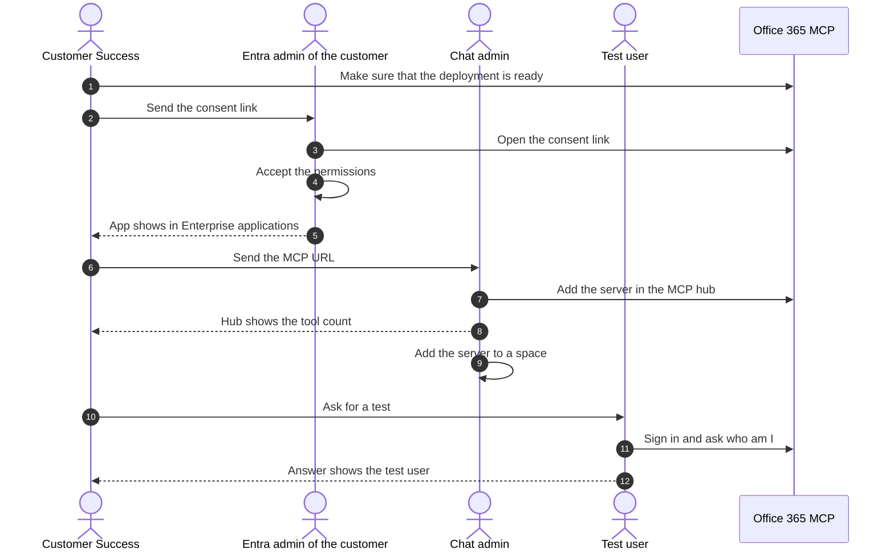

<!-- confluence-space-key: PUBDOC -->

# Office 365 MCP: setup after a deployment

!!! danger "Documentation Disclaimer"
    This feature is `EXPERIMENTAL` and under active development. It may change significantly, be
    discontinued, or have breaking changes without notice.

## Overview

A new deployment runs, but no user can use it yet. Complete the three steps on this page, in
order. The page is for Customer Success and for the operators of the customer.

In this page, `$PUBLIC_BASE_URL` is the public address of the deployment, for example
`https://office-365.mcp.example.com`.

| Step | Who | Result |
|---|---|---|
| 0. Prepare | Customer Success | The deployment is ready. The customer knows the limits. |
| 1. Grant admin consent | Entra admin of the customer | The app shows in Enterprise applications. |
| 2. Add the server | Chat admin | The hub lists the tools. A space has the server. |
| 3. Test | One test user | The chat answers with the profile of the user. |

## Step 0: Prepare (Customer Success)

1. Open `$PUBLIC_BASE_URL/ready`. The answer must be `{"status":"healthy","checks":{"database":true}}`.
2. Run `curl $PUBLIC_BASE_URL/manifest`. Note the number after `tools (` and the number after `permissions (`.
3. Tell the customer in writing that the server is experimental. It can change or break without notice.
4. Agree with the customer which data the test can use.
5. Send these values to the customer:

| Value | Address or number | Who needs it |
|---|---|---|
| Consent link | `$PUBLIC_BASE_URL/admin/consent` | Entra admin |
| MCP URL | `$PUBLIC_BASE_URL/mcp` | Chat admin |
| Tool count | The number after `tools (` | Chat admin |

## Step 1: Grant admin consent (Entra admin)

Some permissions need an administrator before any user can sign in. The
[overview](README.md) explains the reason in the section Admin consent.

1. Open the consent link.
2. Sign in with an account that can grant admin consent in your tenant.
3. Read the list of permissions. Accept it.
4. Make sure that the app shows in Entra, under **Enterprise applications**. The name is the display name of the app registration.

## Step 2: Add the server (Chat admin)

1. Open the MCP hub as an admin.
2. Add a new MCP server. Use the MCP URL.
3. When the hub asks, sign in with your own Microsoft account.
4. Make sure that the server is enabled.
5. Make sure that the hub shows the tool count from step 0.
6. Add the server to a space. Use a test space first.
7. If the customer asks for it, limit the space to a test group.

After a later deployment that changes the tools, press **Refresh Tool Settings** on the server page. The hub does not read new tools by itself.

## Step 3: Test with one user

1. Sign in with a Microsoft account of the customer. Use the space of step 2.
2. Ask the chat: "Who am I?" The chat answers with the profile of the user.
3. Ask the chat to read data of an area that the deployment has. For example, ask for the Teams chats.

CAUTION: Test write tools only with test data. These tools can send mail, change events, and edit files.

## If a step fails

| Symptom | Cause | Action |
|---|---|---|
| Sign-in fails with `AADSTS65001` | Admin consent is missing. | Do step 1. |
| A request never gets an answer | A network policy blocks the gateway. | Set `internalServices.dependents.ingressGateway.namespace` in the Helm values to the namespace of the gateway. The chart default is `system`. |
| The hub shows fewer tools than `/manifest` | The hub has an old tool list. | Press **Refresh Tool Settings**. |
| Sign-in fails at the authorize step, and the pod logs show nothing | The app registration has fewer permissions than the pod. | Compare `/manifest` with the Terraform output `tool_surface`. The [overview](README.md) gives the steps in the section Deployment. |
| `POST $PUBLIC_BASE_URL/mcp` answers 401 without a token | The server needs a sign-in. This is normal. | None. |

## Done when

- [ ] `/ready` answers `healthy`.
- [ ] The app shows in Enterprise applications.
- [ ] The hub shows the tool count of `/manifest`.
- [ ] One test user got an answer from a tool.
- [ ] The customer knows that the server is experimental.
