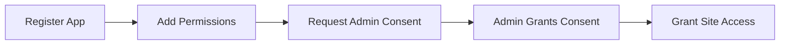

<!-- confluence-page-id: 1953399156 -->
<!-- confluence-space-key: PUBDOC -->

## Overview

The SharePoint Connector requires specific permissions to access Microsoft Graph API and SharePoint REST API. This document lists all required permissions with their use cases.

## Permission Summary

### Content Sync (Required)

| API             | Permission                          | Type        | Description                                       |
| --------------- | ----------------------------------- | ----------- | ------------------------------------------------- |
| Microsoft Graph | `Sites.Selected`                    | Application | Access to specifically granted sites              |
| Microsoft Graph | `Lists.SelectedOperations.Selected` | Application | Access to specifically granted document libraries |

**Note:** Use `Sites.Selected` for site-level access or `Lists.SelectedOperations.Selected` for more granular library-level access. Both can be enabled simultaneously for mixed access scenarios.

**Important:** These two permissions are **not interchangeable**. If library-level grants were issued (via `Grant-PnPAzureADAppSitePermission -List`) but the app registration only has `Sites.Selected`, requests to those libraries will return **403 Forbidden**. The app registration must include `Lists.SelectedOperations.Selected` to honour library-level grants.

### List item attachments (required when `listAttachmentsScan` is enabled, including `content_only`)

Microsoft Graph cannot list or download list attachments. That uses SharePoint REST, even when permission sync is off.

| API             | Permission       | Type        | Description                                                 |
| --------------- | ---------------- | ----------- | ----------------------------------------------------------- |
| SharePoint REST | `Sites.Selected` | Application | List and download list attachments, and read `ReadSecurity` |

The SharePoint API permission is separate from the Graph `Sites.Selected` permission. The app also needs a site grant, certificate authentication (SharePoint REST rejects app-only tokens obtained with a client secret), and network access to `https://{tenant}.sharepoint.com/_api`.

### Permission Sync (Optional)

| API             | Permission             | Type        | Description              |
| --------------- | ---------------------- | ----------- | ------------------------ |
| Microsoft Graph | `GroupMember.Read.All` | Application | Read group memberships   |
| Microsoft Graph | `User.ReadBasic.All`   | Application | Read basic user profiles |
| SharePoint REST | `Sites.Selected`       | Application | Access site groups       |

## Microsoft Graph Permissions

### Content Mode

These APIs are used for fetching SharePoint content:

| API Endpoint                                    | Method | Use Case                                                          | Permission                                              |
| ----------------------------------------------- | ------ | ----------------------------------------------------------------- | ------------------------------------------------------- |
| `/sites/{siteId}`                               | GET    | Fetch site metadata                                               | `Sites.Selected` or `Lists.SelectedOperations.Selected` |
| `/sites/{siteId}/drives`                        | GET    | Fetch document libraries                                          | `Sites.Selected` or `Lists.SelectedOperations.Selected` |
| `/drives/{driveId}/list/columns`                | GET    | Find the sync column of a document library                        | `Sites.Selected` or `Lists.SelectedOperations.Selected` |
| `/drives/{driveId}/items/{itemId}/children`     | GET    | Fetch folder children                                             | `Sites.Selected` or `Lists.SelectedOperations.Selected` |
| `/drives/{driveId}/items/{itemId}/content`      | GET    | Download file content                                             | `Sites.Selected` or `Lists.SelectedOperations.Selected` |
| `/sites/{siteId}/lists`                         | GET    | Find the SitePages list and the lists to scan for attachments     | `Sites.Selected` or `Lists.SelectedOperations.Selected` |
| `/sites/{siteId}/lists/{listId}/columns`        | GET    | Read the columns of the sites configuration list                  | `Sites.Selected` or `Lists.SelectedOperations.Selected` |
| `/sites/{siteId}/lists/{listId}/items`          | GET    | List ASPX pages, list items, and sites configuration list entries | `Sites.Selected` or `Lists.SelectedOperations.Selected` |
| `/sites/{siteId}/lists/{listId}/items/{itemId}` | GET    | Get ASPX page content                                             | `Sites.Selected` or `Lists.SelectedOperations.Selected` |
| `/sites/{siteId}/sites`                         | GET    | Discover child subsites                                           | `Sites.Selected`                                        |

A library-level grant via `Lists.SelectedOperations.Selected` also provides access to basic site information (metadata, drives listing) for the site that hosts the granted library.

With `sitesSource: sharepoint_list`, the app also needs a grant on the site or list that holds the [sites configuration list](<../operator/configuration.md#Dynamic-Sites-Configuration-(sharepoint_list)>).

### Permission Mode

These APIs are used when permission sync is enabled:

| API Endpoint                                                | Method | Use Case                           | Permission                                              |
| ----------------------------------------------------------- | ------ | ---------------------------------- | ------------------------------------------------------- |
| `/drives/{driveId}/items/{itemId}/permissions`              | GET    | Fetch file/folder permissions      | `Sites.Selected` or `Lists.SelectedOperations.Selected` |
| `/sites/{siteId}/lists/{listId}/items/{itemId}/permissions` | GET    | Fetch ASPX page permissions (beta) | `Sites.Selected` or `Lists.SelectedOperations.Selected` |
| `/groups/{groupId}/members`                                 | GET    | Read Entra ID group members        | `GroupMember.Read.All`, `User.ReadBasic.All`            |
| `/groups/{groupId}/owners`                                  | GET    | Read Entra ID group owners         | `GroupMember.Read.All`, `User.ReadBasic.All`            |

## SharePoint REST Permissions

List attachment sync uses these endpoints in every sync mode, including `content_only`, on sites with `listAttachmentsScan` enabled. Group membership endpoints are used only when permission sync is enabled.

SharePoint REST rejects app-only tokens obtained with a client secret. Use certificate authentication, grant the SharePoint `Sites.Selected` application permission on the site, and allow network access to `https://{tenant}.sharepoint.com/_api`.

| API Endpoint                                                                              | Method | Use Case                                            | Permission        |
| ----------------------------------------------------------------------------------------- | ------ | --------------------------------------------------- | ----------------- |
| `/_api/web/lists(guid'{listId}')/RootFolder/Folders('Attachments')/Folders?$expand=Files` | GET    | List item attachment names and sizes                | `Sites.Selected`  |
| `/_api/web/lists(guid'{listId}')/items({itemId})/AttachmentFiles('{fileName}')/$value`    | GET    | Download an attachment                              | `Sites.Selected`  |
| `/_api/web/lists(guid'{listId}')?$select=ReadSecurity`                                    | GET    | Reject lists users can read only their own items of | `Sites.Selected`  |
| `/_api/web/sitegroups/getById({groupId})/users`                                           | GET    | Read site group members                             | `Sites.Selected`* |

**Note:** If "Who can view the membership of the group?" is **not** set to **Everyone**, the connector cannot read group members. Set it to **Everyone**, or make the app principal a member or owner of the group.

### Public Sites and Tenant-Wide Visibility Groups

Public SharePoint sites may include tenant-wide principals such as `Everyone` and `Everyone except external users`. These principals are intentionally not expanded by the connector for permission sync. This can lead to expected differences where content is visible in SharePoint through tenant-wide visibility but not mirrored as broad visibility in Unique.

## Why Sites.Selected?

### Least Privilege Principle

`Sites.Selected` follows the principle of least privilege:

| Permission            | Scope               | Admin Control            |
| --------------------- | ------------------- | ------------------------ |
| `Sites.Read.All`      | All sites in tenant | None (all sites exposed) |
| `Sites.ReadWrite.All` | All sites in tenant | None (all sites exposed) |
| `Sites.Selected`      | Only granted sites  | Per-site grants required |

### Benefits

- **Explicit access**: Each site must be explicitly granted
- **Auditability**: Clear record of which sites are accessible
- **Revocability**: Access can be revoked per-site
- **Compliance**: Meets enterprise security requirements

### Granting Sites.Selected Access

Access is granted via PowerShell:

```powershell
# Connect to SharePoint Admin
Connect-PnPOnline -Url "https://{tenant}-admin.sharepoint.com" -Interactive

# Grant access to a specific site
Grant-PnPAzureADAppSitePermission `
  -AppId "{client-id}" `
  -DisplayName "Unique SharePoint Connector" `
  -Site "https://{tenant}.sharepoint.com/sites/{site-name}" `
  -Permissions Read
```

The connector only issues read (GET) calls against Microsoft Graph and SharePoint REST, so a `Read` grant is sufficient.

An existing `Write` grant should be downgraded to `Read`. Look up its ID with `Get-PnPAzureADAppSitePermission -Site "<site-url>"`, then run `Set-PnPAzureADAppSitePermission -Site "<site-url>" -PermissionId "<id>" -Permissions Read`.

See [Authentication Guide](../operator/authentication.md#4.-Grant-Site-Specific-Access) for detailed instructions.

## Permission Justification

### Sites.Selected

**Justification:** Required to read site structure, document libraries, and file content from specifically granted SharePoint sites.

**Why not Sites.Read.All?**

- `Sites.Read.All` grants access to all sites in the tenant
- Most organizations require explicit site-by-site access control
- `Sites.Selected` allows administrators to control exactly which sites are accessible

### Lists.SelectedOperations.Selected

**Justification:** For more granular access control at the document library level instead of the entire site.

**When to use?**

- When only specific document libraries need to be synced
- When site-level access is too broad for compliance requirements
- Combined with `Sites.Selected` for mixed access scenarios

### GroupMember.Read.All

**Justification:** Required to expand Entra ID (Azure AD) group memberships when syncing permissions.

**Why needed?**

- SharePoint permissions often reference Entra ID groups
- To sync permissions, the connector must resolve group members
- Without this permission, group-based permissions cannot be synced

### User.ReadBasic.All

**Justification:** Required to read basic profile information (email, display name) for permission mapping.

**Why needed?**

- Permission entries reference users by ID
- Connector needs email/username to map to Unique users
- Only basic profile fields are accessed (not full profile)

## Admin Consent

All permissions require admin consent because they are application permissions:



### Consent URL

```
https://login.microsoftonline.com/{tenant-id}/v2.0/adminconsent
  ?client_id={app-id}
  &scope=https://graph.microsoft.com/.default
```

## Application vs Delegated Permissions

The SharePoint Connector uses **application permissions** (not delegated):

| Aspect       | Application            | Delegated              |
| ------------ | ---------------------- | ---------------------- |
| User context | None (service account) | Signed-in user         |
| Consent      | Admin only             | User or admin          |
| Access scope | As configured          | Limited by user access |
| Use case     | Background services    | User-interactive apps  |

**Why application permissions?**

- Connector runs as a background service
- No user is signed in during sync
- Consistent access regardless of individual user permissions

## Rate Limits

Microsoft Graph enforces rate limits:

| Limit Type          | Value                  | Scope                |
| ------------------- | ---------------------- | -------------------- |
| Requests per app    | ~10,000 / 10 min       | Per app registration |
| Concurrent requests | 4 per app per resource | Per resource type    |

The connector respects these limits via:

- Configurable rate limiting (`graphApiRateLimitPerMinuteThousands` in the tenant configuration YAML)
- Exponential backoff on 429 responses
- Concurrent request limiting

## Related Documentation

- [Authentication](../operator/authentication.md) - Azure AD setup and permissions
- [Architecture](./architecture.md) - System components
- [Flows](./flows.md) - Permission sync flow details

## Standard References

- [Microsoft Graph Permissions Reference](https://learn.microsoft.com/en-us/graph/permissions-reference) - Complete permissions list
- [Sites.Selected Permission](https://learn.microsoft.com/en-us/graph/api/site-get?view=graph-rest-1.0&tabs=http#permissions) - Sites.Selected documentation
- [Application vs Delegated Permissions](https://learn.microsoft.com/en-us/azure/active-directory/develop/v2-permissions-and-consent) - Permission types explained
